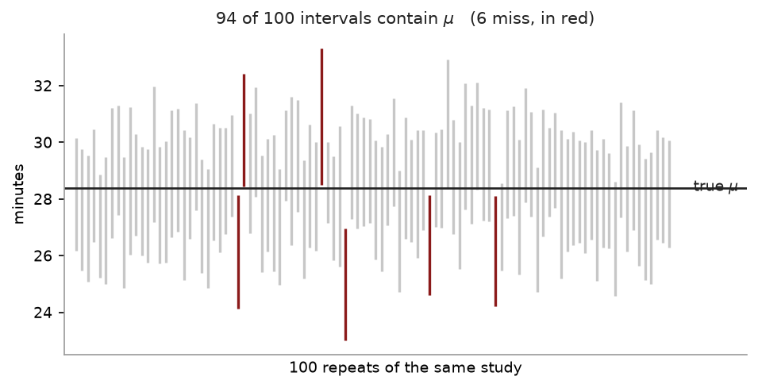
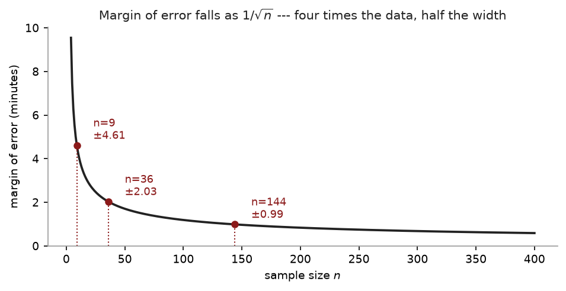

# Chapter 13 — Estimation and confidence intervals

> **The question:** you have a sample mean. Somebody asks what $\mu$ is. What do you
> actually say?

## Two kinds of answer

**A point estimate** is one number. "The mean commute is about 28.4 minutes."
$\bar{x}$ is the point estimator of $\mu$, $s^2$ of $\sigma^2$, $\hat{p}$ of $p$.

**An interval estimate** is a range with a claim attached. "The mean commute is
between 26.4 and 30.4 minutes, and I am 95% confident of that."

## Why a point estimate on its own is worthless

$\bar{X}$ is continuous, so

$$\mathrm{P}(\bar{X} = \mu) = 0$$

The probability that your sample mean lands exactly on $\mu$ is zero. The statement
"$\mu$ is 28.4" is, strictly, certainly wrong.

That is the pedantic objection. The practical one is worse: a point estimate with no
$\pm$ hides the thing the reader most needs, which is **how much it would have moved
had you drawn a different sample**. A study of 10 people and a study of 10,000 can
produce the same $\bar{x}$. They do not deserve the same confidence, and only an
interval says so.

> An estimate without a margin is a number pretending to be a measurement.

## Building the interval

Start from Chapter 12. The CLT says

$$Z = \frac{\bar{X} - \mu}{\sigma/\sqrt{n}} \ \dot\sim\ N(0,1)$$

and the standard normal puts 95% of its area between $-1.96$ and $+1.96$:

$$\mathrm{P}\!\left(-1.96 < \frac{\bar{X} - \mu}{\sigma/\sqrt{n}} < 1.96\right) = 0.95$$

Now just do algebra on the inequality inside. Multiply through by $\sigma/\sqrt{n}$,
subtract $\bar{X}$, multiply by $-1$ (which flips both inequalities), and read it
backwards:

$$\mathrm{P}\!\left(\bar{X} - 1.96\frac{\sigma}{\sqrt{n}} \;<\; \mu \;<\;
\bar{X} + 1.96\frac{\sigma}{\sqrt{n}}\right) = 0.95$$

Nothing statistical happened in that step. It is rearrangement. But the rearranged
version has $\mu$ in the middle, which is the form we can use.

## Anatomy

$$\bar{x} \;\pm\; \underbrace{z_{\alpha/2}}_{\text{how confident}}
\times \underbrace{\frac{\sigma}{\sqrt{n}}}_{\text{how noisy}}$$

or in words:

$$\textbf{point estimate} \;\pm\; (\textbf{critical value}) \times (\textbf{standard error})$$

**That shape never changes.** Every interval in the rest of this course is these
three pieces; only the pieces get swapped. Learn the shape and the later chapters
cost you almost nothing.

The critical values you need:

| confidence | $\alpha$ | $z_{\alpha/2}$ |
|---|---|---|
| 90% | 0.10 | 1.645 |
| 95% | 0.05 | 1.960 |
| 99% | 0.01 | 2.575 |

More confidence means a **wider** interval. There is no free lunch here: you buy
certainty with vagueness. A 100% confidence interval is $(-\infty, \infty)$ and it is
perfectly correct and perfectly useless.

## What "95% confident" means

This is the sentence students get wrong most often, and it is worth being exact.

> **The interval is random. $\mu$ is not.**

**Correct:** if you repeated the whole exercise many times — new sample, new interval
each time — then 95% of the intervals you constructed would contain $\mu$. This
particular one either does or does not, and you will never find out which.

**Wrong:** "there is a 95% probability that $\mu$ lies between 26.4 and 30.4."
$\mu$ is a fixed number. It is not wandering in and out of your interval. Once the
interval is computed, every quantity in that sentence is fixed and no probability
remains.

The confidence is a property of **the procedure**, not of the one interval in front
of you. It is a claim about your method's track record.

This is not pedantry, and you can measure it. Simulate 1,000 samples of $n = 36$ from
a normal population and build an interval from each: **955 of the 1,000 contain
$\mu$**. The procedure promised 95% and delivered 95.5%. The 45 that missed are not
errors — they are the price of admission, and they are exactly what the 5% refers to.

Repeat that on a **skewed** population at the same $n$ and only **919** contain $\mu$.
The interval under-covers, because at $n = 36$ a skewed population has not finished
converging and the $t$ interval is slightly too narrow. Raise $n$ to 200 and it
improves to 939. That is Chapter 12's "it depends on the shape", shown in the one
place where it costs you something.



That is the sentence above, drawn. One hundred repeats of the same study, drawn
from a population whose $\mu$ we know because we chose it. Each grey bar is one 95%
interval; six of them missed, against the five you would expect.

**You only ever get one bar.** You never learn whether yours is grey or red, and no
amount of staring at your own interval will tell you. That is why the 95% belongs to
the procedure that generated the bars and not to any one of them.

## When $\sigma$ is unknown — which is always

In the derivation above, $\sigma$ was handed to us. It never is. You have $s$,
computed from the same sample, and substituting it costs you something:

$$\bar{x} \;\pm\; t_{\alpha/2,\,n-1}\,\frac{s}{\sqrt{n}}$$

The critical value becomes $t$ with $\nu = n - 1$ degrees of freedom — that same
$n - 1$ from Chapter 3.

Why? Because $s$ is itself a random variable. With $\sigma$ you have a fixed
denominator; with $s$ you have one that jumps around from sample to sample, and when
it comes out small the whole ratio blows up. The $t$ distribution's fatter tails are
the distribution being honest about that.

Since $t_{\alpha/2} > z_{\alpha/2}$ always, **the $t$ interval is always wider**. That
extra width is the price of not knowing $\sigma$, and it shrinks fast as $n$ grows:

| $n$ | $t_{0.025,\,n-1}$ | against $z = 1.96$ |
|---|---|---|
| 16 | 2.1314 | 8.7% wider |
| 36 | 2.0301 | 3.6% wider |
| 121 | 1.9799 | 1.0% wider |

## Worked example — a commute

A random sample of $n = 36$ staff reports a mean one-way commute of
$\bar{x} = 28.4$ minutes.

**(a) Suppose past years establish $\sigma = 6$ minutes. Build a 95% interval.**

**(b) Now suppose $\sigma$ is unknown and this sample gave $s = 6$. Rebuild it.**

**(c) Which is wider, and why should it be?**

### Solution

The standard error first, since both parts need it:

$$\frac{6}{\sqrt{36}} = \frac{6}{6} = 1 \text{ minute}$$

**(a)** With $\sigma$ known, use $z_{0.025} = 1.96$:

$$28.4 \pm 1.96(1) \;\Longrightarrow\; (26.44,\ 30.36)$$

**(b)** With $\sigma$ estimated, use $t_{0.025,\,35} = 2.0301$:

$$28.4 \pm 2.0301(1) \;\Longrightarrow\; (26.37,\ 30.43)$$

**(c)** The $t$ interval, by about 0.07 of a minute at each end. You estimated
$\sigma$ from the same 36 people, so you know less — and the interval is honest about
it.

## Margin of error, and the three ways to shrink it

$$E = z_{\alpha/2}\,\frac{\sigma}{\sqrt{n}}$$

the half-width of the interval. There are exactly three levers.

**Raise $n$.** The only honest one — but $\sqrt{n}$ means four times the data for
half the margin.

**Accept less confidence.** 90% instead of 95% narrows it immediately. You are simply
agreeing to be wrong more often.

**Reduce $\sigma$.** Not a statistical move. It means measuring more carefully, or
studying a more homogeneous population.

Nothing else works. Every "tighter interval" you read about came from one of these
three, and it is worth asking which.



The curve is the first lever drawn. It flattens because $n$ sits under a square
root, and the flattening is why survey budgets stop where they do: the first
decimal place is cheap and the second costs a hundred times as much.

### The third lever, worked

"Reduce $\sigma$" sounds like advice you cannot act on — $\sigma$ is a fact about
the population, not a dial. But look at where it comes from.

Suppose the 36 commuters are really two groups:

| | share | mean | SD *within* the group |
|---|---|---|---|
| Walkers | 0.40 | 12 min | 3 |
| Drivers | 0.60 | 38 min | 5 |

Nobody in either group varies by much — three minutes and five minutes. Yet the
standard deviation of all of them pooled together is $\sigma = 13.4477$. That number
did not come from anybody's commute. It came from the gap between the two groups,
and the arithmetic splits cleanly:

$$\underbrace{180.84}_{\text{total}}
= \underbrace{0.40(3^2) + 0.60(5^2)}_{\text{within} \;=\; 18.60}
+ \underbrace{0.40(12-27.6)^2 + 0.60(38-27.6)^2}_{\text{between} \;=\; 162.24}$$

**Nearly 90% of the variation is the gap between walkers and drivers**, not variation
in how long anyone's journey takes. So ask the 36 people which group they are in and
sample within each:

| | standard error |
|---|---|
| 36 people, chosen at random | $13.4477/\sqrt{36} = 2.2413$ |
| 36 people, split into the two groups | $\sqrt{18.60/36} = \mathbf{0.7188}$ |

Same 36 people, same budget, one extra question on the form — and a standard error
three times smaller. Splitting a sample into groups that are alike on the inside is
called **stratifying**, and it is the cheapest precision in the subject. It is also
why a statistician's first question is about how you are collecting the data, not
how much of it you plan to collect.

### The three levers, side by side

| Lever | What it costs you |
|---|---|
| Raise $n$ | **Money**, at four times the rate |
| Lower the confidence level | **Meaning** — you are claiming less |
| Reduce $\sigma$ | **Thought**, and sometimes nothing else |

If an exam question asks how to narrow an interval, there are three admissible
answers and only one of them is "collect more data".

## One-sided intervals

Everything so far has produced a two-sided interval, which makes **two** claims at
once. For the commute data, $(26.3699,\ 30.4301)$ says the mean is at least 26.37
*and* at most 30.43.

Often you only want one of them. If a college is setting a timetable, the question
is whether the mean commute is under half an hour; nobody is worried it might be too
short. A buyer checking a supplier's guarantee cares whether the product falls
short, never whether it is better than promised.

In that case, stop splitting $\alpha$ between two tails and spend it all on the side
you care about:

| | tail area used | critical value | upper end |
|---|---|---|---|
| Two-sided 95% | 2.5% each side | $t_{0.025,35} = 2.0301$ | 30.4301 |
| One-sided 95% | 5% on the right | $t_{0.05,35} = 1.6896$ | **30.0896** |

$$\bar{x} + t_{0.05,\,35}\,\text{SE} = 28.4 + 1.6896(1.0) = 30.0896$$

So we are 95% confident the mean commute is **at most 30.0896 minutes** — tighter
than the two-sided upper end by 0.3405 minutes, from identical data.

What paid for it is the lower end, which is gone. The one-sided interval is

$$(-\infty,\ 30.0896]$$

There is no bottom to it. You are not claiming the mean is above anything, and that
is exactly the claim you traded away. A two-sided interval spends half its error
budget guarding an end you said you did not care about; declining that guard is what
buys the tighter top.

**The catch.** You must choose the direction *before* seeing the data. Look first,
then pick whichever side the data favours, and your stated 5% is really 10% — you
gave yourself two chances. Nothing in the finished output reveals that you did it,
which is precisely why the discipline matters.

## Choosing $n$ before you collect anything

Turn the margin-of-error formula round:

$$n = \left(\frac{z_{\alpha/2}\,\sigma}{E}\right)^{\!2}$$

For the commute study, suppose we want the estimate good to $\pm 1$ minute at 95%,
with $\sigma \approx 6$:

$$n = \left(\frac{1.96 \times 6}{1}\right)^{\!2} = 138.29 \;\Longrightarrow\; n = 139$$

**Always round up.** 138.29 people cannot be surveyed, and rounding down misses the
target.

And note the arithmetic: 36 observations gave us a margin of about 2 minutes. Getting
to 1 minute costs 139. That is the $\sqrt{n}$ tax from Chapter 11, in the form you
will actually meet it.

## In Stata

*The snippets below assume the header and preamble from [Chapter 1](01_what_statistics_is_for.md) — `clear all`, the log, and a `cd` to your own folder.*

```stata
use "DATA/cps_small.dta", clear
ci means wage
```

```
    Variable |  Obs   Mean    Std. err.   [95% conf. interval]
        wage | 1,000  10.21302  .1975361   9.825387   10.60065
```

Read it across: $n$, the point estimate, the **standard error** ($s/\sqrt{n}$, not
$s$), and the interval.

The confidence level is a dial:

```stata
ci means wage, level(90)
ci means wage, level(99)
```

which give widths of 0.650, 0.775 and 1.020 for 90%, 95% and 99% on the same data.
Same $\bar{x}$, same standard error — only the critical value moves.

And `ci means` is not doing anything you cannot do by hand:

```stata
quietly summarize wage
display "lower = " r(mean) - invttail(r(N)-1, 0.025)*r(sd)/sqrt(r(N))
display "upper = " r(mean) + invttail(r(N)-1, 0.025)*r(sd)/sqrt(r(N))
```

These match `ci means` to the last decimal it prints. There is no magic in the
command — it is the formula above, typed once by StataCorp.

For sample size, there is no special command; it is arithmetic:

```stata
display "n = " ceil((invnormal(0.975)*6/1)^2)
```

## In Python

```python
import numpy as np
from scipy import stats

xbar, s, n = 28.4, 6, 36
se = s/np.sqrt(n)                       # 1.0
tc = stats.t.ppf(0.975, n-1)            # 2.0301

print(xbar - tc*se, xbar + tc*se)       # 26.3699  30.4301
```

Or in one call, which also gives it directly from data:

```python
stats.t.interval(0.95, df=n-1, loc=xbar, scale=se)   # the same pair
```

### What "95% confident" means, counted

The claim is about the procedure, so test the procedure — build a thousand intervals
from a population whose mean you know, and count:

```python
rng = np.random.default_rng(250)
mu, sigma, n, reps = 100, 15, 36, 1000

hits = 0
for _ in range(reps):
    x  = rng.normal(mu, sigma, n)
    lo, hi = stats.t.interval(0.95, n-1, loc=x.mean(),
                              scale=x.std(ddof=1)/np.sqrt(n))
    hits += lo <= mu <= hi

print(hits/reps)        # about 0.95
```

The ones that miss are not mistakes. They are the 5%, and this is what that number
refers to.

**Now make the population skewed** — swap `rng.normal(mu, sigma, n)` for
`rng.exponential(mu, n)` — and re-run. Coverage falls below 0.95, because at $n = 36$ a
skewed population has not finished converging. Raise `n` and watch it recover.

## What goes wrong

**"There is a 95% probability that $\mu$ is in this interval."** The most-penalised
sentence in the course. $\mu$ is fixed; the interval is what was random.

**Using $z$ when $\sigma$ was estimated.** If you computed $s$ from the data, it is
$t$ with $n-1$ degrees of freedom. At large $n$ the difference is cosmetic, but the
reasoning is what is being marked.

**Using $s$ instead of $s/\sqrt{n}$.** The interval comes out $\sqrt{n}$ times too
wide, and absurdly so for large samples.

**Rounding $n$ down.** Round up, always. 138.29 means 139.

**Reporting a point estimate alone.** Say the margin. If you do not know it, you do
not know your estimate.

## Exercises

1. A sample of $n = 64$ has $\bar{x} = 120$ and $s = 16$.
   (a) Compute the standard error.
   (b) Build a 95% confidence interval for $\mu$.
   (c) Build a 99% interval and state how much wider it is.

2. A sample of $n = 25$ has $\bar{x} = 48$ and $s = 10$. Build a 95% interval.
   (Use $t_{0.025,\,24} = 2.0639$.)

3. Explain the difference between these two sentences, and say which is correct:
   (a) "95% of the time, $\mu$ falls inside this interval."
   (b) "95% of intervals built this way contain $\mu$."

4. A researcher wants to estimate a population mean to within 3 units at 95%
   confidence, believing $\sigma \approx 20$.
   (a) How many observations are needed?
   (b) How many to get within 1.5 units?
   (c) What does the comparison illustrate?

5. Two studies estimate the same quantity. Study A reports $12.4 \pm 0.3$; Study B
   reports $12.4 \pm 2.9$. Both used 95% confidence. Give two distinct reasons B's
   interval might be so much wider.

### Answers

1. (a) $16/\sqrt{64} = 2$.
   (b) $\nu = 63$, so $t_{0.025} \approx 1.998$: $120 \pm 1.998(2) = (116.00,
   124.00)$.
   (c) $t_{0.005,\,63} \approx 2.656$: $120 \pm 5.31 = (114.69, 125.31)$ — a half-width
   of 5.31 against 4.00, about 33% wider. Higher confidence, vaguer statement.

2. $10/\sqrt{25} = 2$, so $48 \pm 2.0639(2) = 48 \pm 4.128 = (43.87,\ 52.13)$.

3. **(b) is correct.** Sentence (a) treats $\mu$ as the thing that moves, which it is
   not — it is a fixed unknown constant. The randomness lives in the sample, hence in
   the interval. Confidence describes the long-run performance of the procedure.

4. (a) $n = (1.96 \times 20 / 3)^2 = 170.7$, so **171**.
   (b) $n = (1.96 \times 20 / 1.5)^2 = 683.0$, so **684**.
   (c) Halving the margin roughly quadruples the sample. Precision costs at a rate of
   $\sqrt{n}$, so each further improvement is more expensive than the last.

5. Any two of: **(i)** B had a much smaller sample — the margin goes as
   $1/\sqrt{n}$, so a margin nearly ten times larger suggests a sample on the order of
   a hundred times smaller; **(ii)** B's population is far more variable, so $\sigma$
   or $s$ is larger; **(iii)** B measured less precisely, inflating $s$ through
   measurement error. Note that both studies agree on the point estimate — it is the
   precision, not the finding, that differs.

<!-- more-practice:start -->

## More practice

Fifteen more. The commute data from the worked example runs through the first three,
so you can see what changes when only the confidence level moves and nothing else
does.

1. A sample of $n = 36$ commutes gives $\bar{x} = 28.4$ minutes and $s = 6$.
   (a) Find the estimated standard error.
   (b) Find the critical value for a 95% interval, stating the degrees of freedom.
   (c) Build the 95% confidence interval.
   (d) State the margin of error.

2. Using the same data, build the **90%** and **99%** intervals.
   (a) Give both.
   (b) Compare the three widths and state the trade-off in one sentence.

3. Now suppose $\sigma = 6$ were somehow known exactly, with the same $\bar{x}$ and
   $n$.
   (a) Build the 95% interval.
   (b) Compare it with 1(c). Which is wider, by how much, and why?

4. Explain what "95% confident" means. Then say explicitly what it does **not** mean.

5. A 95% interval for a population mean is $(26.37,\ 30.43)$. For each statement, say
   whether it is true.
   (a) 95% of the sample values lie between 26.37 and 30.43.
   (b) There is a 95% probability that $\mu$ lies between 26.37 and 30.43.
   (c) If the study were repeated many times, 95% of the intervals so constructed
   would contain $\mu$.
   (d) A test of $H_0: \mu = 31$ at $\alpha = 0.05$ would reject.
   (e) A test of $H_0: \mu = 27$ at $\alpha = 0.05$ would reject.

6. With $\sigma = 6$ and 95% confidence, find the sample size needed for a margin of
   error of (a) 1.0 minute, (b) 0.5 minutes.

7. Look at your two answers to question 6.
   (a) What happened to $n$ when the margin of error halved?
   (b) Name the three ways to reduce the margin of error, and say which of the three
   is free.

8. A 95% confidence interval is reported as $(12.4,\ 19.6)$. Find the point estimate
   and the margin of error.

9. A firm claims its mean delivery time is 27 minutes. Using the interval from
   question 1(c), what do you conclude at the 5% level, and why can you answer without
   computing a test statistic?

10. A sample of 16 gives $\bar{x} = 52$ and $s = 8$.
    (a) Build the 95% interval.
    (b) Why is the critical value so much larger than 1.96 here?

11. A student uses $z = 1.96$ for a sample of 16 because "1.96 is the 95% number".
    (a) What should they have used?
    (b) Is their interval too wide or too narrow?
    (c) What does that do to the interval's actual coverage?

12. Two studies estimate the same mean. Study A has $n = 100$, Study B has $n = 400$,
    and both find $s = 20$. Without computing the intervals, state the ratio of their
    widths.

13. A researcher writes: "there is a 95% probability that $\mu$ lies between 26.37 and
    30.43." Rewrite the sentence correctly and explain in one line what is wrong with
    the original.

14. Using the data in question 1, construct a **one-sided** 95% lower bound for the
    mean commute. Compare the bound with the lower end of the two-sided 95% interval
    and explain the difference.

15. The $t$ interval assumes the population is normal. A colleague has $n = 12$
    observations from a badly skewed population and builds one anyway.
    (a) What is the problem?
    (b) Would $n = 300$ fix it? Which result are you appealing to?

### Answers to the extra problems

1. (a) $s/\sqrt{n} = 6/\sqrt{36} = 1.0000$ minute.
   (b) $\nu = 35$, so $t_{0.025,35} = 2.0301$.
   (c) $28.4 \pm 2.0301(1.0) = (26.3699,\ 30.4301)$.
   (d) The margin of error is **2.0301** minutes — the critical value times the
   standard error, which here happen to be numerically equal because SE $= 1$.

2. (a) 90%: $t_{0.05,35} = 1.6896$, giving $(26.7104,\ 30.0896)$.
   99%: $t_{0.005,35} = 2.7238$, giving $(25.6762,\ 31.1238)$.
   (b) Widths are 3.3791, 4.0602 and 5.4476 for 90%, 95% and 99%. **Higher confidence
   costs width**: you can be more certain of catching $\mu$ only by casting a wider
   net, and an interval certain to contain $\mu$ would run from minus to plus
   infinity, which is certain and useless.

3. (a) With $\sigma$ known the critical value is $z_{0.025} = 1.9600$, giving
   $28.4 \pm 1.96 = (26.4400,\ 30.3600)$.
   (b) The $t$ interval from 1(c) is **wider**, by 0.0702 minutes in each direction.
   The reason is that $s$ is an estimate with its own sampling variability, and the
   wider $t$ distribution is the price of not knowing $\sigma$. At $\nu = 35$ that
   price is small; at $\nu = 8$ it would be substantial.

4. It means the **procedure** captures $\mu$ in 95% of repetitions. Build an interval
   this way from sample after sample, and 95 in 100 of those intervals will contain
   the true mean. It does **not** mean there is a 95% probability that $\mu$ lies in
   the one interval you computed. $\mu$ is a fixed number and your interval is a fixed
   pair of numbers; either it contains $\mu$ or it does not, and the 95% describes the
   long-run reliability of the method, not the standing of a particular result.

5. (a) **False** — confidence intervals are about the mean, not about where individual
   observations fall. Most of the data lies well outside this interval.
   (b) **False** — see question 4. This is the commonest misstatement in the subject.
   (c) **True.** This is the correct reading.
   (d) **True** — 31 is outside the interval, and a two-tailed test at $\alpha = 0.05$
   rejects exactly the values the 95% interval excludes.
   (e) **False** — 27 is inside, so the test does not reject.

6. The formula is $n = (z\sigma/E)^2$.
   (a) $n = (1.96 \times 6/1.0)^2 = 11.76^2 = 138.2976$, so round **up** to
   $n = 139$.
   (b) $n = (1.96 \times 6/0.5)^2 = 23.52^2 = 553.1904$, so $n = 554$.

7. (a) It roughly **quadrupled**, from 139 to 554. $E$ appears squared in the
   denominator, so halving it multiplies $n$ by four.
   (b) Increase $n$; accept lower confidence; reduce $\sigma$. Lowering the confidence
   level is **free in money and expensive in meaning** — you get a narrower interval
   by making a weaker claim, which is not a gain. Reducing $\sigma$ means measuring
   more precisely or stratifying, which is sometimes possible and is the only genuinely
   free lunch available. Increasing $n$ costs money, at a quadratic rate.

8. The point estimate is the midpoint: $(12.4 + 19.6)/2 = 16.0000$. The margin of
   error is half the width: $(19.6 - 12.4)/2 = 3.6000$. Every reported interval can be
   read backwards like this, which is worth knowing because papers often print the
   interval and not the standard error.

9. 27 **lies inside** $(26.3699,\ 30.4301)$, so you do not reject the firm's claim at
   the 5% level. You can answer without a test statistic because the two procedures are
   algebraically the same thing: a two-tailed test at $\alpha$ rejects $\mu_0$ precisely
   when $\mu_0$ falls outside the $100(1-\alpha)\%$ interval. The interval is the set
   of values that would not be rejected.

10. (a) SE $= 8/\sqrt{16} = 2.0000$ and $t_{0.025,15} = 2.1314$, so the margin of
    error is 4.2629 and the interval is $(47.7371,\ 56.2629)$.
    (b) Because $\nu = 15$. With only 16 observations, $s$ is a poor estimate of
    $\sigma$, and the $t$ distribution compensates by being wider in the tails. The
    gap from 1.96 to 2.1314 is the cost of that ignorance, and it closes as $n$ grows.

11. (a) $t_{0.025,15} = 2.1314$.
    (b) **Too narrow** — 1.96 is smaller, so the interval is shorter than it should be.
    (c) Its real coverage is below the advertised 95%: the interval misses $\mu$ more
    often than once in twenty. The error flatters the result, which is the direction
    that matters, since it makes the researcher look more precise than the data
    supports.

12. Width scales as $1/\sqrt{n}$, so Study B's interval is $\sqrt{400/100} = 2.0000$
    times narrower. Four times the data buys twice the precision, which is the same
    trade-off as question 7 seen from the other end.

13. Correctly: **"We are 95% confident that $\mu$ lies between 26.37 and 30.43"**, or
    more fully, "this interval was produced by a method that captures $\mu$ 95% of the
    time." The original assigns a probability to $\mu$, treating a fixed constant as
    random; the randomness is in the interval, which varies from sample to sample,
    not in the parameter, which does not vary at all.

14. A one-sided 95% lower bound uses $t_{0.05,35} = 1.6896$, putting all 5% in one
    tail: the bound is $28.4 - 1.6896(1.0) = 26.7104$. It is **higher** than the
    two-sided interval's lower end of 26.3699, and the reason is that the two-sided
    interval spends half its error allowance guarding the upper end as well. If you
    genuinely only care about one direction, the one-sided bound is tighter — but you
    must decide which direction before seeing the data, exactly as with a one-tailed
    test.

15. (a) With $n = 12$ there is no normality to appeal to from either direction: the
    population is not normal, and the CLT has not had enough observations to make
    $\bar{X}$ normal either. The stated 95% coverage is simply not what the interval
    delivers, and for a skewed population the two tails will be wrong by different
    amounts.
    (b) **Yes**, broadly — at $n = 300$ the **Central Limit Theorem** makes $\bar{X}$
    approximately normal whatever the population looks like, so the interval recovers
    close to its nominal coverage. The assumption was never really about the population
    being normal; it was about $\bar{X}$ being normal, and there are two routes to that.

<!-- more-practice:end -->

---
