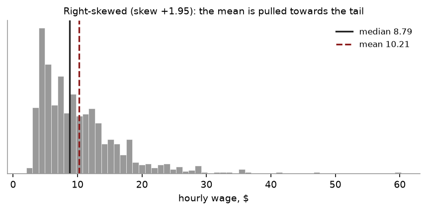
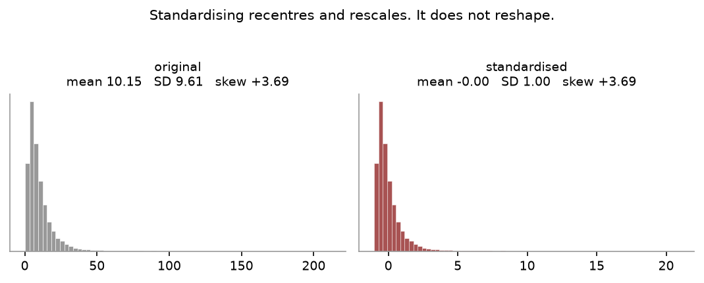
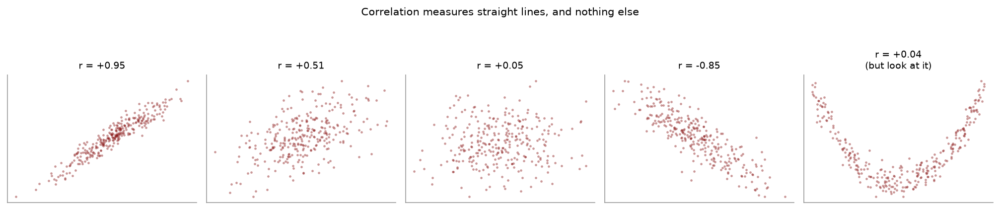
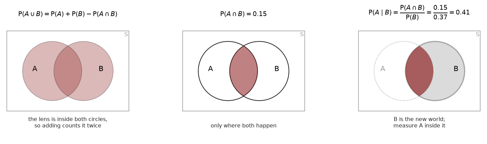
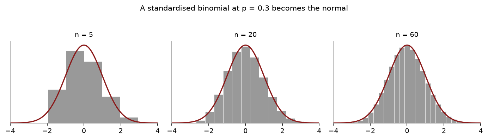
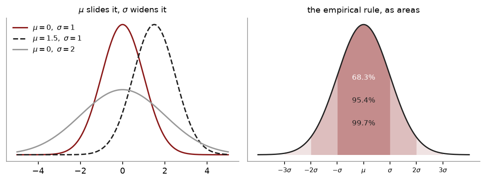
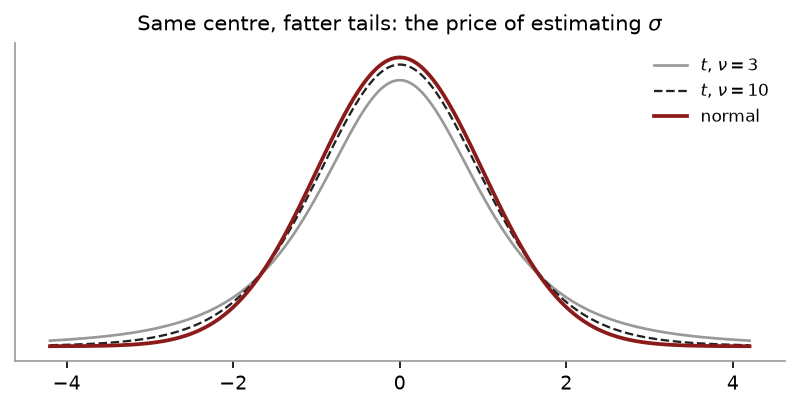
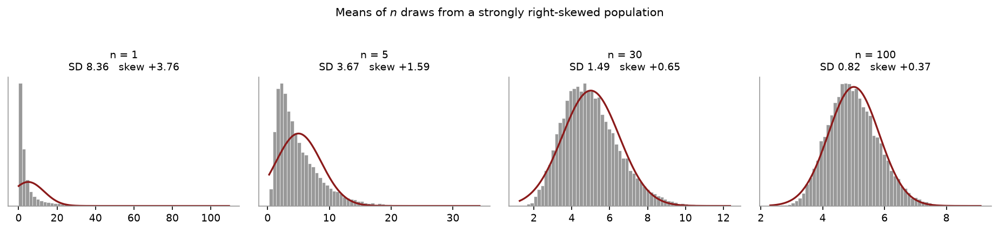
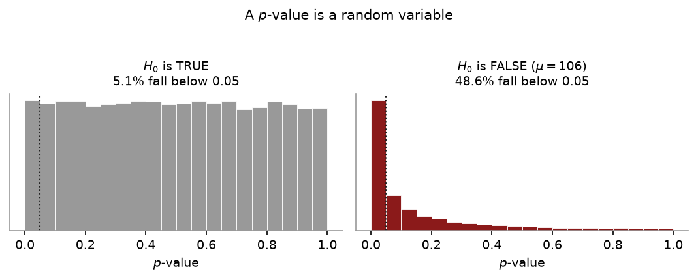

# Statistics for Economists

### A reading companion for Econ 250 · Bates College · Fall 2026

*Hitanshu Pandit*

---

## How to read this

This is the course, written down in the order we teach it. It is not a reference
work and it is not complete in the way a textbook is complete. It covers what we
cover, in our sequence, with our examples — so if you were in the room, you should
recognise every page.

Read it with a pen. Every worked example is laid out the way I want the answer
written on a problem set, so when you reach one, cover the solution and try it
first. Reading a worked example and producing one are different skills, and only
the second is any use when there is a clock running.

Three things about the format.

**The examples repeat on purpose.** The same five numbers turn up in Chapter 2 and
again in Chapter 3, the same two suppliers in Chapters 5 and 6. That is not
laziness. You are meant to notice that the new tool is answering a different
question about data you already understand, rather than spending your attention on
a fresh scenario every time.

**Stata appears only as it was taught.** Nothing in the Stata sections uses a
command you have not run in a lab. If you see something unfamiliar, it means I have
made a mistake — tell me.

**Every number here was computed, not typed.** The figures in the worked examples
come from the same scripts that produced the lecture slides, and the Stata output
was produced by running the code. If a number in the book disagrees with a number
on a slide, the book is wrong and I want to know.

## The one sentence

Here is the whole course, and it is worth putting somewhere you will see it again:

> **You have a sample. You want to say something about a population you will never
> see.**

Every chapter is a piece of that sentence.

Chapters 1 to 4 are about the sample itself — what you can honestly say about the
data in front of you. Chapters 5 to 7 build the language of chance, because the
sample arrived by a random process and nothing careful can be said without it.
Chapters 8 to 10 put a shape on the population, so that you have something to
reason about. Chapters 11 and 12 connect the two ends: they show that a statistic
computed from a sample is itself random, and that its behaviour is predictable even
when the population's is not. Chapters 13 and 14 finally do the saying-something.
Chapters 15 to 18 do it for harder questions — two groups, several groups,
categories, and relationships between variables.

If at any point you cannot say which part of that sentence you are working on, stop
and find out. It is almost always the real source of the confusion.

## A note on where this came from

The course was built against Keller's *Statistics for Management and Economics*,
with OpenIntro Statistics as a second opinion on study design, and two excellent
lecture series — Professor Leonard's on descriptive statistics and sampling, and
Steve Brunton's on probability — behind several of the explanations. Where a
framing is theirs I say so in the text, because you may want to go and watch the
original.

The writing is mine. None of those sources is quoted here; they shaped what is
covered and in what order, not the sentences.

## What is not in here

Worked solutions to the problem sets — those go up separately after each deadline.
Proofs, with one exception: the Central Limit Theorem is proved in Appendix C,
because several of you asked and because the proof is genuinely short once you have
moment generating functions. Nothing in the main text depends on reading it.

---

## Contents

- [Chapter 1 — What statistics is for](#chapter-1--what-statistics-is-for)
  - The gap the whole subject lives in
  - Population and sample
  - What kind of data is it?
  - Where the sample came from
  - Two kinds of error, and only one is your fault
  - In Python
- [Chapter 2 — Centre: mean, median, mode](#chapter-2--centre-mean-median-mode)
  - Five questions, before any formula
  - Three centres
  - Why there are three
  - Worked example — one number changes
  - What skew does
  - In Python
- [Chapter 3 — Spread, standard deviation, and standardising](#chapter-3--spread-standard-deviation-and-standardising)
  - Why the centre is not enough
  - Three measures, in order of usefulness
  - Why $n-1$
  - Worked example
  - Comparing spreads across different things
  - Standardising
  - The empirical rule
  - In Python
- [Chapter 4 — Two variables: covariance and correlation](#chapter-4--two-variables-covariance-and-correlation)
  - Look at it first
  - Covariance
  - Correlation
  - Two warnings that cost marks
  - Worked example
  - One rule to carry forward
  - In Python
- [Chapter 5 — Probability: the four rules](#chapter-5--probability-the-four-rules)
  - Why this chapter exists
  - The vocabulary, quickly
  - Rule 1 — the complement
  - Rule 2 — addition
  - Rule 3 — conditional probability
  - Rule 4 — multiplication
  - Mutually exclusive is not independent
  - Worked example
  - Reading a table
  - In Python
- [Chapter 6 — Conditional probability, independence, and Bayes](#chapter-6--conditional-probability-independence-and-bayes)
  - Turning a conditional round
  - Independence, properly
  - Total probability
  - Bayes' theorem
  - Worked example — where did the defect come from?
  - A harder case worth seeing
  - The probability tree
  - In Python — check Bayes by simulation
- [Chapter 7 — Random variables, expectation and variance](#chapter-7--random-variables-expectation-and-variance)
  - A number you do not know yet
  - The fork that decides everything
  - A probability distribution
  - Expectation
  - Variance
  - The two laws
  - Two variables
  - In Python
- [Chapter 8 — Counting successes: the binomial](#chapter-8--counting-successes-the-binomial)
  - The first named distribution
  - The four conditions
  - The formula
  - Worked example
  - The complement, again
  - In Python
- [Chapter 9 — Continuous distributions: uniform, normal, exponential](#chapter-9--continuous-distributions-uniform-normal-exponential)
  - Probability becomes area
  - The uniform distribution
  - The normal distribution
  - The exponential distribution
  - Which one, when
  - In Python — what the normal actually is
- [Chapter 10 — Three distributions built out of normals: $t$, $\chi^2$ and $F$](#chapter-10--three-distributions-built-out-of-normals-t-chi2-and-f)
  - Learn them as constructions
  - Student's $t$
  - Chi-squared
  - The $F$ distribution
  - Reading the three tables
  - In Python
- [Chapter 11 — Sampling: why your answer moves](#chapter-11--sampling-why-your-answer-moves)
  - Neither of them
  - Sampling error
  - Building a sampling distribution, once, by hand
  - The two results
  - A worked example
  - When the draws are not independent
  - In Python
- [Chapter 12 — The Central Limit Theorem](#chapter-12--the-central-limit-theorem)
  - Why shape is the missing piece
  - The statement
  - Seeing it happen
  - How large does $n$ have to be?
  - The binomial, as a special case
  - A worked example
  - In Python — change $n$ yourself
- [Chapter 13 — Estimation and confidence intervals](#chapter-13--estimation-and-confidence-intervals)
  - Two kinds of answer
  - Why a point estimate on its own is worthless
  - Building the interval
  - Anatomy
  - What "95% confident" means
  - When $\sigma$ is unknown — which is always
  - Worked example — a commute
  - Margin of error, and the three ways to shrink it
  - Choosing $n$ before you collect anything
  - In Python
- [Chapter 14 — Hypothesis testing, and what a p-value is](#chapter-14--hypothesis-testing-and-what-a-p-value-is)
  - A narrower question than Chapter 13
  - The logic
  - Setting up the hypotheses
  - The test statistic
  - The eight steps
  - Two routes, one verdict
  - Worked example — the commute
  - Worked example — one tail, and why the choice matters
  - What a p-value actually is
  - What a small p does not tell you
  - Running lots of tests
  - Two ways to be wrong
  - The interval and the test are the same object
  - In Python
- [Chapter 15 — Comparing two means](#chapter-15--comparing-two-means)
  - The same machinery, one parameter further
  - First, decide which design you have
  - Independent samples
  - Matched pairs
  - In Python
- [Chapter 16 — Comparing several means: ANOVA](#chapter-16--comparing-several-means-anova)
  - Why not just do it three times
  - The idea: two kinds of variation
  - The arithmetic
  - Worked example
  - The ANOVA table
  - The assumptions
  - In Python
- [Chapter 17 — Categorical data: proportions and chi-squared](#chapter-17--categorical-data-proportions-and-chi-squared)
  - Counting instead of measuring
  - A proportion is a mean in disguise
  - Chi-squared: comparing counts with expectations
  - Use one: goodness of fit
  - Use two: independence
  - In Python
- [Chapter 18 — Regression](#chapter-18--regression)
  - From describing to predicting
  - Choosing the line
  - How well does it fit?
  - Is the slope real?
  - Worked example
  - What the line does not license
  - Checking the assumptions
  - In Python
- [Practice: Expectation and variance](#practice-expectation-and-variance)
  - Multiple choice
  - Worked questions
- [Practice: The binomial](#practice-the-binomial)
  - Multiple choice
  - Worked questions
- [Practice: Continuous distributions](#practice-continuous-distributions)
  - Multiple choice
  - Worked questions
- [Practice: Sampling distributions and the CLT](#practice-sampling-distributions-and-the-clt)
  - Multiple choice
  - Worked questions
- [Practice: Estimation and confidence intervals](#practice-estimation-and-confidence-intervals)
  - Multiple choice
  - Worked questions
- [Practice: Hypothesis testing](#practice-hypothesis-testing)
  - Multiple choice
  - Worked questions
- [Practice problems](#practice-problems)
  - Describing data
  - Probability
  - Random variables
  - Distributions
  - From sample to population
- [Practice: describing data](#practice-describing-data)
- [Practice: chance](#practice-chance)
- [Practice: distributions](#practice-distributions)
- [Practice: from sample to population](#practice-from-sample-to-population)
- [Multiple choice: describing data](#multiple-choice-describing-data)
- [Multiple choice: chance](#multiple-choice-chance)
- [Multiple choice: distributions](#multiple-choice-distributions)
- [Multiple choice: from sample to population](#multiple-choice-from-sample-to-population)

---

# Chapter 1 — What statistics is for

> **The question:** you cannot measure everyone. What can you honestly claim anyway?

## The gap the whole subject lives in

Suppose you want to know the average weekly study time of Bates students. There are
about 1,800 of them. You could, in principle, ask all 1,800 — and then you would
not need statistics at all. You would have the answer.

You will not do that. You will ask 200, and you will get a number, and that number
will not be the one you wanted. It will be close, probably. But *probably* and
*close* are doing a lot of work in that sentence, and the whole of this course is
the effort to say exactly how much.

That gap — between the 200 you measured and the 1,800 you care about — is where
statistics lives. Not in the arithmetic. The arithmetic is easy and a computer does
it. The difficulty is knowing what the arithmetic entitles you to say.

## Population and sample

The **population** is every element you care about. The **sample** is the subset you
actually measured.

Two things follow immediately, and students who keep them straight have an easier
term than students who do not.

A number describing a population is a **parameter**. A number describing a sample is
a **statistic**. They get different letters, and the letters are not decoration:

| Quantity | Parameter (population) | Statistic (sample) |
|---|---|---|
| Mean | $\mu$ | $\bar{x}$ |
| Standard deviation | $\sigma$ | $s$ |
| Variance | $\sigma^2$ | $s^2$ |
| Proportion | $p$ | $\hat{p}$ |
| Size | $N$ | $n$ |

**Greek letters are truths you will never see. Roman letters are what you computed.**

And the asymmetry that everything later depends on:

> $\mu$ is a fixed number. It does not move. You do not know it.
>
> $\bar{x}$ moves. Draw a different sample and you get a different one.

That second line looks obvious and is not. It takes until Chapter 12 to use
properly, and most of the confusion students have in the second half of the course
is a failure to believe it early enough. The sample mean is not an approximation
with a mistake attached. It is a *random quantity with a distribution of its own*,
and that distribution is the thing we will eventually learn to describe.

## What kind of data is it?

Before any formula, ask what you are holding.

**Categorical** data are labels: class year, major, country. Numbers used as labels
are still labels — a zip code is categorical, and averaging zip codes produces
nothing.

**Quantitative** data are counts or measurements, and they come in two kinds that
matter later:

- **Discrete** — you can list the possible values, usually counts. Number of
  siblings, defects in a batch, heads in ten coin flips.
- **Continuous** — the values fill an interval. Time, weight, price.

Hold onto that distinction. In Chapter 7 it decides whether you add probabilities
or find an area, and in Chapter 9 it produces the fact that unsettles people most:
for a continuous variable, the probability of any *exact* value is zero.

There is also a hierarchy of how much structure a measurement carries — nominal,
ordinal, interval, ratio — which matters mainly for knowing what operations are
legitimate. You cannot average a nominal variable. You can order an ordinal one but
not subtract it meaningfully: the gap between "fair" and "good" on a survey is not
a quantity.

## Where the sample came from

Everything that follows assumes the sample is related to the population in a way
you can describe. So how you drew it is not an administrative detail. It is the
load-bearing assumption.

Four designs, and you should be able to tell them apart.

**Simple random sampling** is the benchmark. Every member of the population, and
every *group* of the same size, has an equal chance of selection. Nearly all the
theory in this course assumes this, which is worth remembering when you read
someone else's study.

**Systematic sampling** puts the population in some order, picks a random starting
point, and takes every $k$th element. It is random because you did not choose who —
you chose a rule, and the rule chose for you.

**Stratified sampling** splits the population into layers by a characteristic you
care about — class year, region, sex — and then draws a random sample *inside each
layer*. The word *strata* means layers, as in the strato*sphere*, and that is the
whole mnemonic. (I took that one from Professor Leonard, and it has never failed a
student yet.) You stratify to guarantee that every subgroup appears: with pure
random sampling you could, by bad luck, draw almost no first-years.

**Cluster sampling** splits the population into groups *regardless* of
characteristic — city blocks, zip codes, households — picks some groups at random,
and measures everyone in the ones it picked. You do it to save money.

Stratified and cluster get confused every single year, so:

| | Stratified | Cluster |
|---|---|---|
| Groups formed by | a characteristic, chosen deliberately | convenience — geography, cost |
| Each group is | internally similar, different from the others | a miniature of the whole |
| You sample | *within* every group | *whole* groups, chosen at random |
| You do it to | make sure every subgroup appears | save money and travel |

The quick test: **did the grouping use a characteristic you cared about?** If yes,
stratified. If the groups are just whoever happened to be nearby, cluster.

## Two kinds of error, and only one is your fault

**Sampling error** is $\bar{x} - \mu$: the difference between your sample and the
population, arising purely because you took a sample. Your 200 students are not the
1,800 and were never going to be. This error is random, unavoidable, and — crucially
— it *shrinks as $n$ grows*. Chapter 12 will tell you exactly how fast.

**Non-sampling error** is everything else. A mistyped number. A leading question. The
people who did not reply. This error is often systematic, frequently invisible, and
it does **not** shrink as $n$ grows.

> A bigger sample fixes the first and does nothing at all for the second.

That sentence is most of what goes wrong with statistics in public life. A survey of
a million people who all opted in is still a survey of people who opt in, and its
margin of error — computed honestly, reported honestly — is answering a question
nobody asked.

## In Stata

### Start every do-file the same way

Before any analysis, a do-file needs a header and a preamble. This is the template we
use all term, and the one your problem sets are expected to follow — a `.do` file that
does not run from a clean session scores zero on the computational questions, and most
of what makes it run lives in these few lines.

```stata
/*********************************
Name: YOUR NAME
Aim: Problem Set 1 - describing a data set
Date created: 02/09/2026
Date Modified: 14/09/2026
*********************************/

clear all

*********************************
* Preamble to start a do file
* closes previously opened log file
capture log close
* creates a log file
log using hpandit_PS1.log, replace

*changing working directory
cd "/Users/yourname/Desktop/ECO250/STATA"
* CHANGE THE LINE ABOVE to the folder that holds your DATA folder
* show present working directory
pwd
* turns off pause in stata output
set more off
```

Why each piece earns its place:

**The header block** says who wrote it, what it does, and when. You will come back to a
file months later and be grateful.

**`clear all`** empties memory. Without it, a variable left over from the last run can
silently contaminate this one.

**`capture log close`** then **`log using ...`** records everything that happens. The
`capture` matters: without it, the line fails when no log is open and the file stops
dead. With it, Stata shrugs and carries on.

**`cd`** points Stata at your folder, so every later path can be written relative to it
— `"DATA/cps_small.dta"` rather than the full path. **This is the one line every reader
must change.** It is also the commonest reason a classmate's do-file will not run on
your machine.

**`pwd`** prints where Stata actually ended up, which turns a silent wrong-folder error
into an obvious one.

**`set more off`** stops Stata pausing every screenful.

### Then the analysis

With that in place, the two commands to run before anything else:

```stata
use "DATA/cps_small.dta", clear
describe
summarize wage
```

`describe` tells you what is in the file: how many observations, how many variables,
what each one is called and what it holds. `summarize` gives you the count, mean,
standard deviation, minimum and maximum.

Run both before you do anything else, every time. Most of the errors I see in
submitted work are not statistical errors — they are someone computing a careful
answer about a variable that turned out to have 685 missing values, which
`summarize` would have shown in its first column.

## In Python

The same two habits — look at the file, then summarise it — in pandas.

```python
import pandas as pd

d = pd.read_stata("DATA/cps_small.dta")

d.info()                 # Stata's  describe
d.describe()             # Stata's  summarize
d.head()                 # the first few rows, which Stata makes you ask for
```

`d.info()` lists the columns, their types, and — the column that matters most —
**how many non-missing values each has**. `d.describe()` gives count, mean, standard
deviation, minimum, quartiles and maximum in one table.

Run both before anything else, every time. Most errors in submitted work are not
statistical: they are a careful answer computed about a variable that turned out to
have hundreds of missing values, which the count column would have shown.

### Stata to Python

| Stata | Python |
|---|---|
| `use "file.dta", clear` | `d = pd.read_stata("file.dta")` |
| `describe` | `d.info()` |
| `summarize` | `d.describe()` |
| `summarize wage` | `d["wage"].describe()` |
| `list in 1/5` | `d.head()` |
| `count if wage > 20` | `(d["wage"] > 20).sum()` |

Python is **not taught and not examined** in this course — your problem sets are done
in Stata. It is here because a lot of economics is written in Python, and seeing the
same operation twice makes it obvious which part is the statistics and which part is
the software.

## What goes wrong

**Mixing Greek and Roman.** Writing $\sigma$ when you computed $s$ is not a typo,
because the two behave differently and the formulas that use them differ. This costs
more marks across the term than any other single thing.

**Treating a convenience sample as random.** The people who answered are not a random
sample of the people you asked, and the people you asked are not a random sample of
anybody. Say so.

**Thinking more data fixes bias.** See above. It does not.

**Averaging labels.** If the variable is categorical, the mean is a number with no
meaning. Stata will compute it cheerfully.

## Exercises

1. For each, say whether it is a population or a sample, and name the parameter or
   statistic involved.
   (a) The mean GPA of the 23 students in this section.
   (b) The mean GPA of 23 students surveyed in Commons, used to describe the college.

2. Classify as categorical, discrete quantitative, or continuous quantitative:
   student ID number; number of courses taken; time spent on a problem set; letter
   grade; credit hours earned.

3. A researcher wants to estimate mean household income in Maine. Describe how she
   would do it (a) by stratified sampling and (b) by cluster sampling, and say which
   you would choose and why.

4. A website runs a poll and gets 2.4 million responses. The reported margin of
   error is $\pm 0.06$ percentage points. In one sentence, what is wrong?

5. A sample of 200 Bates students gives a mean study time of 14.2 hours a week.
   Which of the following is $\mu$, which is $\bar{x}$, and which is neither?
   (a) 14.2 (b) the true mean over all 1,800 students (c) 200.

### Answers

1. (a) Population — all 23 are the group of interest, so 
   the mean is $\mu$. (b) Sample — the 23 stand in for the college, so the mean is
   $\bar{x}$. Notice the *same 23 people* can be either. It depends entirely on what
   you claim they represent.

2. Categorical: student ID (a label, despite being numeric), letter grade (ordinal).
   Discrete: number of courses, credit hours. Continuous: time spent.

3. (a) Split Maine into counties, or into income bands if known, and draw a random
   sample within each so that every region is represented. (b) Split the state into
   census blocks, pick a random set of blocks, and survey every household in those
   blocks. Cluster is far cheaper because the interviewer travels to a few places
   instead of everywhere; stratified is more precise. Chapter 12 shows precisely how
   much precision clustering costs.

4. The margin of error measures sampling error only. The respondents selected
   themselves, so the dominant error here is non-sampling, and 2.4 million does
   nothing about it. The stated $\pm 0.06$ is arithmetically correct and practically
   meaningless.

5. (a) $\bar{x}$. (b) $\mu$. (c) neither — that is $n$.

---

# Chapter 2 — Centre: mean, median, mode

> **The question:** you have a column of numbers. Where is the middle?

## Five questions, before any formula

Faced with a new data set, there are five things worth asking, and I would rather
you memorised this list than most of the formulas that follow. Professor Leonard
opens his course with it and he is right to.

1. **Centre.** Where is the middle?
2. **Variation.** How spread out is it?
3. **Distribution.** What shape?
4. **Outliers.** Is anything far from the rest?
5. **Change over time.** Is the thing you measured drifting?

Every descriptive statistic you will learn answers one of those five. If you cannot
say which one a number is answering, you do not yet know what it is for. This
chapter is question 1; Chapter 3 is questions 2 and 4.

## Three centres

**The mean** is the balance point:

$$\bar{x} = \frac{\sum_{i=1}^{n} x_i}{n}$$

Add everything up, divide by how many. It is the centre of mass: if the values were
weights on a ruler, the mean is where you would put your finger to balance it.

**The median** is the middle value once you have sorted. With an odd number of
observations it is the one in the middle; with an even number it is the average of
the two straddling the middle.

**The mode** is the value that occurs most often. That is genuinely all it is — the
word means *the most*. A data set can have one mode, several, or none.

## Why there are three

Because they fail differently, and knowing which one to reach for is the actual
skill.

The **mean** is the only one you can do algebra with. $E(aX + b) = aE(X) + b$ works
for means and has no counterpart for medians. That is why the entire rest of this
course — every standard error, every confidence interval, every test — is built on
the mean and not on the median. It is the workhorse, and it is not close.

But the mean feels every observation, including the one somebody typed wrong. That
is its weakness, and the next page is the weakness.

The **median** ignores the sizes of everything except the middle. That makes it
blind to outliers — which is a flaw when the outliers are real information, and a
virtue when they are not.

The **mode** is the only one that works on categorical data. You cannot average
"economics, biology, history". You can say which occurs most.

## Worked example — one number changes

A sample of five values:

$$\{3,\ 7,\ 7,\ 9,\ 14\}$$

**(a) Find the mean, median and mode.**

**(b) Now suppose the largest value was recorded wrongly — it should have been 44,
not 14. Which of the three move, and by how much?**

Try (b) in your head before reading on. You should be able to say which two do not
move without computing anything.

### Solution

**(a)** The mean:

$$\bar{x} = \frac{3 + 7 + 7 + 9 + 14}{5} = \frac{40}{5} = 8$$

Sorted, the values are $3,\ 7,\ \mathbf{7},\ 9,\ 14$. With $n = 5$ the middle one is
the third, so the **median is 7**.

The value 7 appears twice and nothing else repeats, so the **mode is 7**.

**(b)** With 44 in place of 14:

$$\bar{x} = \frac{3 + 7 + 7 + 9 + 44}{5} = \frac{70}{5} = 14$$

The mean has moved by **6**. The sorted values are now $3,\ 7,\ \mathbf{7},\ 9,\ 44$
— the middle one is still 7, so the **median has not moved at all**. Neither has the
mode.

One bad value dragged the mean most of the way towards itself. The median never
noticed.

> That is the entire argument for reporting both, and it is why you see *median*
> household income and never *mean* household income.

## What skew does

The relationship between mean and median tells you the shape.

- **Symmetric**: mean $\approx$ median.
- **Right-skewed** (a long tail of large values): **mean > median**. The tail pulls
  the balance point towards it; the counting point stays put.
- **Left-skewed**: **mean < median**.

This is not a rule to memorise so much as a consequence of what the two things are.
The mean is pulled by distance, the median only by counting.

Wages are the standard case, and it is worth seeing on real data rather than taking
my word for it. In the CPS extract we use in lab, 1,000 workers:

| | |
|---|---|
| Mean hourly wage | \$10.21 |
| Median hourly wage | \$8.79 |
| Skewness | $+1.95$ |

The mean sits nearly a dollar fifty above the median. A relatively small number of
very high earners — the largest in the file is \$60.19 — pull the average up while
leaving the middle person where she is. If you want to describe what a typical
worker earns, \$8.79 is the honest number. If you want to describe the total wage
bill divided by headcount, \$10.21 is. They answer different questions and neither
is wrong.

## In Stata

*The snippets below assume the header and preamble from [Chapter 1](01_what_statistics_is_for.md) — `clear all`, the log, and a `cd` to your own folder.*

```stata
use "DATA/cps_small.dta", clear
summarize wage
summarize wage, detail
```

Plain `summarize` gives you the mean, the standard deviation, and the range.

`summarize, detail` gives you much more: the percentiles — and the 50th percentile
*is* the median — plus skewness and kurtosis, and the five largest and smallest
values, which is the fastest outlier check there is.

Stata has no `mode` in `summarize`, because the mode is nearly useless for
continuous data: with 1,000 wages measured to the cent, almost every value is
unique. If you need it for a categorical variable, use `tabulate` and read off the
biggest row.

```stata
tabulate educ
```

## In Python

```python
import pandas as pd
from scipy import stats

d = pd.read_stata("DATA/cps_small.dta")
w = d["wage"]

print(w.mean())            # 10.2130
print(w.median())          #  8.7900
print(d["educ"].mode())    # 12  -- mode is useful for discrete variables
print(stats.skew(w))       #  1.9533
```

### Seeing the skew



That is the chapter's argument as a picture. The long right tail drags the **mean**
(dashed) a dollar and a half above the **median** (solid), while the median stays with
the bulk of the data. Draw it yourself:

```python
import matplotlib.pyplot as plt

plt.hist(w, bins=60, color="#999999", edgecolor="white")
plt.axvline(w.median(), color="#222222", lw=1.6, label=f"median {w.median():.2f}")
plt.axvline(w.mean(), color="#8b1a1a", lw=1.6, ls="--", label=f"mean {w.mean():.2f}")
plt.legend(); plt.show()
```

**Try it on something symmetric.** Replace `w` with `d["educ"]` and the two lines
almost coincide — which is the point. The gap between mean and median *is* the skew.

## What goes wrong

**Reporting the mean of a skewed variable without saying so.** Not wrong,
exactly, but it misleads, and in a report it will be read as "typical". Give both,
or give the median and say why.

**Forgetting to sort before taking the median.** The median is defined on sorted
data. By hand, this is the single most common slip.

**Taking the median of an even-sized sample as "one of the two middle values".** It
is their average, and the average need not be a value that appears in the data.

**Averaging a categorical variable.** Stata will do it. The result means nothing.

**Assuming the mode is unique.** It often is not, and "no mode" is a legitimate
answer when nothing repeats.

## Exercises

1. For $\{12,\ 15,\ 15,\ 18,\ 22,\ 24\}$ find the mean, median and mode.

2. A sample of seven houses sold for (in thousands): 180, 195, 210, 215, 230, 245,
   1,400. Compute the mean and the median. Which would you report in a newspaper
   story about house prices, and why?

3. A data set has mean 50 and median 62. What shape is it, and sketch roughly what
   the histogram looks like.

4. Nine students score a mean of 72 on a test. A tenth student joins with a score of
   92. What is the new mean? (Do it without recomputing the total from scratch if you
   can see how.)

5. Can the mean of a sample be a value that never appears in the sample? Can the
   median? Can the mode? Give an example or explain why not in each case.

### Answers

1. Sum is 106, so $\bar{x} = 106/6 = 17.67$. With $n = 6$ the median is the average
   of the 3rd and 4th: $(15 + 18)/2 = 16.5$. Mode is 15.

2. Sum is 2,675, so the mean is \$382,143. The median is the 4th of seven sorted
   values: \$215,000. Report the **median**. Six of the seven houses sold for between
   180 and 245; the mean describes none of them, and exists only because of one sale
   that is arguably a different market entirely.

3. Mean below median means **left-skewed** — a long tail running to the left. The
   bulk of the data sits at the high end with a few small values trailing off below.

4. The ten scores total $9(72) + 92 = 648 + 92 = 740$, so the new mean is 74. The
   shortcut: the new value is 20 above the old mean, and that surplus is shared over
   10 students, so the mean rises by $20/10 = 2$.

5. **Mean**: yes, routinely — the mean of $\{1, 2\}$ is 1.5. **Median**: yes, whenever
   $n$ is even and the two middle values differ. **Mode**: no, never — it is defined
   as a value that occurs, so it must be one of them.

---

# Chapter 3 — Spread, standard deviation, and standardising

> **The question:** two data sets have the same mean. How else do they differ?

## Why the centre is not enough

Two factories both average 50 units a day. One produces between 48 and 52; the other
swings between 10 and 90. Same mean, and you would run them very differently.

Centre is the first of the five questions from Chapter 2. This chapter is the second
and the fourth — variation, and outliers — and it ends with the move that the rest of
the course is built on.

## Three measures, in order of usefulness

**The range** is maximum minus minimum. It uses two numbers and throws away everything
in between, so a single freak value controls it entirely. Report it as a quick sanity
check, never as your answer.

**The interquartile range** is $Q_3 - Q_1$, the width of the middle half. It ignores the
extremes by construction, which makes it the spread to pair with a median.

**The variance and standard deviation** use every observation, and they are what the
rest of the course needs.

$$s^2 = \frac{\sum (x_i - \bar{x})^2}{n-1}
\qquad\qquad
\sigma^2 = \frac{\sum (x_i - \mu)^2}{N}$$

$$s = \sqrt{s^2}$$

### Reading the formula

Work from the inside out and it stops looking arbitrary.

$x_i - \bar{x}$ is how far one observation sits from the middle. You cannot simply
average these, because $\sum(x_i - \bar{x}) = 0$ always — that is what "balance point"
means, and the positives cancel the negatives exactly.

So **square them**. Squaring kills the signs and, usefully, penalises distant points
more than near ones. Add the squares, divide to get an average, and you have the
variance.

The variance is in **squared units** — squared dollars, squared minutes — which nobody
has an intuition for. So take the square root, and the **standard deviation** is back
in the units you started with. That is the number to report.

## Why $n-1$

The question that comes up every year.

You are measuring deviations from $\bar{x}$, not from $\mu$. And $\bar{x}$ sits in the
dead centre of *your particular* sample by construction. So your deviations are, on
average, slightly too small — they are measured from the most favourable point
available rather than from the truth.

Dividing by $n-1$ instead of $n$ inflates them by exactly the right amount to correct
for it.

The other way to say the same thing: once you know $\bar{x}$ and any $n-1$ of the
values, the last one is forced. Only $n-1$ of the deviations were ever free to vary.
That count has a name — **degrees of freedom** — and it reappears in Chapters 10, 13
and 14 as the parameter of the $t$ distribution. It is the same $n-1$ every time.

For a *population* you divide by $N$, because there is nothing to correct for. You have
everybody.

## Worked example

The five values from Chapter 2: $\{3,\ 7,\ 7,\ 9,\ 14\}$, with $\bar{x} = 8$.

| $x$ | 3 | 7 | 7 | 9 | 14 |
|---|---|---|---|---|---|
| $x - \bar{x}$ | $-5$ | $-1$ | $-1$ | $1$ | $6$ |
| $(x-\bar{x})^2$ | 25 | 1 | 1 | 1 | 36 |

The deviations sum to zero, as they must — a free check on your arithmetic. The squares
sum to **64**, so

$$s^2 = \frac{64}{5-1} = 16 \qquad s = \sqrt{16} = 4$$

Build that table every time. It is the same table that produces covariance in Chapter 4,
and being fast at it is most of the battle on a timed paper.

## Comparing spreads across different things

A standard deviation of 9 is large for shoe sizes and tiny for house prices, so raw
standard deviations cannot be compared across variables with different means. The
**coefficient of variation** fixes that:

$$\text{CV} = \frac{s}{\bar{x}}$$

A bank's Branch A has a mean wait of 42 seconds with $s = 6$; Branch B averages 78
seconds with $s = 9$.

$$\text{CV}_A = \frac{6}{42} = 14.29\% \qquad \text{CV}_B = \frac{9}{78} = 11.54\%$$

Branch B has the larger standard deviation and is the **more consistent** of the two
relative to its own average. A manager comparing raw standard deviations would get this
exactly backwards.

## Standardising

$$z = \frac{x - \mu}{\sigma}
\qquad\text{or, from a sample,}\qquad
z = \frac{x - \bar{x}}{s}$$

**"How many standard deviations from the middle is this?"**

Three things about it.

It **strips the units**. A $z$ of 1.5 means the same thing for dollars, kilograms and
test scores, which is what makes comparison across different variables possible at all.

It **does not change the shape**. Standardise a skewed variable and you get a skewed
variable with mean 0 and standard deviation 1. Standardising is not a way of making
something normal, and the Stata section below demonstrates it.

And **every test statistic in this course is a $z$ in disguise**:

$$\frac{\text{what I got} - \text{what I expected}}{\text{how much it typically wobbles}}$$

Chapter 14 will put $\bar{x}$ on top and a standard error underneath, but the shape is
this one.

## The empirical rule

For data that *is* roughly bell-shaped — and only then — the standard deviation has a
direct reading:

| within | of the mean |
|---|---|
| $\mu \pm 1\sigma$ | about **68%** of observations |
| $\mu \pm 2\sigma$ | about **95%** |
| $\mu \pm 3\sigma$ | about **99.7%** |

The exact figures are 68.27%, 95.45% and 99.73%. This is where "a $z$ beyond 2 is
unusual" comes from, and it is worth memorising because it lets you sanity-check an
answer without a table.

## In Stata

*The snippets below assume the header and preamble from [Chapter 1](01_what_statistics_is_for.md) — `clear all`, the log, and a `cd` to your own folder.*

```stata
use "DATA/cps_small.dta", clear
summarize wage
summarize wage, detail
```

`summarize` gives the standard deviation. `summarize, detail` adds the percentiles —
$Q_1$ is the 25th, $Q_3$ the 75th, so the IQR is the difference — plus skewness and the
five largest and smallest values, which is the fastest outlier check available.

To standardise a variable:

```stata
egen double zwage = std(wage)
summarize zwage
histogram zwage, normal
```

`egen std()` subtracts the mean and divides by the standard deviation. `summarize` will
confirm the new mean is 0 and the new standard deviation is 1 — and the histogram will
show you that the shape has not changed at all. Wage was right-skewed before
standardising and is right-skewed after.

## In Python

The one thing to watch is `ddof`. NumPy divides by $n$ by default, which is the
**population** formula. For a sample you must ask for $n-1$:

```python
import numpy as np

D = [3, 7, 7, 9, 14]

np.std(D)            # 3.5777  -- divides by n.  NOT what you want for a sample
np.std(D, ddof=1)    # 4.0000  -- divides by n-1.  This one.
np.var(D, ddof=1)    # 16.0000
```

pandas gets this right by default: `d["wage"].std()` already uses $n-1$. NumPy does
not. It is the single most common silent error when people move between the two.

```python
# coefficient of variation, from the branch example
for name, mean, sd in [("A", 42, 6), ("B", 78, 9)]:
    print(f"{name}: CV = {sd/mean:.4f}")      # A 0.1429   B 0.1154
```

### Standardising does not reshape



Both panels are the same 20,000 values. Standardising moved the mean to 0 and set the
standard deviation to 1 — and left the **skewness identical to four decimal places**.

```python
z = (x - x.mean()) / x.std(ddof=1)

print(stats.skew(x), stats.skew(z))    # the same number, twice
```

If standardising made things normal, the right panel would be a bell. It is not, and
this is the cheapest way to settle an argument about it.

## What goes wrong

**Dividing by $n$ when you have a sample.** Use $n-1$ unless the data really is the
whole population.

**Forgetting to square-root.** The variance is not the standard deviation, and an
answer in squared minutes is almost always a missing square root.

**Comparing standard deviations across different variables.** Use the coefficient of
variation, as the branch example shows.

**Applying the empirical rule to skewed data.** The 68–95–99.7 figures assume a bell.
For a skewed variable they can be badly wrong.

**Thinking standardising normalises.** It centres and rescales. It does not reshape.

## Exercises

1. For $\{4,\ 8,\ 9,\ 11,\ 13,\ 15\}$ compute the range, the mean, the sample variance
   and the sample standard deviation.

2. A data set has $\bar{x} = 60$ and $s = 5$. Convert each to a $z$-score: 52, 60, 73.

3. Two investments: Fund A returns a mean of 8% with $s = 3$; Fund B returns a mean of
   22% with $s = 7$. Which is riskier? Defend your answer with a number.

4. A sample of deviations from the mean is reported as $-3, -1, 0, 2, 3$. Something is
   wrong. What, and how do you know without any other information?

5. Scores are bell-shaped with $\mu = 500$, $\sigma = 100$.
   (a) Roughly what proportion lie between 400 and 600?
   (b) Between 300 and 700?
   (c) A score of 780 — is it unusual? Answer with a $z$-score and one sentence.

### Answers

1. Range $= 15 - 4 = 11$. Sum is 60, so $\bar{x} = 10$. Deviations $-6, -2, -1, 1, 3, 5$
   square to $36, 4, 1, 1, 9, 25$, summing to 76. So $s^2 = 76/5 = 15.2$ and
   $s = 3.8987$.

2. $z = (52-60)/5 = -1.60$; $z = (60-60)/5 = 0$; $z = (73-60)/5 = +2.60$. The last is
   unusual — beyond two standard deviations.

3. By standard deviation, B. By **coefficient of variation**, A is riskier:
   $3/8 = 37.5\%$ against $7/22 = 31.8\%$. Per unit of return, Fund A's outcome varies
   more. Either answer is defensible provided you say which measure you used and why —
   but the CV is the one that compares like with like.

4. The deviations sum to $+1$, not 0. Deviations from the mean must sum to exactly zero,
   so either a value or the mean has been computed wrongly. You need nothing else to
   know that.

5. (a) 400 and 600 are $\mu \pm 1\sigma$, so about **68%**.
   (b) $\mu \pm 2\sigma$, so about **95%**.
   (c) $z = (780-500)/100 = 2.80$. Yes — nearly three standard deviations above the
   mean, which the empirical rule puts in the outer 0.3% or so.

---

# Chapter 4 — Two variables: covariance and correlation

> **The question:** when one variable goes up, what does the other do?

## Look at it first

Before any formula, plot the two variables against each other. A scatterplot answers
most of what you want to know — direction, strength, whether the relationship is a line
at all, and whether one odd point is driving everything — and it answers it in a second.

Every number in this chapter can be produced by a variable that looks nothing like what
the number suggests. The plot is the defence against that.

## Covariance

$$s_{xy} = \frac{\sum (x_i - \bar{x})(y_i - \bar{y})}{n-1}
\qquad\qquad
\text{COV}(X,Y) = E\big[(X-\mu_x)(Y-\mu_y)\big]$$

It is the same deviation table as Chapter 3, with one change: instead of squaring each
$x$ deviation, you multiply it by the matching $y$ deviation.

Every term asks one question: **were $x$ and $y$ on the same side of their own means?**

- Both above, or both below → the product is **positive**
- On opposite sides → the product is **negative**

Add them up, and the **sign** tells you the direction of the relationship. That part is
genuinely useful.

The **size** is not, and this is the thing to understand because it is the reason the
next section exists. Covariance carries the units of $x$ multiplied by the units of
$y$ — dollar-hours, kilogram-years, things nobody has any feel for. Measure the same
heights in centimetres instead of metres and the covariance multiplies by 100, while
absolutely nothing about the relationship has changed.

## Correlation

$$r = \frac{s_{xy}}{s_x s_y}
\qquad\qquad
\rho = \frac{\text{COV}(X,Y)}{\sigma_x \sigma_y}$$

Divide the covariance by both standard deviations and the units cancel. What survives
is a pure number, and it is always between $-1$ and $+1$.

**Correlation is covariance with the units divided out.** That is not a loose analogy;
it is exactly what the formula does.

| | |
|---|---|
| **Sign** | direction — same as covariance |
| **Magnitude** | how tightly the points hug a straight line |
| $r = \pm 1$ | the points lie exactly on a line |
| $r = 0$ | no *linear* relationship |

A rough reading for the magnitude: above 0.8 is strong, 0.4 to 0.8 moderate, below 0.4
weak. Treat those as conventions, not law.

## Two warnings that cost marks

**$r$ measures *linear* association only.** Take $y = x^2$ over values of $x$ running
symmetrically either side of zero. The relationship is perfect and deterministic, and
$r = 0$. A correlation near zero means "no straight-line relationship", never "no
relationship".

**Correlation is not causation.** You know the slogan; the useful version is knowing
the three ways it fails. $X$ may cause $Y$; $Y$ may cause $X$; or some third variable
may cause both. Ice cream sales and drowning deaths correlate strongly, and the third
variable is summer.

## Worked example

Five students. $x$ is hours of practice, $y$ is errors made on a task afterwards.

| Practice hours ($x$) | 2 | 4 | 6 | 8 | 10 |
|---|---|---|---|---|---|
| Errors ($y$) | 9 | 7 | 8 | 4 | 2 |

**(a) Compute $s_{xy}$.  (b) Compute $r$.  (c) Errors are re-reported per 100 tasks, so
every $y$ is multiplied by 100. What happens to each?**

### Solution

$\bar{x} = 6$ and $\bar{y} = 6$. Build the deviation table:

| $x - \bar{x}$ | $-4$ | $-2$ | $0$ | $2$ | $4$ |
|---|---|---|---|---|---|
| $y - \bar{y}$ | $3$ | $1$ | $2$ | $-2$ | $-4$ |
| product | $-12$ | $-2$ | $0$ | $-4$ | $-16$ |

**(a)** The products sum to $-34$, so

$$s_{xy} = \frac{-34}{4} = -8.50$$

**(b)** The squared deviations give $\sum(x-\bar{x})^2 = 40$ and
$\sum(y-\bar{y})^2 = 34$, so $s_x = \sqrt{10} = 3.1623$ and $s_y = \sqrt{8.5} = 2.9155$.

$$r = \frac{-8.50}{(3.1623)(2.9155)} = \frac{-8.50}{9.2195} = -0.9220$$

Strong and negative: more practice goes with fewer errors, and the points sit close to
a line.

**(c)** The covariance becomes $-850$ — a hundred times larger. The correlation is
**unchanged** at $-0.9220$, because the 100 appears in $s_{xy}$ and again in $s_y$ and
cancels.

That cancellation is the whole reason we report $r$ and not $s_{xy}$.

## One rule to carry forward

$$V(X+Y) = V(X) + V(Y) + 2\,\text{COV}(X,Y)$$

**Variances only add when the covariance is zero.** Two positively correlated things
rise and fall together, so their total swings more than either alone — which is the
argument for diversification, written as algebra.

Memorise it now. It is doing quiet work behind the standard error in Chapter 11.

## In Stata

*The snippets below assume the header and preamble from [Chapter 1](01_what_statistics_is_for.md) — `clear all`, the log, and a `cd` to your own folder.*

```stata
use "DATA/cps_small.dta", clear
scatter wage educ
correlate wage educ exper
correlate wage educ, covariance
```

`scatter` first, always. `correlate` gives the correlation matrix; adding
`, covariance` gives the covariance matrix instead — and comparing the two outputs on
the same variables makes the units point concrete.

To see rescaling do nothing to $r$:

```stata
generate wage_cents = wage*100
correlate wage educ
correlate wage_cents educ
```

Identical correlations. Then run both with `, covariance` and watch the covariance
multiply by 100.

## In Python

```python
import numpy as np, pandas as pd

x = [2, 4, 6, 8, 10]
y = [9, 7, 8, 4, 2]

np.cov(x, y, ddof=1)[0, 1]       # -8.5000   the covariance
np.corrcoef(x, y)[0, 1]          # -0.9220   the correlation

pd.DataFrame({"x": x, "y": y}).corr()      # the whole correlation matrix
```

Note `ddof=1` on the covariance, for the same reason as the last chapter.

### What a correlation looks like

Students can quote "$r$ measures linear association" and still have no picture of what
$r = 0.5$ means. Here are five:



The fourth panel is strong and negative. The fifth is the one to remember: a **perfect**
relationship, plainly visible, and $r = +0.04$. Correlation sees straight lines and
nothing else.

```python
import matplotlib.pyplot as plt

plt.scatter(x, y, s=12, color="#8b1a1a")
plt.xlabel("practice hours"); plt.ylabel("errors")
plt.show()
```

**Plot before you compute.** It takes a second and it is the only thing that reveals
curvature, clustering, or a single point driving the whole correlation.

### Stata to Python

| Stata | Python |
|---|---|
| `summarize x` | `d["x"].describe()` |
| `summarize x, detail` | `d["x"].describe()` plus `stats.skew(d["x"])` |
| `correlate x y` | `np.corrcoef(x, y)[0,1]` |
| `correlate x y, covariance` | `np.cov(x, y, ddof=1)[0,1]` |
| `egen z = std(x)` | `(x - x.mean()) / x.std(ddof=1)` |
| `scatter y x` | `plt.scatter(x, y)` |
| `histogram x, normal` | `plt.hist(x, bins=...)` |

## What goes wrong

**Reporting covariance as if its size meant something.** It depends on your units.
Report $r$.

**Reading $r = 0$ as "no relationship".** It means no *linear* relationship.

**Skipping the scatterplot.** One outlier can create or destroy a correlation, and the
plot is the only thing that shows you.

**Dividing by $n$ instead of $n-1$** in $s_{xy}$. Same rule as the variance.

**Sign errors in the deviation table.** Check that both the $x$ and the $y$ deviation
rows sum to zero before you multiply. It is free, and it catches most slips.

## Exercises

1. For the data below compute $\bar{x}$, $\bar{y}$, $s_{xy}$ and $r$.

   | $x$ | 1 | 3 | 5 | 7 | 9 |
   |---|---|---|---|---|---|
   | $y$ | 4 | 7 | 8 | 12 | 14 |

2. A covariance is computed as 240 for two variables measured in dollars and hours.
   A colleague says this shows "a very strong relationship". What is wrong with that
   claim?

3. $V(X) = 25$, $V(Y) = 16$, $\text{COV}(X,Y) = -8$. Find $V(X+Y)$ and $V(X-Y)$, and say
   which is larger and why.

4. Sketch a scatterplot of ten points with a clear relationship but $r$ close to zero.
   What kind of relationship did you draw?

5. In a sample of towns, the number of fire engines sent to a fire correlates strongly
   and positively with the damage caused. Does sending fewer engines reduce damage?
   Explain.

### Answers

1. $\bar{x} = 5$, $\bar{y} = 9$. Deviations in $x$: $-4, -2, 0, 2, 4$; in $y$:
   $-5, -2, -1, 3, 5$. Products: $20, 4, 0, 6, 20$, summing to 50, so
   $s_{xy} = 50/4 = 12.5$. Squared deviations give $\sum(x-\bar{x})^2 = 40$ and
   $\sum(y-\bar{y})^2 = 64$, so $s_x = 3.1623$, $s_y = 4$, and
   $r = 12.5/(3.1623 \times 4) = 0.9882$. Very strong and positive.

2. The size of a covariance has no interpretation on its own, because it carries the
   product of the two units — here dollar-hours. Restate the hours in minutes and the
   covariance becomes 14,400 without anything changing. Compute $r$ instead.

3. $V(X+Y) = 25 + 16 + 2(-8) = 25$. $V(X-Y) = 25 + 16 - 2(-8) = 57$. The **difference**
   is more variable, because the two move in opposite directions — so subtracting them
   compounds the swings while adding them partly cancels.

4. Any symmetric curved relationship: a parabola, or points on a circle. The
   relationship is strong but not *linear*, and $r$ only detects straight lines.

5. No. Both are driven by a third variable — the size of the fire. Big fires get more
   engines and cause more damage. This is the "third variable" failure, and sending
   fewer engines would make the damage worse, not better.

---

# Chapter 5 — Probability: the four rules

> **The question:** how do you put a number on "how likely"?

## Why this chapter exists

Chapters 1 to 4 described data you have. Everything from here on describes data you
*might* get — and the bridge is probability.

The connection is the one from Chapter 1: your sample arrived by a random process. To
say anything careful about how far $\bar{x}$ might sit from $\mu$, you need a language
for randomness. This chapter is that language, and it is only four rules.

## The vocabulary, quickly

An **experiment** is any process with an uncertain outcome. The **sample space** is the
set of all possible outcomes. An **event** is a collection of outcomes you care about.

Roll a die: the sample space is $\{1,2,3,4,5,6\}$, and "even" is the event
$\{2,4,6\}$.

Probabilities obey two rules so basic they are easy to forget: every probability lies
between 0 and 1, and the probabilities of all outcomes in the sample space sum to
exactly 1. If your answer is 1.4 or $-0.2$, stop.

## Rule 1 — the complement

$$\mathrm{P}(A^c) = 1 - \mathrm{P}(A)$$

The cheapest trick available, and the one students under-use.

Whenever a question says **"at least one"**, try the complement first. "At least one"
covers many separate cases; "none" is a single case. Computing one thing and
subtracting from 1 beats computing eight things and adding.

## Rule 2 — addition

$$\mathrm{P}(A \cup B) = \mathrm{P}(A) + \mathrm{P}(B) - \mathrm{P}(A \cap B)$$

$A \cup B$ is "$A$ or $B$ or both". You subtract the overlap because adding the two
probabilities counts anything in both twice.

When $A$ and $B$ cannot happen together — **mutually exclusive** — the overlap is empty
and the rule simplifies to $\mathrm{P}(A) + \mathrm{P}(B)$. But check that it really is
empty rather than assuming.

## Rule 3 — conditional probability

$$\mathrm{P}(A \mid B) = \frac{\mathrm{P}(A \cap B)}{\mathrm{P}(B)}$$

Read it as: **you have been told $B$ happened, so shrink the world down to $B$ and
measure $A$ inside it.**

That phrase — shrink the world — is the only intuition you need. The denominator is the
new world; the numerator is the part of it where $A$ also holds. It is why conditional
probabilities are so easy to read off a table, as the worked example shows.

## Rule 4 — multiplication

$$\mathrm{P}(A \cap B) = \mathrm{P}(B)\,\mathrm{P}(A \mid B)$$

This is Rule 3 rearranged, and it holds always.

It collapses to the familiar $\mathrm{P}(A)\mathrm{P}(B)$ **only when $A$ and $B$ are
independent** — which Chapter 6 takes up properly. Multiplying probabilities without
checking independence is the most common error in this material.

## Mutually exclusive is not independent

These two get confused constantly, and they are close to opposites.

| | Mutually exclusive | Independent |
|---|---|---|
| Means | cannot both happen | knowing one tells you nothing about the other |
| $\mathrm{P}(A \cap B)$ | $0$ | $\mathrm{P}(A)\mathrm{P}(B)$ |
| $\mathrm{P}(A \mid B)$ | $0$ | $\mathrm{P}(A)$ |

If $A$ and $B$ are mutually exclusive and $B$ happens, you know for certain $A$ did
not. That is the strongest possible dependence. **Mutually exclusive events with
non-zero probabilities are never independent.**

## Worked example

A credit union classifies 400 loan applications by outcome and by borrower type:

| | First-time | Repeat | Total |
|---|---|---|---|
| **Approved** | 180 | 120 | 300 |
| **Declined** | 70 | 30 | 100 |
| **Total** | 250 | 150 | 400 |

**(a) What is the probability an application was approved?**

**(b) Approved *and* from a repeat borrower?**

**(c) Approved *or* from a repeat borrower?**

**(d) Approved, *given* it came from a repeat borrower?**

### Solution

**(a)** The approved row total over the grand total:

$$\mathrm{P}(A) = \frac{300}{400} = 0.75$$

**(b)** The single cell where both hold:

$$\mathrm{P}(A \cap R) = \frac{120}{400} = 0.30$$

**(c)** Addition rule, subtracting the overlap:

$$\mathrm{P}(A \cup R) = \frac{300}{400} + \frac{150}{400} - \frac{120}{400}
= 0.75 + 0.375 - 0.30 = 0.825$$

**(d)** Shrink the world to repeat borrowers — the 150 in that column — and ask how
many were approved:

$$\mathrm{P}(A \mid R) = \frac{120}{150} = 0.80$$

Notice you can read (d) straight off the table without the formula. That is the whole
point of "shrink the world": the denominator becomes the column total instead of 400.

**A bonus observation.** $\mathrm{P}(A) = 0.75$ but $\mathrm{P}(A \mid R) = 0.80$.
Knowing the applicant is a repeat borrower *changes* the probability of approval, so
these two events are **not independent** — which is Chapter 6's test, arriving early.

## Reading a table

Contingency tables are where most probability questions on an exam live, so get the
pattern fixed:

| You want | Denominator |
|---|---|
| a **joint** probability, $\mathrm{P}(A \cap B)$ | the grand total |
| a **marginal** probability, $\mathrm{P}(A)$ | the grand total |
| a **conditional** probability, $\mathrm{P}(A\mid B)$ | the **row or column** total for $B$ |

Everything else is reading the right cell.

## In Stata

*The snippets below assume the header and preamble from [Chapter 1](01_what_statistics_is_for.md) — `clear all`, the log, and a `cd` to your own folder.*

Probability is mostly pencil work, but a contingency table is one command:

```stata
use "DATA/cps_small.dta", clear
tabulate female black
tabulate female black, cell
tabulate female black, row
```

Plain `tabulate` gives the counts. `, cell` turns every cell into a proportion of the
grand total — those are your **joint** probabilities. `, row` makes each row sum to 1 —
those are **conditional** probabilities given the row variable.

Running all three on the same table is the fastest way to see that joint, marginal and
conditional are three different divisions of the same counts.

## In Python

### The rules, drawn



The left panel is the addition rule and why it has a minus sign: shading both circles
covers the lens **twice**, so you subtract it once to put it right. The middle panel
is the intersection alone. The right panel is conditioning, which the next chapter
takes up — $B$ becomes the whole world and $A$ is measured inside it.

### Contingency tables

```python
import pandas as pd

d = pd.read_stata("DATA/cps_small.dta")

pd.crosstab(d.female, d.black)                      # counts
pd.crosstab(d.female, d.black, normalize="all")     # JOINT probabilities
pd.crosstab(d.female, d.black, normalize="index")   # CONDITIONAL, given the row
pd.crosstab(d.female, d.black, margins=True)        # with the totals
```

Those three `normalize` options are exactly the three divisions from the chapter.
`"all"` divides by the grand total; `"index"` divides by the row total, which *is*
conditioning on the row. Running all three on one table is the quickest way to see
that joint, marginal and conditional are three ways of dividing the same counts.

### Stata to Python

| Stata | Python |
|---|---|
| `tabulate x y` | `pd.crosstab(d.x, d.y)` |
| `tabulate x y, cell` | `pd.crosstab(d.x, d.y, normalize="all")` |
| `tabulate x y, row` | `pd.crosstab(d.x, d.y, normalize="index")` |
| `count if x == 1` | `(d.x == 1).sum()` |

## What goes wrong

**Multiplying without independence.** $\mathrm{P}(A \cap B) = \mathrm{P}(A)\mathrm{P}(B)$
needs justification every single time.

**Forgetting to subtract the overlap** in the addition rule.

**Confusing $\mathrm{P}(A \mid B)$ with $\mathrm{P}(B \mid A)$.** These are different
numbers and the difference matters enormously — Chapter 6 is largely about it.

**Treating mutually exclusive as independent.** They are near-opposites.

**Probabilities outside $[0,1]$.** Always sanity-check the final number.

## Exercises

1. $\mathrm{P}(A) = 0.55$, $\mathrm{P}(B) = 0.40$, $\mathrm{P}(A \cap B) = 0.22$.
   (a) Find $\mathrm{P}(A \cup B)$.
   (b) Find the probability neither occurs.
   (c) Find $\mathrm{P}(A \mid B)$.
   (d) Are $A$ and $B$ independent?

2. A machine produces items independently, each defective with probability 0.04. Six
   are drawn. Find the probability that at least one is defective, and say why the
   complement is the sensible route.

3. Of 500 commuters, 300 take the bus, 150 cycle, and 40 do both at different times.
   Find the probability a randomly chosen commuter does neither.

4. Explain, in your own words and without formulas, why two mutually exclusive events
   with non-zero probability cannot be independent.

5. A table shows $\mathrm{P}(A) = 0.6$, $\mathrm{P}(B) = 0.5$ and
   $\mathrm{P}(A \cap B) = 0.30$. A classmate concludes the events must be mutually
   exclusive. What has gone wrong, and what are they actually?

### Answers

1. (a) $0.55 + 0.40 - 0.22 = 0.73$.
   (b) $1 - 0.73 = 0.27$.
   (c) $0.22/0.40 = 0.55$.
   (d) **Yes.** $\mathrm{P}(A \mid B) = 0.55 = \mathrm{P}(A)$. Equivalently
   $0.55 \times 0.40 = 0.22$, which matches the given joint probability.

2. $\mathrm{P}(\text{none defective}) = 0.96^6 = 0.7828$, so
   $\mathrm{P}(\text{at least one}) = 1 - 0.7828 = 0.2172$. Directly, "at least one"
   would need the six separate cases $X = 1$ through $X = 6$ added together. The
   complement is one calculation instead of six.

3. $\mathrm{P}(\text{bus or cycle}) = (300 + 150 - 40)/500 = 410/500 = 0.82$, so neither
   is $1 - 0.82 = 0.18$.

4. If they are mutually exclusive and you learn that one happened, you immediately know
   the other did not — its probability drops to zero. Learning something that changes
   the other's probability that drastically is the opposite of "tells you nothing",
   which is what independence requires.

5. They have confused the two ideas. $\mathrm{P}(A \cap B) = 0.30$ is **not zero**, so
   the events plainly *can* occur together and are not mutually exclusive. In fact
   $0.6 \times 0.5 = 0.30$ exactly, so they are **independent**.

---

# Chapter 6 — Conditional probability, independence, and Bayes

> **The question:** something happened. What does it tell you about why?

## Turning a conditional round

Chapter 5 gave you $\mathrm{P}(A \mid B)$. This chapter is about the fact that
$\mathrm{P}(A \mid B)$ and $\mathrm{P}(B \mid A)$ are **different numbers**, and about
how to get from one to the other.

That sounds like a technicality. It is the single most consequential idea in the first
half of this course, and the place where trained professionals get things wrong in
print.

Consider: the probability that someone is a professional pianist given that they can
read music is small. The probability that they can read music given that they are a
professional pianist is 1. Same two events, opposite conditioning, wildly different
answers.

## Independence, properly

$A$ and $B$ are **independent** when

$$\mathrm{P}(A \mid B) = \mathrm{P}(A)$$

Knowing $B$ happened tells you nothing about $A$. Equivalently — multiply both sides by
$\mathrm{P}(B)$ —

$$\mathrm{P}(A \cap B) = \mathrm{P}(A)\,\mathrm{P}(B)$$

Either form is a valid test, so use whichever the question makes easy. If you are given
a table, the first is usually quicker; if you are given probabilities, the second.

**Independence is a claim that needs justifying.** On an exam you may only multiply
when independence is stated, or genuinely arguable. "Two different people drawn at
random" is an argument. "Two days at the same shop" usually is not — weather, payday
and season link them.

## Total probability

When the thing you care about can be reached by several routes, add the routes.

If $B_1, B_2, \ldots, B_k$ are mutually exclusive and together cover everything, then
for any event $D$:

$$\mathrm{P}(D) = \mathrm{P}(D \mid B_1)\mathrm{P}(B_1) + \mathrm{P}(D \mid B_2)\mathrm{P}(B_2)
+ \cdots + \mathrm{P}(D \mid B_k)\mathrm{P}(B_k)$$

Each term is one route: the chance of taking that route, times the chance of $D$ once
you are on it. It is a weighted average of the conditional probabilities, weighted by
how often each case arises.

## Bayes' theorem

$$\mathrm{P}(B_i \mid D) = \frac{\mathrm{P}(D \mid B_i)\,\mathrm{P}(B_i)}{\mathrm{P}(D)}$$

Look at the denominator. **It is exactly the total probability** you just computed.

Which gives you the procedure, and it never varies:

> **Compute $\mathrm{P}(D)$ first. Every time.**

Students who get stuck on Bayes problems are almost always students who tried to skip
that step. Build the weighted sum, then divide the one route you care about by it.

The three pieces have names worth knowing: $\mathrm{P}(B_i)$ is the **prior** — what
you believed before the evidence; $\mathrm{P}(D \mid B_i)$ is the **likelihood** — how
well that case explains the evidence; and $\mathrm{P}(B_i \mid D)$ is the
**posterior** — what you believe after.

## Worked example — where did the defect come from?

A plant buys one component from two suppliers.

| | Share of parts | Defect rate |
|---|---|---|
| Supplier X | 0.70 | 0.02 |
| Supplier Y | 0.30 | 0.05 |

**(a) What proportion of all parts are defective?**

**(b) A part fails inspection. What is the probability it came from Y?**

Before computing (b), guess. Most parts come from X, so surely a defective part
probably came from X too?

### Solution

**(a)** Total probability — add the two routes to a defect:

$$\mathrm{P}(D) = (0.70)(0.02) + (0.30)(0.05) = 0.014 + 0.015 = 0.0290$$

**(b)** Bayes — the route through Y, divided by all routes:

$$\mathrm{P}(Y \mid D) = \frac{(0.30)(0.05)}{0.0290} = \frac{0.015}{0.0290} = 0.5172$$

**Y supplies under a third of the parts and is the more likely source of a defective
one.**

Why the intuition failed: it was answering a different question. "Where do parts come
from?" has the answer X. "Where do *defective* parts come from?" weights each supplier
by its defect rate as well as its share, and Y's rate is two and a half times X's —
enough to overturn the share.

## A harder case worth seeing

A screening test is 99% sensitive (it catches 99% of those who have the condition) and
95% specific (it correctly clears 95% of those who do not). The condition affects 1% of
the population. You test positive. What is the probability you have it?

Most people say about 95%. Work it:

$$\mathrm{P}(+) = \underbrace{(0.01)(0.99)}_{\text{sick and positive}}
+ \underbrace{(0.99)(0.05)}_{\text{healthy and false positive}}
= 0.0099 + 0.0495 = 0.0594$$

$$\mathrm{P}(\text{sick} \mid +) = \frac{0.0099}{0.0594} = 0.1667$$

**About 17%.** Five positives in six are false.

The reason is in the denominator. The healthy group is 99 times larger, so even a small
false-positive rate on a huge group produces more positives than a high true-positive
rate on a tiny one. The test is good; the **base rate** is doing the work.

This is the most important thing in the chapter. A small $\mathrm{P}(D \mid B)$ applied
to a large group can swamp a large $\mathrm{P}(D \mid B)$ applied to a small one.

## The probability tree

For two or three cases, a tree is faster and less error-prone than the formula.

Draw one branch per case, labelled with its prior. From each, draw a branch for the
evidence, labelled with the likelihood. **Multiply along each path** to get the joint
probability of that path. The total probability is the sum of the paths where the
evidence occurred; the posterior is one path divided by that sum.

For the supplier problem the four paths multiply to $0.686$, $0.014$, $0.285$ and
$0.015$. They sum to 1, which is your check, and the two defect paths give the $0.029$
above.

## In Stata

*The snippets below assume the header and preamble from [Chapter 1](01_what_statistics_is_for.md) — `clear all`, the log, and a `cd` to your own folder.*

Bayes is pencil work, but you can confirm an answer by simulation, which is a genuinely
good way to convince yourself:

```stata
clear
set seed 250
set obs 1000000

* 70% of parts come from X, the rest from Y
generate byte fromY = runiform() < 0.30

* defect rates differ by supplier
generate byte defect = runiform() < cond(fromY, 0.05, 0.02)

summarize defect
summarize fromY if defect == 1
```

The first `summarize` estimates $\mathrm{P}(D)$ and should land near 0.029. The second
restricts to defective parts and reports the fraction from Y — near 0.5172.

That second line is "shrink the world" written as code: `if defect == 1` *is* the
conditioning.

## In Python — check Bayes by simulation

Bayes is pencil work, but simulating it is the fastest way to convince yourself the
answer is right — and "shrink the world" becomes a line of code.

```python
import numpy as np
rng = np.random.default_rng(250)
n = 1_000_000

from_Y = rng.random(n) < 0.30                            # 30% come from Y
defect = rng.random(n) < np.where(from_Y, 0.05, 0.02)    # rates differ by supplier

print(defect.mean())            # 0.0290  -- P(D), matching the exact answer
print(from_Y[defect].mean())    # 0.5183  -- P(Y | D), exact value 0.5172
```

The second line is the whole idea. `from_Y[defect]` keeps **only the defective parts**
and then asks what fraction came from Y. That subsetting *is* the conditioning — you
have shrunk the world to $D$ and measured $Y$ inside it.

The simulated 0.5183 differs from the exact 0.5172 in the third decimal. That is
simulation noise, not an error: with a million draws the standard error on a
proportion near 0.5 is about 0.0005, so a gap of 0.001 is ordinary.

### The base-rate case

Worth running, because the result is hard to believe until you have counted it:

```python
prev, sens, spec = 0.01, 0.99, 0.95
sick = rng.random(n) < prev
pos  = rng.random(n) < np.where(sick, sens, 1 - spec)

print(pos.mean())          # 0.0594  -- how many test positive at all
print(sick[pos].mean())    # 0.1667  -- how many of those are actually sick
```

About one positive in six is real. Change `prev` to 0.10 and re-run: the same test now
gives a predictive value near 0.69. **The test did not change — the base rate did.**

## What goes wrong

**Skipping $\mathrm{P}(D)$.** Compute the denominator first and the rest is division.

**Inverting the conditional.** $\mathrm{P}(\text{positive} \mid \text{sick})$ is 0.99;
$\mathrm{P}(\text{sick} \mid \text{positive})$ is 0.17. Writing one when you mean the
other is the error this chapter exists to prevent.

**Ignoring the base rate.** The priors are not decoration — in the screening example
they change the answer by a factor of five.

**Assuming independence to make the arithmetic easier.** Check it.

**Forgetting the cases must cover everything.** Total probability needs the $B_i$ to be
mutually exclusive *and* exhaustive. If the shares do not sum to 1, something is
missing.

## Exercises

1. A firm's output comes from three lines: A makes 50% with a 3% defect rate, B makes
   30% with 5%, and C makes 20% with 8%.
   (a) What proportion of output is defective?
   (b) A defective item is found. Which line most probably made it?
   (c) Line C makes the least. Explain in one sentence why it is still a strong
   suspect.

2. $\mathrm{P}(A) = 0.4$, $\mathrm{P}(B) = 0.5$, $\mathrm{P}(A \cap B) = 0.2$. Are $A$
   and $B$ independent? Show both tests.

3. A test for a rare condition is 98% sensitive and 97% specific. The condition affects
   2 people in 1,000.
   (a) Of 100,000 people tested, roughly how many test positive?
   (b) Of those, roughly how many actually have the condition?
   (c) Comment on using this test for population-wide screening.

4. Explain, to someone who has not taken this course, why
   $\mathrm{P}(A \mid B) \neq \mathrm{P}(B \mid A)$. Use an example of your own.

5. Two events have $\mathrm{P}(A) = 0.3$ and $\mathrm{P}(B \mid A) = 0.6$. Find
   $\mathrm{P}(A \cap B)$. Can you find $\mathrm{P}(B)$ from what you are given?

### Answers

1. (a) $(0.50)(0.03) + (0.30)(0.05) + (0.20)(0.08) = 0.015 + 0.015 + 0.016 = 0.046$.
   (b) **Line C**: $0.016/0.046 = 0.3478$, against $0.015/0.046 = 0.3261$ for each of A
   and B. C is the most probable source despite making the least.
   (c) Because its defect rate is high enough to more than offset its small share —
   what matters is share **times** rate, not share alone.

2. **Not independent.** Test 1: $\mathrm{P}(A \mid B) = 0.2/0.5 = 0.4$ — which equals
   $\mathrm{P}(A) = 0.4$, so this test says independent. Test 2:
   $\mathrm{P}(A)\mathrm{P}(B) = 0.4 \times 0.5 = 0.20$, which matches the given joint
   probability. Both tests agree: they **are** independent. (If the two tests ever
   disagree, you have made an arithmetic error — they are algebraically the same
   condition.)

3. (a) Sick: 200 people, of whom 98% test positive → 196. Healthy: 99,800, of whom 3%
   falsely test positive → 2,994. Total positives ≈ **3,190**.
   (b) About **196**, so $196/3190 = 0.0614$ — roughly **6%**.
   (c) As a screen it generates about fifteen false positives for every true one. That
   is not a reason to reject the test, but it is a decisive reason not to treat a
   positive as a diagnosis: it must be followed by a second, more specific test.

4. Any correct example. One form: the probability that it is raining given that the
   ground is wet is moderate — sprinklers, street cleaning, a burst pipe. The
   probability that the ground is wet given that it is raining is nearly 1. The two
   questions point in opposite directions, and the sizes of the two groups — rainy days
   versus wet-ground occasions — are what make the answers differ.

5. $\mathrm{P}(A \cap B) = \mathrm{P}(A)\mathrm{P}(B \mid A) = (0.3)(0.6) = 0.18$.
   **No**, you cannot find $\mathrm{P}(B)$: that would need $\mathrm{P}(B \mid A^c)$ as
   well, to complete the total-probability sum.

---

# Chapter 7 — Random variables, expectation and variance

> **The question:** how do you describe the centre and spread of something that has not
> happened yet?

## A number you do not know yet

A **random variable** attaches a number to each outcome of an experiment.

Something random is about to happen, and the random variable is the number you read off
once it has. Roll a die and $X$ is whatever comes up. Twelve applications land on your
desk and $X$ is how many are incomplete. You stand at a bus stop and $X$ is how long you
wait.

The thing people trip on: $X$ itself is not random, and it is not a variable in the
algebra sense either. The randomness is in *which outcome happens*. $X$ is just the
number we have agreed to attach to each one. Before the die lands, $X$ is a
distribution. After it lands, $X$ is 4.

Capital letters for the random variable, lower case for a value it took. $\mathrm{P}(X = x)$
reads "the probability that the random variable takes the particular value $x$".

## The fork that decides everything

**Discrete** — you can list the values. Number of defects, heads in ten flips, people in
a queue. Here $\mathrm{P}(X = k)$ is a real, usable number.

**Continuous** — the values fill an interval. Time, weight, price. Here
$\mathrm{P}(X = k) = 0$ for every single $k$, only intervals carry probability, and
probability is **area** under a curve.

That fork decides which tool you reach for: **discrete, add up probabilities;
continuous, find an area.** This chapter is discrete. Chapter 9 is continuous.

## A probability distribution

For a discrete random variable, the distribution is a list: every value, and its
probability.

| $x$ | 0 | 1 | 2 | 3 |
|---|---|---|---|---|
| $\mathrm{P}(X = x)$ | 0.10 | 0.30 | 0.40 | 0.20 |

To be valid it must satisfy two conditions, and checking them is often a mark:

- every probability lies in $[0, 1]$
- they sum to exactly 1

## Expectation

$$\mu = E(X) = \sum x\,\mathrm{P}(x)$$

A **weighted average** of the values, weighted by how often each occurs. It is what you
would average if you ran the experiment forever.

For the table above:

$$E(X) = 0(0.10) + 1(0.30) + 2(0.40) + 3(0.20) = 0 + 0.30 + 0.80 + 0.60 = 1.7$$

Note what just happened: **the expected value is 1.7, and $X$ can never be 1.7.** The
expected value is where the distribution balances, not a value to expect. A household
can have 2.4 children on average and no household has 2.4 children.

## Variance

$$\sigma^2 = V(X) = \sum (x - \mu)^2 \mathrm{P}(x) = E(X^2) - \mu^2$$

The same idea as Chapter 3 — average squared distance from the centre — but weighted by
probability instead of divided by $n$.

### Where the shortcut comes from

The two forms are not two definitions. The second follows from the first in four
lines, and the derivation is worth doing once because every step is a rule you
already have from this chapter.

Start from the definition, and write $(X-\mu)^2$ out:

$$V(X) = E\big[(X-\mu)^2\big] = E\big[X^2 - 2\mu X + \mu^2\big]$$

Expectation of a sum is the sum of the expectations, so split it into three:

$$= E(X^2) - E(2\mu X) + E(\mu^2)$$

Now use the two facts that do the work. **$\mu$ is a constant**, not a random variable
— it is a fixed number once the distribution is fixed. So $2\mu$ comes outside the
middle expectation, and $\mu^2$ is already constant, so its expectation is itself:

$$= E(X^2) - 2\mu\,E(X) + \mu^2$$

Finally, $E(X)$ *is* $\mu$. Substitute:

$$= E(X^2) - 2\mu \cdot \mu + \mu^2 = E(X^2) - 2\mu^2 + \mu^2$$

$$\boxed{\;V(X) = E(X^2) - \mu^2\;}$$

Two things worth noticing.

**The shortcut is faster because it needs one pass through the table instead of two.**
The definition requires $\mu$ before you can compute a single deviation; the shortcut
lets you accumulate $\sum x\,\mathrm{P}(x)$ and $\sum x^2\mathrm{P}(x)$ together.

**And it explains why $E(X^2) \neq [E(X)]^2$.** The gap between them is exactly
$V(X)$, which is non-negative — so $E(X^2)$ is always at least $[E(X)]^2$, with
equality only when $X$ is a constant. In the example above, $3.7$ against $2.89$, and
the difference $0.81$ is the variance.

The second form is the **shortcut**, and it is nearly always faster by hand. Compute
$E(X^2)$ by squaring each value and weighting:

$$E(X^2) = 0^2(0.10) + 1^2(0.30) + 2^2(0.40) + 3^2(0.20) = 0 + 0.30 + 1.60 + 1.80 = 3.7$$

$$V(X) = 3.7 - (1.7)^2 = 3.7 - 2.89 = 0.81
\qquad \sigma = \sqrt{0.81} = 0.90$$

Both forms give the same answer. Use whichever the table in front of you makes easier,
but know the shortcut — on an exam it saves a column.

## The two laws

$$E(aX + b) = aE(X) + b
\qquad\qquad
V(aX + b) = a^2 V(X)$$

These do a surprising amount of work, so look at what each says.

In the expectation law, both $a$ and $b$ come through. Scale everything and the average
scales; shift everything and the average shifts.

In the variance law, **the $b$ has vanished**. Adding a constant slides the whole
distribution along without stretching it, so the spread is untouched. Only the
multiplier matters, and it arrives **squared** — which is why variance is in squared
units and why we report $\sigma$ instead.

### An example of the laws

A depot hires out vehicles with the distribution above. It charges \$50 per hire and
has fixed daily costs of \$20, so daily revenue net of costs is $R = 50X - 20$.

$$E(R) = 50(1.7) - 20 = 85 - 20 = 65$$
$$V(R) = 50^2 (0.81) = 2500(0.81) = 2025
\qquad \sigma_R = \sqrt{2025} = 45$$

Raise the fixed costs to \$100 and $E(R)$ falls by 80 while $V(R)$ does not move at all.

## Two variables

For two random variables, the covariance and correlation of Chapter 4 carry over
unchanged in meaning:

$$\text{COV}(X,Y) = E\big[(X-\mu_x)(Y-\mu_y)\big]
\qquad
\rho = \frac{\text{COV}(X,Y)}{\sigma_x \sigma_y}$$

And the rule that matters later:

$$V(X + Y) = V(X) + V(Y) + 2\,\text{COV}(X,Y)$$

**Variances add only when the covariance is zero** — that is, when the two are
uncorrelated. Chapter 11 leans on this to derive the standard error, so it is worth
having it fixed now.

## In Stata

*The snippets below assume the header and preamble from [Chapter 1](01_what_statistics_is_for.md) — `clear all`, the log, and a `cd` to your own folder.*

Stata is built for data, not for probability tables, so most of this chapter is pencil
work. But you can compute expectations from a table directly:

```stata
clear
input x px
0 0.10
1 0.30
2 0.40
3 0.20
end

generate double xp  = x*px
generate double x2p = x*x*px
summarize xp x2p, meanonly

quietly summarize xp
scalar EX = r(sum)
quietly summarize x2p
scalar EX2 = r(sum)

display "E(X)   = " EX
display "E(X^2) = " EX2
display "V(X)   = " EX2 - EX^2
display "SD(X)  = " sqrt(EX2 - EX^2)
```

Note `r(sum)` rather than `r(mean)`: an expectation is a weighted **sum**, and the
weights are already in the column.

## In Python

An expectation is a weighted **sum**, so it is one dot product:

```python
import numpy as np

v = np.array([0, 1, 2, 3])
p = np.array([0.10, 0.30, 0.40, 0.20])

assert np.isclose(p.sum(), 1)       # always check this first

E  = (v * p).sum()                  # 1.70
E2 = (v**2 * p).sum()               # 3.70
V  = E2 - E**2                      # 0.81
print(E, V, np.sqrt(V))             # 1.70  0.81  0.90
```

That is the shortcut from the derivation above, written in two lines. Confirm it
against the definition:

```python
print(((v - E)**2 * p).sum())       # 0.81 -- the same number
```

The laws are worth checking too, because seeing them hold is more convincing than
being told:

```python
a, b = 50, 20
print(a*E + b,  (a*v + b @ p if False else ((a*v + b) * p).sum()))   # both 105.0
print(a**2 * V, (((a*v + b) - (a*E + b))**2 * p).sum())              # both 2025.0
```

Note the second line: adding `b` shifted the mean by 20 and left the variance
untouched, exactly as $V(aX+b) = a^2V(X)$ says.

## What goes wrong

**Probabilities that do not sum to 1.** Check before computing anything.

**Expecting the expected value.** $E(X) = 1.7$ when $X$ is a count of vehicles is
correct and perfectly normal.

**Forgetting to square the $a$** in $V(aX + b)$, or wrongly adding the $b$.

**Using $E(X^2) = [E(X)]^2$.** These are different, and the gap between them *is* the
variance. Here $E(X^2) = 3.7$ while $[E(X)]^2 = 2.89$.

**Assuming variances add.** Only when the covariance is zero.

## Exercises

1. A random variable has this distribution:

   | $x$ | 1 | 2 | 3 | 4 | 5 |
   |---|---|---|---|---|---|
   | $\mathrm{P}(X=x)$ | 0.15 | 0.20 | 0.30 | 0.25 | 0.10 |

   (a) Verify it is valid. (b) Find $E(X)$. (c) Find $V(X)$ and $\sigma$.

2. For the variable in question 1, let $Y = 20X + 5$. Find $E(Y)$, $V(Y)$ and
   $\sigma_Y$.

3. A distribution has $\mathrm{P}(X=0) = 0.2$, $\mathrm{P}(X=1) = 0.5$ and
   $\mathrm{P}(X=2) = p$. Find $p$, then find $E(X)$.

4. $E(X) = 8$ and $E(X^2) = 73$. Find $V(X)$ and $\sigma$. Then find $V(3X - 4)$.

5. Two product lines have $V(X) = 36$, $V(Y) = 64$ and $\text{COV}(X,Y) = 24$.
   (a) Find $V(X+Y)$.
   (b) What would it be if the two were uncorrelated?
   (c) Which arrangement would a risk-averse manager prefer, and why?

### Answers

1. (a) All five lie in $[0,1]$ and they sum to $1.00$. Valid.
   (b) $E(X) = 1(0.15)+2(0.20)+3(0.30)+4(0.25)+5(0.10) = 0.15+0.40+0.90+1.00+0.50
   = 2.95$.
   (c) $E(X^2) = 1(0.15)+4(0.20)+9(0.30)+16(0.25)+25(0.10) = 0.15+0.80+2.70+4.00+2.50
   = 10.15$. So $V(X) = 10.15 - 2.95^2 = 10.15 - 8.7025 = 1.4475$ and
   $\sigma = 1.2031$.

2. $E(Y) = 20(2.95) + 5 = 64$. $V(Y) = 20^2(1.4475) = 579$. $\sigma_Y = 24.0624$.
   (Equivalently $\sigma_Y = 20 \times 1.2031$ — the multiplier passes straight through
   to the standard deviation, unsquared.)

3. Probabilities sum to 1, so $p = 1 - 0.2 - 0.5 = 0.3$. Then
   $E(X) = 0(0.2) + 1(0.5) + 2(0.3) = 1.1$.

4. $V(X) = 73 - 64 = 9$, so $\sigma = 3$. And $V(3X-4) = 3^2(9) = 81$ — the $-4$ does
   nothing.

5. (a) $36 + 64 + 2(24) = 148$.
   (b) $36 + 64 = 100$.
   (c) The uncorrelated arrangement. Expected total profit is unchanged either way, but
   its variance falls from 148 to 100 — the same return with less risk. That is
   diversification, and it is entirely a statement about the covariance term.

---

# Chapter 8 — Counting successes: the binomial

> **The question:** you run the same trial $n$ times. How many will succeed?

## The first named distribution

Chapter 7 gave you machinery for *any* discrete random variable — but it needed a table
of probabilities handed to you. This chapter is the first case where you can **build**
the table from a description of the situation.

That is the trade a named distribution offers: accept a few assumptions about how the
data arose, and every probability follows from a formula. No table required.

## The four conditions

It is only binomial if **all four** hold. Checking them is worth marks on its own, and
it is the honest reason half of real-world "binomial" problems are not.

1. **A fixed number of trials, $n$**, decided before you start.
2. **Two outcomes per trial** — success or failure. (What you call a "success" is your
   choice; it need not be good.)
3. **The same $p$ on every trial.**
4. **The trials are independent.**

Condition 3 is the one that quietly fails most often. Drawing without replacement from
a small population changes $p$ as you go — take two cards from a deck and the second
draw's probabilities depend on the first. The usual rule of thumb is that sampling
without replacement is close enough to binomial when the sample is under about 5% of
the population.

### Bernoulli

Satisfy conditions 2, 3 and 4 with $n = 1$ and you have a **Bernoulli trial** — a
single success-or-failure experiment.

The binomial is just $n$ Bernoullis added together. That is the quickest way to see why
$E(X) = np$: it is $n$ copies of $p$. It is also why Chapter 12's claim that the
binomial goes normal is not a separate fact — it is the Central Limit Theorem applied
to a sum.

## The formula

$$\mathrm{P}(X = k) = \binom{n}{k} p^k (1-p)^{n-k}
\qquad\text{where}\qquad
\binom{n}{k} = \frac{n!}{k!\,(n-k)!}$$

Read it in three pieces, because then you never have to memorise it.

$p^k$ — the probability of $k$ successes, if they all happened first.

$(1-p)^{n-k}$ — the probability that the remaining $n - k$ trials all fail.

$\binom{n}{k}$ — **the number of different orders** in which those $k$ successes could
have occurred. Three successes in ten trials could be the first three, or the last
three, or scattered; each arrangement has the same probability, and the coefficient
counts them.

And the summary measures:

$$E(X) = np \qquad\qquad V(X) = np(1-p) \qquad\qquad \sigma = \sqrt{np(1-p)}$$

## Worked example

Thirty per cent of items coming off a production line need rework. Ten items are drawn
independently.

**(a) Check the four conditions.**

**(b) Find $\mathrm{P}(X = 3)$.**

**(c) Find $\mathrm{P}(X \leq 2)$.**

**(d) Find $E(X)$ and $\sigma$.**

### Solution

**(a)** $n = 10$ is fixed; each item either needs rework or does not; $p = 0.30$ is
constant; the items are drawn independently. All four hold, so $X \sim \text{Bin}(10,
0.3)$.

**(b)**

$$\mathrm{P}(X=3) = \binom{10}{3}(0.3)^3(0.7)^7
= 120 \times 0.027 \times 0.0823543 = 0.2668$$

**(c)** "At most 2" means $X = 0$, 1 or 2, so three terms added:

$$\mathrm{P}(X \le 2) = \binom{10}{0}(0.7)^{10} + \binom{10}{1}(0.3)(0.7)^{9}
+ \binom{10}{2}(0.3)^2(0.7)^{8} = 0.3828$$

**(d)**

$$E(X) = 10(0.3) = 3.0
\qquad
\sigma = \sqrt{10(0.3)(0.7)} = \sqrt{2.1} = 1.4491$$

Sit with (b) and (d) together for a moment. The expected value is exactly 3, and the
probability of getting exactly 3 is only **0.2668** — it happens about a quarter of the
time. Chapter 7's point, made concrete: the expected value is where the distribution
balances, not a value you should expect.

## The complement, again

"At least one" questions are binomial questions in disguise, and the complement trick
from Chapter 5 is always the fast route.

A firm sends out 8 invoices, each independently queried with probability 0.15.

Directly, "at least one query" is $X = 1, 2, \ldots, 8$ — eight binomial terms. Via the
complement, it is one:

$$\mathrm{P}(X \ge 1) = 1 - \mathrm{P}(X = 0) = 1 - (0.85)^8 = 1 - 0.2725 = 0.7275$$

One calculation instead of eight. Look for "at least one" and reach for this
immediately.

## In Stata

*The snippets below assume the header and preamble from [Chapter 1](01_what_statistics_is_for.md) — `clear all`, the log, and a `cd` to your own folder.*

Two functions, and the distinction between them is the usual cumulative-versus-exact
trap:

```stata
* P(X = 3) exactly, for n = 10, p = 0.3
display "P(X=3)  = " comb(10,3)*0.3^3*0.7^7

* the cumulative function: P(X <= k)
display "P(X<=2) = " binomial(10, 2, 0.3)

* the upper tail: P(X >= k)
display "P(X>=1) = " binomialtail(8, 1, 0.15)
```

`binomial(n, k, p)` gives $\mathrm{P}(X \le k)$ — **at most** $k$. `binomialtail(n, k, p)`
gives $\mathrm{P}(X \ge k)$ — **at least** $k$. Note they are not complements of each
other, because both include $k$.

For an exact single probability, either compute it with `comb()` as above, or subtract:
`binomial(10,3,0.3) - binomial(10,2,0.3)`.

To generate binomial data and check the theory empirically:

```stata
clear
set seed 250
set obs 10000
generate byte x = rbinomial(10, 0.3)
summarize x
tabulate x
```

The mean should land near 3 and the standard deviation near 1.4491.

## In Python

```python
from scipy import stats

stats.binom.pmf(3, 10, 0.3)      # 0.2668  P(X = 3)      exactly
stats.binom.cdf(2, 10, 0.3)      # 0.3828  P(X <= 2)     at most
1 - stats.binom.cdf(0, 8, 0.15)  # 0.7275  P(X >= 1)     at least one
stats.binom.stats(10, 0.3)       # (3.0, 2.1)  mean and VARIANCE, not sd
```

Watch the last one: `stats.binom.stats` returns the **variance**, so take a square
root for the standard deviation — $\sqrt{2.1} = 1.4491$.

`pmf` is exact, `cdf` is cumulative. Those are the "exactly" and "at most" of the
chapter, and mixing them up is the commonest error here.

### Watching it become normal



Each panel is an exact binomial at $p = 0.3$, standardised, with the standard normal
drawn over it. At $n = 5$ the bars are visibly lumpy and lopsided; by $n = 20$ they
have nearly settled; by $n = 60$ you cannot separate them by eye.

```python
import numpy as np, matplotlib.pyplot as plt

p, n = 0.3, 60
k = np.arange(n + 1)
mu, sd = n*p, np.sqrt(n*p*(1-p))

plt.bar((k - mu)/sd, stats.binom.pmf(k, n, p)*sd, width=1/sd, color="#999999")
xs = np.linspace(-4, 4, 300)
plt.plot(xs, stats.norm.pdf(xs), color="#8b1a1a", lw=1.6)
plt.show()
```

**Change `n` and re-run.** Then set `p = 0.03` and watch it fail — at $np = 1.8$ the
distribution is piled against zero with no room to be symmetric, which is the
$np \geq 5$ condition made visible.

## What goes wrong

**Not checking the four conditions.** Especially constant $p$ — sampling without
replacement from a small population breaks it.

**Confusing $\mathrm{P}(X = k)$ with $\mathrm{P}(X \le k)$.** "Exactly", "at most" and
"at least" are three different calculations, and the wording is the only clue.

**Dropping the binomial coefficient.** Without $\binom{n}{k}$ you have computed the
probability of one specific ordering, not of $k$ successes.

**Using $\sigma = np(1-p)$.** That is the **variance**. The standard deviation is its
square root.

**Doing "at least one" the long way.** Use the complement.

**Mixing up $k$ and $n-k$** in the exponents. The power on $p$ is the number of
successes.

## Exercises

1. $X \sim \text{Bin}(12, 0.25)$.
   (a) Find $\mathrm{P}(X = 3)$.
   (b) Find $E(X)$ and $\sigma$.
   (c) Is $\mathrm{P}(X = 3)$ the most likely single outcome? Explain without computing
   every probability.

2. A multiple-choice quiz has 20 questions, each with four options. A student guesses
   every one.
   (a) What are $n$ and $p$?
   (b) How many would you expect them to get right?
   (c) Find the standard deviation.

3. A machine produces items with a 4% defect rate. Six are drawn independently. Find
   the probability that at least one is defective.

4. For each, say whether the binomial applies, and if not which condition fails.
   (a) Number of heads in 50 flips of a fair coin.
   (b) Number of aces in 5 cards dealt from a 52-card deck.
   (c) Number of customers arriving at a shop between 9 and 10 am.
   (d) Number of left-handed people in a random sample of 200 from a city.

5. $X \sim \text{Bin}(n, 0.5)$ has standard deviation 3. Find $n$.

### Answers

1. (a) $\binom{12}{3}(0.25)^3(0.75)^9 = 220 \times 0.015625 \times 0.0750847 = 0.2581$.
   (b) $E(X) = 12(0.25) = 3$ and $\sigma = \sqrt{12(0.25)(0.75)} = \sqrt{2.25} = 1.5$.
   (c) Yes. The distribution peaks at or next to $np = 3$, and since $np$ is a whole
   number here the mode is exactly 3.

2. (a) $n = 20$, $p = 0.25$.
   (b) $E(X) = 20(0.25) = 5$.
   (c) $\sigma = \sqrt{20(0.25)(0.75)} = \sqrt{3.75} = 1.9365$.

3. $\mathrm{P}(X \ge 1) = 1 - (0.96)^6 = 1 - 0.7828 = 0.2172$.

4. (a) **Yes** — all four hold.
   (b) **No.** Cards are dealt without replacement, so $p$ changes between draws, and 5
   of 52 is nearly 10% of the population, too large for the approximation.
   (c) **No.** There is no fixed number of trials — $n$ is not decided in advance. This
   is a counting-over-time problem, which needs a different distribution.
   (d) **Yes**, effectively. Strictly it is without replacement, but 200 from a city is
   a tiny fraction of the population, so $p$ is constant to any accuracy that matters.

5. $\sigma^2 = n(0.5)(0.5) = 0.25n = 9$, so $n = 36$.

---

# Chapter 9 — Continuous distributions: uniform, normal, exponential

> **The question:** what changes when the variable can take any value in an interval?

## Probability becomes area

For a discrete variable you add probabilities. For a continuous one you cannot, and the
reason is worth seeing rather than memorising.

Ask for the probability that a delivery takes exactly 3 minutes. Not 3.0001, not
2.9999 — exactly 3, to infinite precision. There are infinitely many values it could
take, so any single one gets probability

$$\mathrm{P}(X = a) = 0$$

That is not a technicality to wave past. It has three consequences you will use.

**Only intervals carry probability.** $\mathrm{P}(2 < X < 4)$ is a sensible question;
$\mathrm{P}(X = 3)$ is not.

**Probability is area.** The curve is a **probability density function**, and
$\mathrm{P}(a < X < b)$ is the area under it between $a$ and $b$. Total area is 1.

**Strict and weak inequalities are the same.** $\mathrm{P}(X < a) = \mathrm{P}(X \le a)$,
because the endpoint contributes nothing. This is **false for discrete variables**, and
confusing the two cases is a standard exam trap.

One more thing: a density is not a probability, and its **height can exceed 1**. A
uniform distribution on $[0, 0.5]$ has height 2 everywhere. What cannot exceed 1 is the
area.

## The uniform distribution

The simplest case: every value in $[a, b]$ is equally likely. The density is a flat
line of height $1/(b-a)$, and probabilities are rectangles.

$$\mathrm{P}(c < X < d) = \frac{d - c}{b - a}
\qquad
\mu = \frac{a+b}{2}
\qquad
\sigma = \frac{b-a}{\sqrt{12}}$$

**Example.** Delivery times are uniform between 10 and 50 minutes.

$$\mu = \frac{10+50}{2} = 30
\qquad
\sigma = \frac{40}{\sqrt{12}} = 11.547
\qquad
\mathrm{P}(X < 25) = \frac{25-10}{40} = 0.375$$

No tables, no standardising — just the fraction of the interval you want. The uniform
is genuinely as simple as it looks, which is why it gets one page.

## The normal distribution

$$X \sim N(\mu, \sigma^2)$$

The bell. Symmetric about $\mu$, with $\sigma$ controlling how wide. Two parameters and
you have the whole curve.

It matters for two quite different reasons. Many measured quantities happen to be
roughly bell-shaped — and, far more importantly, Chapter 12 will show that **sample
means are normal whatever the population looks like**. Most of the normal's work in
this course is done on behalf of $\bar{X}$, not on behalf of raw data.

### Standardising, and the table

There are infinitely many normal curves, one for each $(\mu, \sigma)$, and nobody
tabulates them all. Instead, convert to the one that is tabulated:

$$Z = \frac{X - \mu}{\sigma} \sim N(0, 1)$$

Chapter 3's $z$-score, doing a new job. Subtracting $\mu$ centres the curve on zero;
dividing by $\sigma$ sets its width to 1.

**Always sketch first.** Draw the bell, mark $\mu$, mark your value, shade what the
question asks for. Then compute. It takes five seconds and it prevents the most common
error in this chapter, which is finding the area on the wrong side.

### Worked example

Placement test scores are normal with $\mu = 72$ and $\sigma = 8$.

**(a) What proportion score above 80?**

$$z = \frac{80-72}{8} = 1.00
\qquad
\mathrm{P}(X > 80) = \mathrm{P}(Z > 1) = 1 - 0.8413 = 0.1587$$

**(b) What proportion score between 64 and 80?**

Those are $z = -1$ and $z = +1$:

$$\mathrm{P}(-1 < Z < 1) = 0.8413 - 0.1587 = 0.6827$$

The familiar 68% from the empirical rule, now derived rather than quoted.

**(c) Above what score do the top 10% fall?**

This is the table read **backwards** — you are given an area and want a value. The top
10% begins at $z = 1.2816$, so

$$x = \mu + z\sigma = 72 + 1.2816(8) = 82.25$$

Both directions matter and the second is the one students practise less. Given a
probability, find $z$ first, then unstandardise with $x = \mu + z\sigma$.

## The exponential distribution

Waiting time until the next event, when events arrive at a constant average rate. Calls
to a switchboard, time between machine breakdowns, time until a component fails.

If the mean waiting time is $\mu$, then

$$\mathrm{P}(X > x) = e^{-x/\mu}
\qquad
\mathrm{P}(X < x) = 1 - e^{-x/\mu}
\qquad
\sigma = \mu$$

That last identity is not a misprint: for an exponential, **the standard deviation
equals the mean**. It is a strongly right-skewed distribution — many short waits, a few
very long ones.

**Example.** Time between arrivals at a service desk averages 4 minutes.

$$\mathrm{P}(X > 6) = e^{-6/4} = e^{-1.5} = 0.2231
\qquad
\mathrm{P}(X < 2) = 1 - e^{-2/4} = 1 - 0.6065 = 0.3935$$

No table needed — just the exponential function.

## Which one, when

| Distribution | Reach for it when |
|---|---|
| **Uniform** | every value in a range is equally likely |
| **Normal** | symmetric and bell-shaped — and for sample means, always |
| **Exponential** | waiting time until the next event |

## In Stata

*The snippets below assume the header and preamble from [Chapter 1](01_what_statistics_is_for.md) — `clear all`, the log, and a `cd` to your own folder.*

The two normal functions, and the fact that they invert each other:

```stata
* value -> probability.  normal(z) gives the area to the LEFT.
display "P(X>80)    = " 1 - normal((80-72)/8)
display "P(64<X<80) = " normal((80-72)/8) - normal((64-72)/8)

* probability -> value.  invnormal() takes the area to the left.
display "z for top 10% = " invnormal(0.90)
display "the score     = " 72 + invnormal(0.90)*8
```

`normal()` and `invnormal()` are inverses, which is worth confirming once:

```stata
display normal(invnormal(0.90))
```

For the exponential, no special function is needed:

```stata
display "P(X>6) = " exp(-6/4)
display "P(X<2) = " 1 - exp(-2/4)
```

And to generate continuous data to experiment on:

```stata
clear
set seed 250
set obs 10000
generate double y = rnormal(72, 8)
generate double u = runiform(10, 50)
summarize y u
histogram y, normal
```

## In Python — what the normal actually is

The formula for the normal density is unpleasant and you are never asked to use it.
What you do need is a feel for **what the two parameters do** and **what the areas
look like**, and a picture settles both in seconds.



The left panel is the whole definition. $\mu$ **slides** the curve left or right
without changing its shape; $\sigma$ **widens or narrows** it without moving its
centre. Those are the only two things you can change, which is why naming $\mu$ and
$\sigma$ names the entire distribution.

The right panel is the empirical rule drawn as areas rather than quoted as a rule:
**68.3%** within one standard deviation, **95.4%** within two, **99.7%** within three.

Change the parameters and re-run:

```python
MU, SIGMA = 72, 8        # <-- change these

import numpy as np
import matplotlib.pyplot as plt
from scipy import stats

xs = np.linspace(MU - 4*SIGMA, MU + 4*SIGMA, 600)
plt.plot(xs, stats.norm.pdf(xs, MU, SIGMA), color="#8b1a1a", lw=1.8)

for k in (1, 2, 3):                       # shade one, two, three sigma
    m = (xs >= MU - k*SIGMA) & (xs <= MU + k*SIGMA)
    plt.fill_between(xs[m], stats.norm.pdf(xs[m], MU, SIGMA),
                     color="#8b1a1a", alpha=0.12, linewidth=0)
    pct = stats.norm.cdf(k) - stats.norm.cdf(-k)
    print(f"within {k} sigma: {pct:.4f}")

plt.yticks([]); plt.show()
```

Notice the printed percentages **do not change** when you change `MU` and `SIGMA`.
That is the point of standardising: every normal is the same curve in different units.

### The two directions, in Python

Chapter 9's worked example, done both ways. `sf` is the *survival function* — the area
to the right — so you never have to subtract from 1:

```python
mu, sigma = 72, 8

# value -> probability
print(stats.norm.sf(80, mu, sigma))                  # P(X > 80)   = 0.1587
print(stats.norm.cdf(80, mu, sigma)
      - stats.norm.cdf(64, mu, sigma))               # P(64<X<80)  = 0.6827

# probability -> value
print(stats.norm.ppf(0.90, mu, sigma))               # top 10% start at 82.25
```

`ppf` is the inverse — Stata's `invnormal()`. The two are exact inverses, which is worth
confirming once: `stats.norm.cdf(stats.norm.ppf(0.9))` returns `0.9`.

### Stata to Python

| Stata | Python |
|---|---|
| `normal(z)` | `stats.norm.cdf(z)` |
| `1 - normal(z)` | `stats.norm.sf(z)` |
| `invnormal(p)` | `stats.norm.ppf(p)` |
| `display exp(-6/4)` | `stats.expon.sf(6, scale=4)` |
| `runiform(10, 50)` | `rng.uniform(10, 50, size)` |
| `rnormal(72, 8)` | `rng.normal(72, 8, size)` |

Python is **not taught and not examined** in this course — your problem sets are done in
Stata. It is here because seeing the same operation written twice is a cheap way to
notice which part is the statistics and which part is the software.

## What goes wrong

**Looking for $\mathrm{P}(X = a)$ on a continuous variable.** It is zero. The question
must mean an interval.

**Finding the area on the wrong side.** `normal()` and most printed tables give the area
to the **left**. For an upper tail, subtract from 1. Sketching prevents this.

**Forgetting to unstandardise.** When the question asks for a *score* and you have found
$z = 1.2816$, you are not finished: $x = \mu + z\sigma$.

**Using $\sigma^2$ where $\sigma$ belongs.** $N(72, 64)$ and $N(72, 8)$ describe the
same distribution under different conventions — check whether you have been given the
variance or the standard deviation.

**Treating a density height as a probability.** It can exceed 1; only area cannot.

## Exercises

1. $X \sim N(100, 15^2)$.
   (a) Find $\mathrm{P}(X > 120)$.
   (b) Find $\mathrm{P}(85 < X < 130)$.
   (c) Below what value do the bottom 5% fall?

2. Waiting times at a counter are uniform between 0 and 12 minutes.
   (a) Find the mean and standard deviation.
   (b) Find $\mathrm{P}(X > 9)$.
   (c) Find $\mathrm{P}(3 < X < 7)$.

3. The time between breakdowns of a machine is exponential with a mean of 20 days.
   (a) Find the probability it runs more than 30 days without breaking down.
   (b) Find the probability it breaks down within the first week.
   (c) What is the standard deviation?

4. A classmate writes $\mathrm{P}(X = 50) = 0.04$ for a continuous variable. Explain
   what has gone wrong and what they probably meant.

5. Scores are normal with $\mu = 500$ and $\sigma = 100$. A scholarship goes to the top
   2.5%. What is the cut-off, and what $z$ did you use?

### Answers

1. (a) $z = (120-100)/15 = 1.3333$, so $\mathrm{P} = 1 - 0.9088 = 0.0912$.
   (b) $z = -1$ and $z = 2$, so $0.9772 - 0.1587 = 0.8186$.
   (c) $z = -1.6449$, so $x = 100 - 1.6449(15) = 75.33$.

2. (a) $\mu = 6$; $\sigma = 12/\sqrt{12} = 3.4641$.
   (b) $(12-9)/12 = 0.25$.
   (c) $(7-3)/12 = 0.3333$.

3. (a) $e^{-30/20} = e^{-1.5} = 0.2231$.
   (b) $1 - e^{-7/20} = 1 - 0.7047 = 0.2953$.
   (c) 20 days — for an exponential, the standard deviation equals the mean.

4. For a continuous variable the probability of any exact value is zero, so
   $\mathrm{P}(X=50)$ cannot be 0.04. They have most likely computed the **density** at
   50, which is a height and not a probability, or they meant an interval around 50
   such as $\mathrm{P}(49.5 < X < 50.5)$.

5. The top 2.5% starts at $z = 1.96$, so the cut-off is $500 + 1.96(100) = 696$.

---

# Chapter 10 — Three distributions built out of normals: $t$, $\chi^2$ and $F$

> **The question:** the normal needs $\sigma$. What do you use when you have to
> estimate it?

## Learn them as constructions

These three arrive together and look like three new table formats to memorise. They are
not. Each is **built out of standard normals**, and if you can say what each is made
of, you can work out what it is for.

| | Built from | About |
|---|---|---|
| $\chi^2_\nu$ | $Z_1^2 + Z_2^2 + \cdots + Z_\nu^2$ — standard normals **squared and added** | one variance |
| $t_\nu$ | a $Z$ divided by $\sqrt{\chi^2_\nu/\nu}$ — a normal over an **estimated** spread | a mean, when $\sigma$ is unknown |
| $F_{\nu_1,\nu_2}$ | $\dfrac{\chi^2_{\nu_1}/\nu_1}{\chi^2_{\nu_2}/\nu_2}$ — a **ratio of two $\chi^2$s** | comparing two variances |

Everything below is commentary on that table.

## Student's $t$

Same bell shape as the normal, centred at zero, but with **fatter tails**. One
parameter: the degrees of freedom $\nu$, which in this course is almost always $n - 1$
— the same $n-1$ from Chapter 3.

### Why the tails are fatter

Here is the whole argument, and it is worth getting rather than accepting.

$$z = \frac{\bar{x} - \mu}{\sigma/\sqrt{n}}
\qquad\text{against}\qquad
t = \frac{\bar{x} - \mu}{s/\sqrt{n}}$$

In $z$, the denominator is a **fixed number**. In $t$, it is $s$, which is computed
from the same sample and therefore **jumps around**. Two sources of randomness instead
of one.

And the damage is asymmetric. When $s$ happens to come out small, the ratio blows up.
With only five observations, $s$ lands below $0.7\sigma$ about a quarter of the time —
so "blows up" is not a rare accident, it is a quarter of your samples.

A simulation makes it concrete. Drawing 1,000 samples from a normal population at
$n = 5$:

| | share beyond 1.96 |
|---|---|
| $\lvert z\rvert$ | 0.045 — the 5% the normal table promises |
| $\lvert t\rvert$ | **0.116** — more than double |

Use the normal's critical value on a $t$ statistic at $n = 5$ and you reject nearly
three times too often.

### It converges on the normal

As $\nu$ grows, $s$ settles down towards $\sigma$ and the surcharge shrinks:

| $\nu$ | $t_{0.025,\nu}$ | against $z = 1.96$ |
|---|---|---|
| 4 | 2.7764 | 42% larger |
| 10 | 2.2281 | 14% |
| 30 | 2.0423 | 4% |
| 100 | 1.9840 | 1% |
| $\infty$ | 1.9600 | — |

The bottom row *is* the normal. That is the real content of the "use $z$ for large
samples" rule of thumb.

### The rule people get wrong

> It is **not** "a standard error in the denominator means $t$."

The question is whether the denominator is **known** or **estimated from the same
data**.

$\dfrac{\bar{x}-\mu}{\sigma/\sqrt{n}}$ — $\sigma$ handed to you. This is $z$, and
$\sigma/\sqrt{n}$ is still called the standard error.

$\dfrac{\bar{x}-\mu}{s/\sqrt{n}}$ — you computed $s$. This is $t$.

The counterexample that settles it: tests about **proportions** use an estimated
standard error and still use $z$.

## Chi-squared

$\chi^2_\nu$ is a sum of $\nu$ squared standard normals. Two consequences fall straight
out of that, and you should be able to recite them:

**It cannot be negative.** It is a sum of squares.

**It is right-skewed.** Squaring stretches the large values and compresses the small
ones.

Because it is not symmetric, there is no trick for getting the lower tail from the
upper one — check which tail your table gives you. As $\nu$ grows it becomes more
symmetric, for the reason you would now guess: it is a sum, and sums go normal.

It is also built for exactly one job: **adding up squared errors**. Take your data,
subtract what your model predicted, square each gap, add them. That sum is a $\chi^2$,
which is why the same distribution reappears when we test categorical data later in the
course.

## The $F$ distribution

$F$ is one $\chi^2$ divided by another, each first divided by its own degrees of
freedom. So it is also **non-negative** and **right-skewed**, and it needs **two**
degrees of freedom — numerator first, always.

$$F_{\nu_1,\nu_2} \neq F_{\nu_2,\nu_1}$$

Getting the order backwards is the characteristic $F$ error.

Reading it: an $F$ near 1 says the two variances look alike. A large $F$ says the
numerator group is much more spread out.

## Reading the three tables

| | You need | Worked value |
|---|---|---|
| $t$ | $\nu$ and a tail area | $\nu = 10$, 2.5% above $\Rightarrow$ **2.2281** |
| $\chi^2$ | $\nu$ and a tail area | $\nu = 10$, 5% above $\Rightarrow$ **18.3070** |
| $F$ | **two** $\nu$s and a tail | $\nu_1 = 5$, $\nu_2 = 10$, 5% above $\Rightarrow$ **3.3258** |

$t$ is symmetric, so one column serves both tails. $\chi^2$ and $F$ are not, so read
the heading.

## In Stata

*The snippets below assume the header and preamble from [Chapter 1](01_what_statistics_is_for.md) — `clear all`, the log, and a `cd` to your own folder.*

Two families, running in opposite directions, and keeping them straight is most of the
skill:

```stata
* AREA -> CUTOFF.  These take the area to the LEFT.
display "t,    nu=10, 2.5% above = " invt(10, 0.975)
display "t,    nu=inf (that is z) = " invnormal(0.975)
display "chi2, nu=10, 5% above    = " invchi2(10, 0.95)
display "chi2, nu=10, 5% below    = " invchi2(10, 0.05)
display "F,    5 over 10, 5% above = " invF(5, 10, 0.95)
display "F,    10 over 5, 5% above = " invF(10, 5, 0.95)
```

Note the last two differ — that is $F_{\nu_1,\nu_2} \neq F_{\nu_2,\nu_1}$ in one line.

```stata
* CUTOFF -> AREA.  The tail functions give the area ABOVE.
display "P(t_10 > 2.2281)  = " ttail(10, 2.2281)
display "P(chi2_10 > 18.31) = " chi2tail(10, 18.3070)
display "P(F_5,10 > 3.3258) = " Ftail(5, 10, 3.3258)
```

`invt` goes area → cutoff; `ttail` goes cutoff → area. **A critical value is the first
question. A p-value is the second.** That distinction is the whole of Chapter 14.

You can also watch the constructions happen:

```stata
* a chi-squared really is squared z's added up
clear
set seed 250
set obs 10000
generate double ss = 0
forvalues j = 1/10 {
    quietly generate double z`j' = rnormal()
    quietly replace ss = ss + z`j'^2
}
summarize ss
```

The mean should come out near 10 — because $E(\chi^2_\nu) = \nu$, which is another fact
that falls out of the construction: each $Z^2$ contributes 1 on average.

## In Python

```python
from scipy import stats

# AREA -> CUTOFF.  ppf takes the area to the LEFT.
stats.t.ppf(0.975, 10)        #  2.2281   invt(10, 0.975)
stats.chi2.ppf(0.95, 10)      # 18.3070   invchi2(10, 0.95)
stats.f.ppf(0.95, 5, 10)      #  3.3258   invF(5, 10, 0.95)
stats.norm.ppf(0.975)         #  1.9600   the t table's infinity row

# CUTOFF -> AREA.  sf is the area to the RIGHT.
stats.t.sf(2.2281, 10)        # 0.0250   ttail(10, 2.2281)
stats.chi2.sf(18.3070, 10)    # 0.0500
stats.f.sf(3.3258, 5, 10)     # 0.0500
```

`ppf` and `sf` are the two directions, and they are exact inverses. **A critical value
is `ppf`; a p-value is `sf`.**

### Seeing the fat tails



Same centre, same bell shape, heavier tails — and the lower the degrees of freedom the
heavier they get. The numbers behind the picture:

```python
for df in (3, 10, 30):
    print(df, 2*stats.t.sf(2, df))     # 0.1393, 0.0734, 0.0578
print("normal", 2*stats.norm.sf(2))    # 0.0455
```

At $\nu = 3$ a value beyond $\pm 2$ happens three times as often as the normal says.
By $\nu = 30$ the gap has nearly closed. That is the surcharge for estimating $\sigma$,
shrinking as the sample grows.

### Watching a chi-squared get built

```python
import numpy as np
rng = np.random.default_rng(250)

z = rng.normal(size=(100_000, 10))     # ten standard normals, many times
chi = (z**2).sum(axis=1)               # square them and add

print(chi.mean())                      # near 10 -- because E(chi2_v) = v
print((chi > 18.3070).mean())          # near 0.05
```

Each $Z^2$ contributes 1 on average, which is why the mean is the degrees of freedom.
Nothing about the table is needed to see it.

## What goes wrong

**Using $z$ when $\sigma$ was estimated.** At large $n$ the numerical difference is
cosmetic, but the reasoning is what is being marked.

**Getting the degrees of freedom wrong.** For a one-sample $t$ it is $n - 1$, not $n$.

**Reversing the $F$ degrees of freedom.** Numerator first.

**Assuming symmetry for $\chi^2$ or $F$.** Neither is symmetric, so you cannot flip a
sign to get the other tail.

**Confusing `invt` with `ttail`.** One takes an area, the other returns one.

**Thinking these are about new situations.** They are about the same questions as
before — a mean, a variance, two variances — under the realistic condition that you had
to estimate something.

## Exercises

1. Using Stata functions or a table, find:
   (a) $t_{0.05,\,15}$ (b) $t_{0.025,\,24}$ (c) $\chi^2_{0.05,\,8}$
   (d) $F_{0.05,\,3,\,12}$

2. Explain, in two sentences and without formulas, why the $t$ distribution has fatter
   tails than the normal.

3. A sample of $n = 16$ gives $\bar{x} = 52$ and $s = 8$, and the population mean is
   claimed to be 48.
   (a) Should you use $z$ or $t$? Why?
   (b) How many degrees of freedom?
   (c) Compute the test statistic.

4. Why can a $\chi^2$ value never be negative? Answer from the construction, not from
   a table.

5. A classmate computes $F_{10,5}$ when the question asked for $F_{5,10}$. Does it
   matter? Check with Stata or a table and explain.

### Answers

1. (a) 1.7531 (b) 2.0639 (c) 15.5073 (d) 3.4903.
   In Stata: `invt(15,0.95)`, `invt(24,0.975)`, `invchi2(8,0.95)`, `invF(3,12,0.95)`.

2. Because $t$ divides by $s$ rather than by $\sigma$, and $s$ is itself random — it
   changes from sample to sample. When $s$ comes out small the whole ratio is pushed
   far from zero, so extreme values occur more often than the normal predicts.

3. (a) **$t$** — $\sigma$ is unknown and $s$ was computed from the same 16
   observations.
   (b) $\nu = 15$.
   (c) SE $= 8/\sqrt{16} = 2$, so $t = (52-48)/2 = 2.00$.

4. A $\chi^2_\nu$ is the sum of $\nu$ squared standard normals. Every term is a square,
   so every term is at least zero, so the sum is at least zero. Nothing about the table
   is needed.

5. **Yes, it matters.** $F_{0.05,5,10} = 3.3258$ while $F_{0.05,10,5} = 4.7351$ — not
   remotely the same. The $F$ is a ratio, and swapping the degrees of freedom swaps
   which group is on top, which is a different question.

---

# Chapter 11 — Sampling: why your answer moves

> **The question:** two honest researchers do the same study and get different
> numbers. Which one is wrong?

## Neither of them

That is the whole chapter, and it is worth stating before any formula.

Chapter 1 set up the gap: you measure a sample, you care about a population.
Chapters 2 to 10 filled in the tools — how to describe the sample, how to reason
about chance, how to put a shape on a population. This chapter joins the two ends,
and it does it with one idea that most students take longer to accept than they
expect:

> **A statistic is itself a random variable.**

Draw a sample, compute $\bar{x}$. Draw a different sample from the same population,
compute $\bar{x}$ again. The two numbers differ. Nobody made an arithmetic mistake
and no equipment malfunctioned — the samples were different, so the numbers are
different.

Which means $\bar{x}$ has a distribution. It has a centre, it has a spread, it has a
shape. That distribution is called the **sampling distribution of the mean**, and
once you can describe it, everything in Chapters 13 and 14 follows almost
mechanically.

## Sampling error

Define

$$\text{sampling error} = \bar{x} - \mu$$

It is the gap between what you computed and what you wanted. Three things about it.

It is **not a mistake**. Chapter 1 contrasted it with non-sampling error, which *is*
a mistake — a mistyped value, a leading question. Sampling error is what remains
when you have done everything right.

It is **random**, not systematic. Sometimes positive, sometimes negative, with no
tendency either way.

And it **shrinks with $n$** — at a rate we are about to pin down exactly.

## Building a sampling distribution, once, by hand

The only honest way to believe any of this is to construct one. So take a population
small enough to write down completely:

$$\{2,\ 4,\ 6,\ 8\}$$

This is a *population*, not a sample, so we divide by $N$ and not by $N - 1$:

$$\mu = \frac{2+4+6+8}{4} = 5, \qquad
\sigma^2 = \frac{(2-5)^2 + (4-5)^2 + (6-5)^2 + (8-5)^2}{4} = \frac{20}{4} = 5$$

so $\sigma = \sqrt{5} = 2.2361$.

Now take every possible sample of size $n = 2$, drawing **with replacement** so the
draws are independent. There are $4 \times 4 = 16$ of them. Here is what their means
come to:

| $\bar{x}$ | 2 | 3 | 4 | 5 | 6 | 7 | 8 |
|---|---|---|---|---|---|---|---|
| how many of the 16 | 1 | 2 | 3 | 4 | 3 | 2 | 1 |
| probability | 1/16 | 2/16 | 3/16 | 4/16 | 3/16 | 2/16 | 1/16 |

That table **is** the sampling distribution of $\bar{X}$ for $n = 2$. It is an
ordinary probability distribution of an ordinary random variable, and you already
know how to find its mean and variance from Chapter 7.

**Its centre.** Treating it as a discrete random variable:

$$E(\bar{X}) = 2\left(\tfrac{1}{16}\right) + 3\left(\tfrac{2}{16}\right) + \cdots
+ 8\left(\tfrac{1}{16}\right) = 5$$

Exactly $\mu$. Not approximately — exactly.

**Its spread.**

$$V(\bar{X}) = \sum (\bar{x} - 5)^2 \mathrm{P}(\bar{x}) = 2.5
\qquad\Longrightarrow\qquad
\mathrm{SD}(\bar{X}) = \sqrt{2.5} = 1.5811$$

And now look at that number next to the population's:

$$\frac{\sigma}{\sqrt{n}} = \frac{2.2361}{\sqrt{2}} = 1.5811$$

The same. Which is not a coincidence, and is the single most useful fact in the
course.

## The two results

For a simple random sample of size $n$ from a population with mean $\mu$ and
standard deviation $\sigma$:

$$\boxed{\;E(\bar{X}) = \mu \qquad\qquad \mathrm{SD}(\bar{X}) = \frac{\sigma}{\sqrt{n}}\;}$$

**The first says $\bar{X}$ is unbiased.** It is not systematically too big or too
small. It misses, but it does not lean.

**The second has a name**: $\sigma/\sqrt{n}$ is the **standard error of the mean**.
It is not the standard deviation of the data — it is the standard deviation of
$\bar{x}$ *across repeated samples*. Confusing the two is the most expensive mistake
in this half of the course, and the Stata section below is largely about not making
it.

### The $\sqrt{n}$, and why precision is expensive

The $n$ is under a square root, and that has a consequence people find
disappointing:

| $n$ | standard error when $\sigma = 6$ |
|---|---|
| 36 | 1.000 |
| 144 | 0.500 |
| 576 | 0.250 |

**To halve the standard error you must quadruple the sample.** Not double it. Going
from 36 observations to 144 buys you a factor of two; getting another factor of two
costs you 432 more.

This is why survey costs explode when someone asks for a more precise estimate, and
why Chapter 13 can tell you exactly how many observations a target precision
requires.

## A worked example

A coffee chain knows that daily sales per outlet have mean $\mu = 18$ (hundred cups)
and standard deviation $\sigma = 6$. A random sample of $n = 36$ outlets is drawn.

**(a) Find the standard error of $\bar{X}$.**

**(b) Within what range would you expect the middle 95% of sample means to fall?**

**(c) Why can you answer (b) without being told the shape of the population?**

### Solution

**(a)**

$$\mathrm{SD}(\bar{X}) = \frac{\sigma}{\sqrt{n}} = \frac{6}{\sqrt{36}} = \frac{6}{6} = 1$$

**(b)** Taking the sampling distribution as approximately normal — which is what
Chapter 12 justifies — the middle 95% lies within 1.96 standard errors of the centre:

$$18 \pm 1.96(1) = (16.04,\ 19.96)$$

**(c)** Because of the Central Limit Theorem, which is the next chapter. The results
$E(\bar{X}) = \mu$ and $\mathrm{SD}(\bar{X}) = \sigma/\sqrt{n}$ hold for *any*
population shape whatsoever — they are consequences of the rules for expectation and
variance from Chapter 7, nothing more. Only the claim that the shape is **normal**
needs the CLT, and at $n = 36$ it is usually safe.

Notice what we have **not** claimed: nothing here says a single outlet's sales lie
between 16.04 and 19.96. That statement would need the population itself to be
normal. This is a statement about *averages of 36 outlets*, which is a far
better-behaved quantity.

## When the draws are not independent

Everything above assumes a simple random sample — independent draws. Large real
surveys are often not built that way, and the consequence is worth seeing.

The American Community Survey does not sample people. It samples **households**, and
interviews everyone in them. We tested this in lab on 13,275 people from Maine, where
the population standard deviation of age is 23.82:

| design | people per sample | SD of the 1,000 sample means |
|---|---|---|
| 100 people, drawn independently | 100.0 | 2.427 |
| 48 households | 99.9 | 3.364 |

Both samples contain about a hundred people. The household design has **39% more
sampling error**.

The reason is that $\sigma/\sqrt{n}$ counts *independent pieces of information*, and
people in the same household are not independent — partners are close in age, and a
household of students or of retirees pulls a sample's ages together. Forty-eight
households carry less information than a hundred unrelated people.

So the formula $\sigma/\sqrt{n}$, applied with $n$ = number of people, **understates**
the true standard error for household survey data. Anyone reporting a margin of error
from a clustered survey without adjusting for the design is quoting a number that is
too small.

## In Stata

*The snippets below assume the header and preamble from [Chapter 1](01_what_statistics_is_for.md) — `clear all`, the log, and a `cd` to your own folder.*

The distinction that matters:

```stata
use "DATA/cps_small.dta", clear
summarize wage
ci means wage
```

`summarize` reports `Std. dev.` — that is $s$, the spread of individual wages,
$6.2466$.

`ci means` reports `Std. err.` — that is $s/\sqrt{n}$, the spread of $\bar{x}$,
$0.1975$.

They differ by a factor of $\sqrt{1000} = 31.6$, and they answer different questions.
**How much do wages vary?** is the first. **How precisely do I know the average
wage?** is the second.

To watch a sampling distribution being built rather than take my word for it:

```stata
use "DATA/Gen_w.dta", clear
tempfile pop
quietly save `pop', replace

clear
set obs 1000
set seed 66454
generate double sample_mean = .

forvalues i = 1/1000 {
    preserve
        use `pop', clear
        bsample 36
        quietly summarize Gen_w
        local m = r(mean)
    restore
    quietly replace sample_mean = `m' in `i'
}

summarize sample_mean
histogram sample_mean, normal
```

The standard deviation that `summarize` reports at the end is the standard error,
measured rather than predicted. Compare it with $\sigma/\sqrt{36}$ and it will agree.

## In Python

Build a sampling distribution the same way the lab did, but in three lines:

```python
import numpy as np, pandas as pd
rng = np.random.default_rng(250)

d = pd.read_stata("DATA/cps_small.dta")
w = d["wage"].astype(float).to_numpy()

means = np.array([rng.choice(w, 36, replace=True).mean() for _ in range(2000)])

print(means.std(ddof=1))        # the standard error, MEASURED
print(w.std(ddof=1)/np.sqrt(36))  # the standard error, PREDICTED
```

Those two numbers agree to within simulation noise, which is the chapter's central
claim checked rather than asserted. `rng.choice(..., replace=True)` is Stata's
`bsample`.

```python
import matplotlib.pyplot as plt
plt.hist(w, bins=60, alpha=0.5, density=True, label="individual wages")
plt.hist(means, bins=40, alpha=0.8, density=True, label="means of 36")
plt.legend(); plt.show()
```

Two histograms on one axis makes the point no table can: the sample means are centred
in the same place and are **dramatically narrower**. That narrowing is $\sigma/\sqrt{n}$.

**Change 36 to 144 and re-run.** The second histogram halves in width — not quarters —
because the standard error goes as $\sqrt{n}$.

## What goes wrong

**Confusing $s$ with $s/\sqrt{n}$.** Reading `Std. dev.` where you want `Std. err.`
is the single most common error in submitted work. One describes the data, the other
describes your estimate.

**Thinking $\mu$ moves.** It does not. $\mu$ is a fixed number you do not know.
$\bar{x}$ is what moves. Sentences like "the population mean could be anywhere in
this range" are sloppy in a way that causes real trouble in Chapter 13.

**Treating $\sigma/\sqrt{n}$ as a law of nature.** It assumes independent draws. For
clustered or stratified designs it is wrong, and for clustered designs it is wrong in
the dangerous direction — too small.

**Dividing by $N-1$ for a population.** In the $\{2,4,6,8\}$ example we divided by
$N$, because those four values *are* the population. The $n-1$ correction exists to
compensate for estimating the mean from a sample. There is nothing to compensate for
when you have everybody.

**Applying a statement about $\bar{X}$ to a single observation.** "95% of sample
means fall between 16.04 and 19.96" says nothing about any individual outlet.

## Exercises

1. A population has $\mu = 70$ and $\sigma = 12$. A random sample of 9 is drawn.
   (a) Find $E(\bar{X})$ and $\mathrm{SD}(\bar{X})$.
   (b) How large would $n$ have to be for the standard error to equal 2?

2. For the population $\{1,\ 3,\ 5\}$:
   (a) Find $\mu$ and $\sigma$.
   (b) List all 9 samples of size 2 drawn with replacement and their means.
   (c) Verify that $E(\bar{X}) = \mu$ and that $\mathrm{SD}(\bar{X}) = \sigma/\sqrt{2}$.

3. A researcher reports that in her sample of 400, the standard deviation of income
   is \$18,000 and therefore "the average is accurate to within about \$18,000".
   What has she confused, and what is the right figure?

4. Explain in your own words why quadrupling the sample size only halves the standard
   error.

5. A polling firm samples 1,200 voters by selecting 300 households and interviewing
   all adults in each. It reports a margin of error based on $n = 1{,}200$. Is that
   margin too large, too small, or about right? Explain.

### Answers

1. (a) $E(\bar{X}) = 70$ and $\mathrm{SD}(\bar{X}) = 12/\sqrt{9} = 4$.
   (b) Set $12/\sqrt{n} = 2$, so $\sqrt{n} = 6$ and $n = 36$.

2. (a) $\mu = 3$; $\sigma^2 = [(1-3)^2 + (3-3)^2 + (5-3)^2]/3 = 8/3 = 2.6667$, so
   $\sigma = 1.6330$.
   (b) The nine means are 1, 2, 3, 2, 3, 4, 3, 4, 5 — that is, $\bar{x} = 1, 2, 3, 4,
   5$ with probabilities $1/9, 2/9, 3/9, 2/9, 1/9$.
   (c) $E(\bar{X}) = (1 + 4 + 9 + 8 + 5)/9 = 3 = \mu$. And
   $V(\bar{X}) = 4/3$, so $\mathrm{SD}(\bar{X}) = 1.1547 = 1.6330/\sqrt{2}$.

3. She has used $s$ where she wanted $s/\sqrt{n}$. The standard error is
   $18{,}000/\sqrt{400} = \$900$, which is twenty times smaller. \$18,000 describes
   how much *incomes* vary, not how precisely she knows the average.

4. The standard error depends on $\sqrt{n}$, not $n$. Averaging cancels out
   independent errors, but each new observation contributes less than the one before
   — the tenth observation improves a mean of nine far more than the thousandth
   improves a mean of 999. Precision accumulates, but with diminishing returns, and
   the exponent $\tfrac{1}{2}$ is the exact rate.

5. **Too small.** Adults in the same household are not independent draws — they share
   location, income bracket, and often political views. The effective sample size is
   well below 1,200, so the true standard error is larger than
   $\sigma/\sqrt{1200}$ and the reported margin is optimistic.

---

# Chapter 12 — The Central Limit Theorem

> **The question:** Chapter 11 gave you the centre and the spread of $\bar{X}$. What
> about its *shape*?

## Why shape is the missing piece

You know $E(\bar{X}) = \mu$ and $\mathrm{SD}(\bar{X}) = \sigma/\sqrt{n}$. Both came
out of the rules for expectation and variance in Chapter 7, and both hold for any
population whatsoever.

But a centre and a spread are not enough to compute a probability. To say anything
like "there is a 5% chance $\bar{X}$ exceeds 19" you need the whole distribution —
you need to know which curve to find an area under.

The Central Limit Theorem supplies it, and it supplies it on terms that are almost
too generous to believe.

## The statement

> For a random sample of size $n$ drawn from **any** population with mean $\mu$ and
> finite standard deviation $\sigma$, the sampling distribution of $\bar{X}$ becomes
> approximately normal as $n$ grows:
>
> $$\bar{X} \ \dot\sim\ N\!\left(\mu,\ \frac{\sigma^2}{n}\right)
> \qquad\text{equivalently}\qquad
> Z = \frac{\bar{X} - \mu}{\sigma/\sqrt{n}} \ \dot\sim\ N(0, 1)$$

Read the word **any** again. Not "any symmetric population", not "any population
without outliers". Skewed, bimodal, uniform, discrete — it does not matter. Average
enough draws and the average is normal.

That is a genuinely strange result, and it is the reason the normal distribution
occupies the place it does in statistics. The normal is not common in nature because
of some mysterious preference. It is common because **so many of the quantities we
measure are secretly averages or sums**, and sums of independent things go normal
whatever they are sums of.

## Seeing it happen

Take something that is plainly not normal.

A gym weight stack wears unevenly: the middle plates are rubbed shiny and the top
and bottom ones stay dusty. Nobody collected that data — hundreds of people
independently chose a weight and the metal kept score. The distribution of those
choices is lopsided, with a long tail towards the heavy end.

Now change one thing. Suppose every person does **six sets** and we record *each
person's own average*. One number per person. Plot those.

| | every set everyone did | one average per person |
|---|---|---|
| $n$ | 1 | 6 |
| standard deviation | 24.1 lb | 9.7 lb |
| shape | skewed right | symmetric |

Three things happened, and each is one of the results you now have.

**The spread shrank**, from 24.1 to 9.7. That is $\sigma/\sqrt{n}$ with $n = 6$:
$24.1/\sqrt{6} = 9.8$. The standard error, measured rather than predicted.

**The centre did not move.** $E(\bar{X}) = \mu$.

**The shape changed.** The left panel is skewed. The right panel, built from exactly
the same choices, is not. Nobody made the population normal — we took averages, and
averages go normal.

There is a matching result for skewness that is worth knowing because it tells you
*how fast*:

$$\text{skewness of } \bar{X} \;=\; \frac{\text{skewness of the population}}{\sqrt{n}}$$

The asymmetry does not merely fade, it fades at the same $\sqrt{n}$ rate as the
spread.

## How large does $n$ have to be?

You will see "$n \geq 30$" quoted as a rule. It is a rule of thumb and not a law, and
the honest answer is **it depends on how skewed the population is**.

Here is the evidence, from a deliberately nasty population — strongly left-skewed,
with skewness $-2.11$. For each sample size, 1,000 simulated samples, and we count
how many sample means fall below, inside and above the interval the normal
approximation predicts should hold 95% of the time:

| $n$ | skewness of $\bar{X}$ | below | inside | above |
|---|---|---|---|---|
| 4 | $-1.05$ | 0.047 | 0.953 | **0.000** |
| 9 | $-0.63$ | 0.049 | 0.942 | 0.009 |
| 36 | $-0.29$ | 0.030 | 0.955 | 0.015 |
| 100 | $-0.34$ | 0.034 | 0.937 | 0.029 |

The skewness column follows the $\sqrt{n}$ prediction closely: $-2.11/\sqrt{4} =
-1.06$ against a simulated $-1.05$.

But look at the row for $n = 4$, because it contains a trap.

**The "inside" share is 0.953 — almost exactly the 0.95 promised.** On that evidence
the normal approximation looks perfect. It is not. The two tails are 0.047 and
**0.000** against 0.025 each. The left tail is nearly double what it should be and
the right tail is *empty*, and the two errors cancel in the total.

So a two-sided 95% statement survives at $n = 4$ by sheer luck. Any **one-tailed**
probability is badly wrong — $\mathrm{P}(\bar{X} < 1.5)$ would be understated, and an
upper-tail probability overstated.

By $n = 36$ both tails are within noise of 0.025. So for a population this skewed,
**roughly 36 or more**, and more again if a one-tailed probability is what you
actually care about.

> Thirty is a rule of thumb, not a law. For a badly skewed population it is about the
> minimum; for a symmetric one you can often get away with far less.

## The binomial, as a special case

You already met a version of this in Chapter 8 without it being called the CLT.

A binomial count is a sum: $X = $ the number of successes in $n$ independent trials
is $n$ Bernoulli variables added up. Sums of independent things go normal. So:

$$X \sim \text{Bin}(n, p) \quad\Longrightarrow\quad
X \ \dot\sim\ N\big(np,\ np(1-p)\big) \text{ for large } n$$

Standardise a binomial at $p = 0.3$ and plot it for $n = 5$, then 20, then 60, and
the lumpy, lopsided set of bars at $n = 5$ has nearly settled onto a bell by 20 and
is indistinguishable from one by 60.

The usual working condition is $np \geq 5$ **and** $n(1-p) \geq 5$. Both are needed:
at $n = 60$ and $p = 0.01$ you have $np = 0.6$, and the distribution is piled against
zero with nowhere to be symmetric.

## A worked example

Daily sales per outlet for a coffee chain have $\mu = 18$ (hundred cups) and
$\sigma = 6$. The distribution of individual outlets is right-skewed. A random sample
of $n = 36$ outlets is drawn.

**(a) What is the distribution of $\bar{X}$?**

**(b) Find $\mathrm{P}(\bar{X} > 19)$.**

**(c) Can you find the probability that a *single* outlet sells more than 19?**

### Solution

**(a)** By the CLT, $\bar{X}$ is approximately normal with
$E(\bar{X}) = 18$ and $\mathrm{SD}(\bar{X}) = 6/\sqrt{36} = 1$.

**(b)** Standardise:

$$z = \frac{19 - 18}{1} = 1.00
\qquad\Longrightarrow\qquad
\mathrm{P}(\bar{X} > 19) = \mathrm{P}(Z > 1) = 1 - 0.8413 = 0.1587$$

**(c)** **No.** The population is right-skewed and the CLT says nothing about
individual observations — it is a statement about averages. To find a probability
for one outlet you would need the actual shape of the population, which you have not
been given.

That distinction is the one students most often lose marks on. $\bar{X}$ being
well-behaved does not make $X$ well-behaved.

## In Stata

*The snippets below assume the header and preamble from [Chapter 1](01_what_statistics_is_for.md) — `clear all`, the log, and a `cd` to your own folder.*

The simulation is the demonstration. Draw many samples, keep each mean, look at what
you get:

```stata
use "DATA/Gen_y.dta", clear
tempfile pop
quietly save `pop', replace

clear
set obs 1000
set seed 66454
generate double sample_mean = .

forvalues i = 1/1000 {
    preserve
        use `pop', clear
        bsample 4
        quietly summarize Gen_y
        local m = r(mean)
    restore
    quietly replace sample_mean = `m' in `i'
}

summarize sample_mean, detail
histogram sample_mean, normal
```

Change `bsample 4` to 9, 36, 100 and watch the skewness in `summarize, detail` fall
and the histogram straighten. That is the table above, produced in front of you.

For the theoretical probability once you trust the approximation:

```stata
display "P(xbar > 19) = " 1 - normal((19 - 18)/(6/sqrt(36)))
```

## In Python — change $n$ yourself

Stata showed you the simulation. Python shows you the *picture*, and the point of
this one is that **you change the number and watch what happens.**



The population on the left is deliberately nasty — strongly right-skewed with a lump
near zero, nothing bell-like about it. Read the two numbers in each title as $n$ grows:

| $n$ | SD of $\bar{X}$ | skewness |
|---|---|---|
| 1 | 8.36 | $+3.76$ |
| 5 | 3.67 | $+1.59$ |
| 30 | 1.49 | $+0.65$ |
| 100 | 0.82 | $+0.37$ |

The spread falls like $\sigma/\sqrt{n}$ and the skewness falls like
$\text{skew}/\sqrt{n}$, exactly as the chapter claims — and by $n = 100$ the red normal
curve sits on the histogram.

Here is the code that drew it. **Change the first line** and run it again:

```python
N_VALUES = [1, 5, 30, 100]      # <-- change these and re-run
REPS     = 20000                # how many sample means to simulate

import numpy as np
import matplotlib.pyplot as plt
from scipy import stats

rng = np.random.default_rng(250)

def draw(size):
    """A deliberately ugly population: mostly short values, a long right tail."""
    a = rng.exponential(2.0, size)
    b = rng.exponential(12.0, size)
    return np.where(rng.random(size) < 0.30, b, a)

pop = draw(200_000)
mu, sigma = pop.mean(), pop.std()

fig, axes = plt.subplots(1, len(N_VALUES), figsize=(3.1*len(N_VALUES), 2.7))
for ax, n in zip(np.atleast_1d(axes), N_VALUES):
    means = draw(REPS*n).reshape(REPS, n).mean(axis=1)

    ax.hist(means, bins=60, density=True, color="#999999", edgecolor="white")
    xs = np.linspace(means.min(), means.max(), 300)
    ax.plot(xs, stats.norm.pdf(xs, mu, sigma/np.sqrt(n)), color="#8b1a1a", lw=1.6)

    ax.set_title(f"n = {n}\nSD {means.std():.2f}   skew {stats.skew(means):+.2f}")
    ax.set_yticks([])
plt.tight_layout(); plt.show()
```

**Things worth trying.**

Set `N_VALUES = [1, 2, 3, 4]` and watch how slowly it starts — a population this skewed
is nowhere near normal at $n = 4$, which is the honest answer to "is 30 enough?"

Replace `draw` with `rng.normal(100, 15, size)`. Now even $n = 1$ is a perfect bell,
because the population was already normal and averaging had nothing to fix.

Replace it with `rng.uniform(0, 1, size)` — flat, not remotely bell-shaped. It converges
in a handful of draws, far faster than the skewed case. **How fast the CLT works depends
on how far the population starts from normal**, and this is the cheapest way to see it.

Set `REPS = 200` instead of 20,000. The bell gets lumpy — a reminder that you are
looking at a simulation, not the theorem itself.

## What goes wrong

**Applying the CLT to one observation.** The most common error in this chapter. The
theorem is about $\bar{X}$. A skewed population stays skewed no matter how many
samples you take from it.

**Believing $n = 30$ is a threshold.** It is a convention. For a symmetric population
$n = 10$ may be ample; for the population in the table above, 30 is roughly the
floor, and not enough for a one-tailed statement.

**Trusting a two-sided result as evidence the approximation works.** The $n = 4$ row
shows why: errors in the two tails can cancel and leave the total looking perfect.
Check the tails separately.

**Thinking the CLT makes the population normal.** It does not change the population
at all. Standardising does not either — Chapter 3 made that point, and it is the same
point. The CLT is a statement about what happens when you *average*.

**Forgetting the standard error.** Using $\sigma$ in place of $\sigma/\sqrt{n}$ when
standardising $\bar{X}$ produces a $z$ that is $\sqrt{n}$ times too small.

## Exercises

1. A population has $\mu = 50$, $\sigma = 15$, and is heavily right-skewed. A sample
   of 100 is drawn.
   (a) What is the approximate distribution of $\bar{X}$?
   (b) Find $\mathrm{P}(\bar{X} < 47)$.
   (c) Find $\mathrm{P}(X < 47)$ for a single observation, or explain why you cannot.

2. Explain why the normal distribution turns up so often in practice. Your answer
   should use the word "sum" or "average".

3. A binomial has $n = 40$ and $p = 0.08$. Is the normal approximation appropriate?
   Show the check.

4. In the skewed-population table, the "inside" share at $n = 4$ is 0.953, almost
   exactly the nominal 0.95. Explain why this is not evidence that the approximation
   works at $n = 4$.

5. A quantity is the sum of 200 small independent effects, none of them normal and
   none dominant. What can you say about its distribution, and which theorem licenses
   it?

### Answers

1. (a) Approximately $N(50, 15^2/100)$, i.e. mean 50 with standard error
   $15/\sqrt{100} = 1.5$.
   (b) $z = (47 - 50)/1.5 = -2.00$, so $\mathrm{P}(\bar{X} < 47) = 0.0228$.
   (c) **You cannot.** The population is right-skewed, and the CLT applies only to
   $\bar{X}$. Without the population's actual distribution there is no way to get a
   probability for a single observation.

2. Because so many measured quantities are themselves sums or averages of many small
   independent contributions — a person's height, a firm's monthly revenue, a
   measurement error. The CLT says such sums approach normality whatever the
   individual pieces look like, so the bell appears everywhere without anyone
   arranging it.

3. $np = 40(0.08) = 3.2$, which is **below 5**, so the approximation is not
   appropriate. ($n(1-p) = 36.8$ passes, but both conditions must hold.) Use the
   binomial directly.

4. Because the two tails err in opposite directions and cancel. They are 0.047 and
   0.000 against 0.025 each — the left tail is nearly double and the right is empty.
   The total hides two large, offsetting failures, and any one-tailed statement built
   on that approximation would be badly wrong.

5. It will be approximately normal, by the Central Limit Theorem. The conditions that
   matter are in the question: the effects are independent, there are many of them,
   and none dominates — so no single component's shape can impose itself on the
   total.

---

# Chapter 13 — Estimation and confidence intervals

> **The question:** you have a sample mean. Somebody asks what $\mu$ is. What do you
> actually say?

## Two kinds of answer

**A point estimate** is one number. "The mean commute is about 28.4 minutes."
$\bar{x}$ is the point estimator of $\mu$, $s^2$ of $\sigma^2$, $\hat{p}$ of $p$.

**An interval estimate** is a range with a claim attached. "The mean commute is
between 26.4 and 30.4 minutes, and I am 95% confident of that."

## Why a point estimate on its own is worthless

$\bar{X}$ is continuous, so

$$\mathrm{P}(\bar{X} = \mu) = 0$$

The probability that your sample mean lands exactly on $\mu$ is zero. The statement
"$\mu$ is 28.4" is, strictly, certainly wrong.

That is the pedantic objection. The practical one is worse: a point estimate with no
$\pm$ hides the thing the reader most needs, which is **how much it would have moved
had you drawn a different sample**. A study of 10 people and a study of 10,000 can
produce the same $\bar{x}$. They do not deserve the same confidence, and only an
interval says so.

> An estimate without a margin is a number pretending to be a measurement.

## Building the interval

Start from Chapter 12. The CLT says

$$Z = \frac{\bar{X} - \mu}{\sigma/\sqrt{n}} \ \dot\sim\ N(0,1)$$

and the standard normal puts 95% of its area between $-1.96$ and $+1.96$:

$$\mathrm{P}\!\left(-1.96 < \frac{\bar{X} - \mu}{\sigma/\sqrt{n}} < 1.96\right) = 0.95$$

Now just do algebra on the inequality inside. Multiply through by $\sigma/\sqrt{n}$,
subtract $\bar{X}$, multiply by $-1$ (which flips both inequalities), and read it
backwards:

$$\mathrm{P}\!\left(\bar{X} - 1.96\frac{\sigma}{\sqrt{n}} \;<\; \mu \;<\;
\bar{X} + 1.96\frac{\sigma}{\sqrt{n}}\right) = 0.95$$

Nothing statistical happened in that step. It is rearrangement. But the rearranged
version has $\mu$ in the middle, which is the form we can use.

## Anatomy

$$\bar{x} \;\pm\; \underbrace{z_{\alpha/2}}_{\text{how confident}}
\times \underbrace{\frac{\sigma}{\sqrt{n}}}_{\text{how noisy}}$$

or in words:

$$\textbf{point estimate} \;\pm\; (\textbf{critical value}) \times (\textbf{standard error})$$

**That shape never changes.** Every interval in the rest of this course is these
three pieces; only the pieces get swapped. Learn the shape and the later chapters
cost you almost nothing.

The critical values you need:

| confidence | $\alpha$ | $z_{\alpha/2}$ |
|---|---|---|
| 90% | 0.10 | 1.645 |
| 95% | 0.05 | 1.960 |
| 99% | 0.01 | 2.575 |

More confidence means a **wider** interval. There is no free lunch here: you buy
certainty with vagueness. A 100% confidence interval is $(-\infty, \infty)$ and it is
perfectly correct and perfectly useless.

## What "95% confident" means

This is the sentence students get wrong most often, and it is worth being exact.

> **The interval is random. $\mu$ is not.**

**Correct:** if you repeated the whole exercise many times — new sample, new interval
each time — then 95% of the intervals you constructed would contain $\mu$. This
particular one either does or does not, and you will never find out which.

**Wrong:** "there is a 95% probability that $\mu$ lies between 26.4 and 30.4."
$\mu$ is a fixed number. It is not wandering in and out of your interval. Once the
interval is computed, every quantity in that sentence is fixed and no probability
remains.

The confidence is a property of **the procedure**, not of the one interval in front
of you. It is a claim about your method's track record.

This is not pedantry, and you can measure it. Simulate 1,000 samples of $n = 36$ from
a normal population and build an interval from each: **955 of the 1,000 contain
$\mu$**. The procedure promised 95% and delivered 95.5%. The 45 that missed are not
errors — they are the price of admission, and they are exactly what the 5% refers to.

Repeat that on a **skewed** population at the same $n$ and only **919** contain $\mu$.
The interval under-covers, because at $n = 36$ a skewed population has not finished
converging and the $t$ interval is slightly too narrow. Raise $n$ to 200 and it
improves to 939. That is Chapter 12's "it depends on the shape", shown in the one
place where it costs you something.

## When $\sigma$ is unknown — which is always

In the derivation above, $\sigma$ was handed to us. It never is. You have $s$,
computed from the same sample, and substituting it costs you something:

$$\bar{x} \;\pm\; t_{\alpha/2,\,n-1}\,\frac{s}{\sqrt{n}}$$

The critical value becomes $t$ with $\nu = n - 1$ degrees of freedom — that same
$n - 1$ from Chapter 3.

Why? Because $s$ is itself a random variable. With $\sigma$ you have a fixed
denominator; with $s$ you have one that jumps around from sample to sample, and when
it comes out small the whole ratio blows up. The $t$ distribution's fatter tails are
the distribution being honest about that.

Since $t_{\alpha/2} > z_{\alpha/2}$ always, **the $t$ interval is always wider**. That
extra width is the price of not knowing $\sigma$, and it shrinks fast as $n$ grows:

| $n$ | $t_{0.025,\,n-1}$ | against $z = 1.96$ |
|---|---|---|
| 16 | 2.1314 | 8.7% wider |
| 36 | 2.0301 | 3.6% wider |
| 121 | 1.9799 | 1.0% wider |

## Worked example — a commute

A random sample of $n = 36$ staff reports a mean one-way commute of
$\bar{x} = 28.4$ minutes.

**(a) Suppose past years establish $\sigma = 6$ minutes. Build a 95% interval.**

**(b) Now suppose $\sigma$ is unknown and this sample gave $s = 6$. Rebuild it.**

**(c) Which is wider, and why should it be?**

### Solution

The standard error first, since both parts need it:

$$\frac{6}{\sqrt{36}} = \frac{6}{6} = 1 \text{ minute}$$

**(a)** With $\sigma$ known, use $z_{0.025} = 1.96$:

$$28.4 \pm 1.96(1) \;\Longrightarrow\; (26.44,\ 30.36)$$

**(b)** With $\sigma$ estimated, use $t_{0.025,\,35} = 2.0301$:

$$28.4 \pm 2.0301(1) \;\Longrightarrow\; (26.37,\ 30.43)$$

**(c)** The $t$ interval, by about 0.07 of a minute at each end. You estimated
$\sigma$ from the same 36 people, so you know less — and the interval is honest about
it.

## Margin of error, and the three ways to shrink it

$$E = z_{\alpha/2}\,\frac{\sigma}{\sqrt{n}}$$

the half-width of the interval. There are exactly three levers.

**Raise $n$.** The only honest one — but $\sqrt{n}$ means four times the data for
half the margin.

**Accept less confidence.** 90% instead of 95% narrows it immediately. You are simply
agreeing to be wrong more often.

**Reduce $\sigma$.** Not a statistical move. It means measuring more carefully, or
studying a more homogeneous population.

Nothing else works. Every "tighter interval" you read about came from one of these
three, and it is worth asking which.

## Choosing $n$ before you collect anything

Turn the margin-of-error formula round:

$$n = \left(\frac{z_{\alpha/2}\,\sigma}{E}\right)^{\!2}$$

For the commute study, suppose we want the estimate good to $\pm 1$ minute at 95%,
with $\sigma \approx 6$:

$$n = \left(\frac{1.96 \times 6}{1}\right)^{\!2} = 138.29 \;\Longrightarrow\; n = 139$$

**Always round up.** 138.29 people cannot be surveyed, and rounding down misses the
target.

And note the arithmetic: 36 observations gave us a margin of about 2 minutes. Getting
to 1 minute costs 139. That is the $\sqrt{n}$ tax from Chapter 11, in the form you
will actually meet it.

## In Stata

*The snippets below assume the header and preamble from [Chapter 1](01_what_statistics_is_for.md) — `clear all`, the log, and a `cd` to your own folder.*

```stata
use "DATA/cps_small.dta", clear
ci means wage
```

```
    Variable |  Obs   Mean    Std. err.   [95% conf. interval]
        wage | 1,000  10.21302  .1975361   9.825387   10.60065
```

Read it across: $n$, the point estimate, the **standard error** ($s/\sqrt{n}$, not
$s$), and the interval.

The confidence level is a dial:

```stata
ci means wage, level(90)
ci means wage, level(99)
```

which give widths of 0.650, 0.775 and 1.020 for 90%, 95% and 99% on the same data.
Same $\bar{x}$, same standard error — only the critical value moves.

And `ci means` is not doing anything you cannot do by hand:

```stata
quietly summarize wage
display "lower = " r(mean) - invttail(r(N)-1, 0.025)*r(sd)/sqrt(r(N))
display "upper = " r(mean) + invttail(r(N)-1, 0.025)*r(sd)/sqrt(r(N))
```

These match `ci means` to the last decimal it prints. There is no magic in the
command — it is the formula above, typed once by StataCorp.

For sample size, there is no special command; it is arithmetic:

```stata
display "n = " ceil((invnormal(0.975)*6/1)^2)
```

## In Python

```python
import numpy as np
from scipy import stats

xbar, s, n = 28.4, 6, 36
se = s/np.sqrt(n)                       # 1.0
tc = stats.t.ppf(0.975, n-1)            # 2.0301

print(xbar - tc*se, xbar + tc*se)       # 26.3699  30.4301
```

Or in one call, which also gives it directly from data:

```python
stats.t.interval(0.95, df=n-1, loc=xbar, scale=se)   # the same pair
```

### What "95% confident" means, counted

The claim is about the procedure, so test the procedure — build a thousand intervals
from a population whose mean you know, and count:

```python
rng = np.random.default_rng(250)
mu, sigma, n, reps = 100, 15, 36, 1000

hits = 0
for _ in range(reps):
    x  = rng.normal(mu, sigma, n)
    lo, hi = stats.t.interval(0.95, n-1, loc=x.mean(),
                              scale=x.std(ddof=1)/np.sqrt(n))
    hits += lo <= mu <= hi

print(hits/reps)        # about 0.95
```

The ones that miss are not mistakes. They are the 5%, and this is what that number
refers to.

**Now make the population skewed** — swap `rng.normal(mu, sigma, n)` for
`rng.exponential(mu, n)` — and re-run. Coverage falls below 0.95, because at $n = 36$ a
skewed population has not finished converging. Raise `n` and watch it recover.

## What goes wrong

**"There is a 95% probability that $\mu$ is in this interval."** The most-penalised
sentence in the course. $\mu$ is fixed; the interval is what was random.

**Using $z$ when $\sigma$ was estimated.** If you computed $s$ from the data, it is
$t$ with $n-1$ degrees of freedom. At large $n$ the difference is cosmetic, but the
reasoning is what is being marked.

**Using $s$ instead of $s/\sqrt{n}$.** The interval comes out $\sqrt{n}$ times too
wide, and absurdly so for large samples.

**Rounding $n$ down.** Round up, always. 138.29 means 139.

**Reporting a point estimate alone.** Say the margin. If you do not know it, you do
not know your estimate.

## Exercises

1. A sample of $n = 64$ has $\bar{x} = 120$ and $s = 16$.
   (a) Compute the standard error.
   (b) Build a 95% confidence interval for $\mu$.
   (c) Build a 99% interval and state how much wider it is.

2. A sample of $n = 25$ has $\bar{x} = 48$ and $s = 10$. Build a 95% interval.
   (Use $t_{0.025,\,24} = 2.0639$.)

3. Explain the difference between these two sentences, and say which is correct:
   (a) "95% of the time, $\mu$ falls inside this interval."
   (b) "95% of intervals built this way contain $\mu$."

4. A researcher wants to estimate a population mean to within 3 units at 95%
   confidence, believing $\sigma \approx 20$.
   (a) How many observations are needed?
   (b) How many to get within 1.5 units?
   (c) What does the comparison illustrate?

5. Two studies estimate the same quantity. Study A reports $12.4 \pm 0.3$; Study B
   reports $12.4 \pm 2.9$. Both used 95% confidence. Give two distinct reasons B's
   interval might be so much wider.

### Answers

1. (a) $16/\sqrt{64} = 2$.
   (b) $\nu = 63$, so $t_{0.025} \approx 1.998$: $120 \pm 1.998(2) = (116.00,
   124.00)$.
   (c) $t_{0.005,\,63} \approx 2.656$: $120 \pm 5.31 = (114.69, 125.31)$ — a half-width
   of 5.31 against 4.00, about 33% wider. Higher confidence, vaguer statement.

2. $10/\sqrt{25} = 2$, so $48 \pm 2.0639(2) = 48 \pm 4.128 = (43.87,\ 52.13)$.

3. **(b) is correct.** Sentence (a) treats $\mu$ as the thing that moves, which it is
   not — it is a fixed unknown constant. The randomness lives in the sample, hence in
   the interval. Confidence describes the long-run performance of the procedure.

4. (a) $n = (1.96 \times 20 / 3)^2 = 170.7$, so **171**.
   (b) $n = (1.96 \times 20 / 1.5)^2 = 683.0$, so **684**.
   (c) Halving the margin roughly quadruples the sample. Precision costs at a rate of
   $\sqrt{n}$, so each further improvement is more expensive than the last.

5. Any two of: **(i)** B had a much smaller sample — the margin goes as
   $1/\sqrt{n}$, so a margin nearly ten times larger suggests a sample on the order of
   a hundred times smaller; **(ii)** B's population is far more variable, so $\sigma$
   or $s$ is larger; **(iii)** B measured less precisely, inflating $s$ through
   measurement error. Note that both studies agree on the point estimate — it is the
   precision, not the finding, that differs.

---

# Chapter 14 — Hypothesis testing, and what a p-value is

> **The question:** somebody claims $\mu$ is 25. Is your data consistent with that?

## A narrower question than Chapter 13

Estimation asked *what is $\mu$?* and answered with a range. Testing asks something
smaller and far more common: a claim arrives from outside the data — a policy
document, a contract, a previous study, a competitor's advertisement — and you have
to say whether your sample is compatible with it.

You do not get to answer *yes* or *no*. You get to answer **surprising** or **not
surprising**, and the whole machinery exists to make that word precise.

## The logic

1. **Assume the boring thing is true.** That is the null hypothesis, $H_0$.
2. **Ask how surprising your data would be** if it were.
3. **If very surprising, reject $H_0$.** If not, you have learned nothing about it.

That is proof by contradiction with a probability attached.

The asymmetry is deliberate. $H_0$ gets the benefit of the doubt in the way a
defendant does — and "not guilty" is not the same verdict as "innocent". Failing to
reject is not evidence that $H_0$ is true. It is an absence of evidence that it is
false, which is a different and weaker thing.

## Setting up the hypotheses

This is the part Stata cannot do for you, and the part that carries the marks.

- **$H_0$ always contains the equality.** $H_0: \mu = 25$. You cannot test
  $H_0: \mu > 20$ — there is no single number to build a sampling distribution
  around.
- **$H_a$ is what you want evidence *for*.** It never contains the equality.
- **The direction comes from the wording**, never from the data.

| The claim says… | $H_a$ | Tail |
|---|---|---|
| "differs from", "has changed", "is there an effect" | $\mu \neq \mu_0$ | two |
| "exceeds", "is more than", "has increased" | $\mu > \mu_0$ | right |
| "is less than", "has fallen", "fewer" | $\mu < \mu_0$ | left |
| "at least", "guarantees", "meets the standard" | $\mu < \mu_0$ | left — you test *against* the guarantee |

Two questions, in this order. **What number is being claimed?** That is $\mu_0$.
**What would I have to show to overturn it?** That is $H_a$.

The last row catches people. A *guarantee* is tested from the side of whoever the
guarantee protects: a buyer told "at least 500 hours" looks for evidence that it
fails. A *target*, by contrast, is tested two-tailed, because missing it in either
direction is a problem.

> **Choose the direction before you look at the data.** Picking the tail afterwards
> halves your p-value for free. It has a name — p-hacking — and we will measure what
> it does later in this chapter.

## The test statistic

$$z = \frac{\bar{x} - \mu_0}{\sigma/\sqrt{n}}
\qquad\text{or}\qquad
t = \frac{\bar{x} - \mu_0}{s/\sqrt{n}}$$

Both ask: **how many standard errors is my sample mean from the value $H_0$ claims?**

Same $z$-or-$t$ question as Chapter 13 — is the denominator known, or estimated from
the same data? In practice it is nearly always $t$.

The numerator is **signal**, the denominator is **noise**. A test statistic is a
signal-to-noise ratio and nothing more. Which immediately tells you something
uncomfortable: there are two ways to make it large, a bigger gap or a smaller
standard error, and only the first is about the effect.

## The eight steps

Write all eight down every time until you stop needing to. Exams give marks for the
steps, not only the arithmetic.

1. **State the hypotheses.** $H_0$ says no effect; $H_a$ says what you want evidence
   of.
2. **Choose the test.** $z$ if $\sigma$ is known, $t$ if you estimated it.
3. **Set $\alpha$.** The Type I error rate you will live with — 0.05 by convention.
4. **Write the decision rule.** Critical value and tail: "reject if $|t| > 2.0301$".
5. **Get the data.**
6. **Compute the test statistic** and its p-value.
7. **Reach the statistical conclusion.** Reject if $p \leq \alpha$, otherwise fail to
   reject.
8. **Say what it means** — in commutes, wages, batteries. The thing somebody actually
   asked about.

**Steps 1 to 5 happen before you look at a single number.** That ordering is the
entire protection against fooling yourself, and a marker can see from the order of
your working whether you kept it.

## Two routes, one verdict

**Rejection region.** Pick $\alpha$, find the critical value, reject if the statistic
lands beyond it. Set up before you see the data.

**p-value.** Compute the probability of data at least this extreme *if $H_0$ were
true*. Reject if $p < \alpha$.

They always agree. The p-value is the rejection region read backwards — it reports
*how far* past the line you landed, not merely that you did.

## Worked example — the commute

The same $n = 36$ staff from Chapter 13: $\bar{x} = 28.4$, $s = 6$. Management's
planning document assumes the mean commute is **25 minutes**.

| step | | |
|---|---|---|
| 1 | hypotheses | $H_0: \mu = 25$ against $H_a: \mu \neq 25$ (two-tailed) |
| 2 | test | one mean, $\sigma$ unknown $\Rightarrow$ one-sample $t$, $\nu = 35$ |
| 3 | $\alpha$ | 0.05 |
| 4 | decision rule | reject if $\lvert t\rvert > 2.0301$ |
| 5 | data | $n = 36$, $\bar{x} = 28.4$, $s = 6$ |
| 6 | compute | SE $= 1$, $t = (28.4 - 25)/1 = 3.4$, $p = 0.0017$ |
| 7 | conclusion | $3.4 > 2.0301$ and $p < 0.05$ $\Rightarrow$ **reject $H_0$** |
| 8 | meaning | the mean commute is **not** 25 minutes; it appears about 3.4 minutes longer, so the planning figure is too low |

Why two-tailed? Nothing in the question says management's figure is too low — only
that it is "assumed". No direction is given, so both must be allowed.

Every test you meet this term fills in that same table. **Only rows 2, 4 and 6 ever
change.**

## Worked example — one tail, and why the choice matters

Your working weight on a gym machine averaged **65 lb**. You start a new routine, and
over the next block you log **20 sessions**: $\bar{x} = 72$ lb, $s = 12$ lb.

**(a)** You believe the routine made you *stronger*. State the hypotheses.
**(b)** Test at $\alpha = 0.05$.
**(c)** Redo it two-tailed.
**(d)** What if you had only logged **10** sessions, with the same $\bar{x}$ and $s$?

### Solution

**(a)** "Stronger" names a direction, so one tail pointing up:
$H_0: \mu = 65$ against $H_a: \mu > 65$.

**(b)** SE $= 12/\sqrt{20} = 2.6833$, so $t = (72-65)/2.6833 = 2.6087$ with
$\nu = 19$. The critical value is $t_{0.05,19} = 1.7291$. Since $2.6087 > 1.7291$,
**reject**. One-tailed $p = 0.0086$.

**(c)** Two-tailed: critical $\pm 2.0930$, and $p = 0.0173$ — exactly double. Still a
rejection, but you spent twice the evidence for it.

**(d)** With $n = 10$: SE $= 3.7947$, $t = 1.8447$, $\nu = 9$.

| | statistic vs critical | verdict | $p$ |
|---|---|---|---|
| one-tailed | $1.8447 > 1.8331$ | **reject** | 0.0491 |
| two-tailed | $1.8447 < 2.2622$ | **do not reject** | 0.0982 |

**Same data. Opposite verdicts.** Which is why the tail is chosen from your question
before you lift, and never from the numbers afterwards.

## What a p-value actually is

Here is the definition, and every word is load-bearing:

> the probability of getting data **at least this extreme**, **if $H_0$ were true**

Say your result out loud as a sentence. For the gym test, $p = 0.0086$:

*"If the routine had done nothing at all, I would see a jump this big or bigger about
9 times in 1,000 blocks of training."*

It is an area under a curve, not a verdict a computer reached. For the commute test,
$2 \times \mathrm{ttail}(35, 3.4) = 0.0017$ reproduces Stata's p-value exactly.

### The p-value is a random variable

This is the fact that changes how you read research.

Draw a fresh sample, test the same **true** hypothesis, record $p$. Do it a thousand
times. If a p-value measured truth, it would come out small every time or large every
time. Here is what it actually does — 1,000 tests, $H_0$ true in every one:

| | |
|---|---|
| $p < 0.05$ | **50** of 1000 |
| $p < 0.10$ | 105 of 1000 |
| $p < 0.50$ | 479 of 1000 |
| mean $p$ | 0.511 |

The histogram is **flat**. When $H_0$ is true the p-value is uniform on $[0,1]$: any
value is as likely as any other.

Read the first row again. $\alpha$ was 0.05, $H_0$ was true every single time, and we
rejected it 50 times out of 1,000. **Five per cent.** The Type I error rate is not a
convention you are asked to trust — it is built into the definition, and that is it
measured.

### Now make $H_0$ false

Same test, same $n = 25$. The only change: the true mean is 106, not 100. Now $p$
piles up near zero, and $p < 0.05$ in **476 of 1,000**.

That 476 is the **power** of the test. Sit with it. The effect is genuine, it is six
points, it is nearly half a standard deviation — and with 25 observations we **miss
it more than half the time**.

> "Not significant" does not mean "no effect". Here it mostly means $n$ was 25.

## What a small p does not tell you

Two sentences students write every year, both false.

**"$p = 0.03$, so there is a 3% chance $H_0$ is true."** Backwards. $p$ is computed
*assuming* $H_0$ is true — you cannot then use it as the probability of the thing you
assumed.

**"$p = 0.001$ is a bigger effect than $p = 0.04$."** No. Consider a population whose
mean is 100.5 when the claim is 100 — an effect of half a point that nobody would
care about:

| $n$ | $p$ | 95% interval |
|---|---|---|
| 25 | 0.927 | — |
| 5,000 | **0.037** | (100.03, 100.87) |

At $n = 5{,}000$ it is "significant", and the effect is exactly as pointless as
before. The interval is what saves you: the whole thing sits within one point of 100.
The test says *not 100*; the interval says *not 100, but by at most 0.87*.

A big enough $n$ makes any difference significant, because the standard error in the
denominator goes to zero. **Significance is a statement about $n$ as much as about
the effect**, which is why a p-value should never be reported on its own.

| $p$ **is** | $p$ **is not** |
|---|---|
| the probability of data this extreme, assuming $H_0$ | the probability that $H_0$ is true |
| a measure of how *surprising* the data is | a measure of how *big* the effect is |
| small $\Rightarrow$ the data sits badly with $H_0$ | small $\Rightarrow$ the finding matters |

## Running lots of tests

Twenty studies. In every one $H_0$ is **true** — the true mean is 100 and we test 100.
There is nothing to find. Watch anyway:

> test 7 gives $p = 0.0159$. Test 20 gives $p = 0.0336$.

Two "significant" findings out of twenty, and **not one of them is real**. We know
that for certain, because the data was generated with no effect in it.

Now imagine running twenty tests and publishing test 7. The arithmetic is correct.
The p-value is correctly computed. The finding is nothing at all.

That is what p-hacking *is* — not fraud, not bad arithmetic, just not telling anyone
about the other nineteen. It is also why steps 3 and 4 come before step 5.

## Two ways to be wrong

| | $H_0$ is actually true | $H_0$ is actually false |
|---|---|---|
| **You reject** | **Type I error**, probability $\alpha$ | correct (power, $1-\beta$) |
| **You do not reject** | correct | **Type II error**, probability $\beta$ |

**Type I** — convicting the innocent. You declared an effect that is not there.
**Type II** — acquitting the guilty. There was an effect and you missed it.

You *choose* $\alpha$. You only *influence* $\beta$, mostly through $n$. For a fixed
$n$, lowering $\alpha$ raises $\beta$ — the only way to cut both is a bigger sample.

$\alpha = 0.05$ is a convention, not a law. Choose it by what the two mistakes cost. A
smoke alarm should have a high $\alpha$: false alarms are cheap and misses are not. A
murder conviction should not.

## The interval and the test are the same object

One data set, two questions:

| | |
|---|---|
| 95% CI for mean wage | $(9.8254,\ 10.6007)$ |
| test $\mu = 10.5$ | $p = 0.1466$ — inside, so **not** rejected |
| test $\mu = 10.7$ | $p = 0.0139$ — outside, so **rejected** |

> A two-tailed test of $\mu = \mu_0$ at level $\alpha$ rejects **exactly when** the
> $(1-\alpha)$ confidence interval excludes $\mu_0$.

Not a coincidence — the interval was built from the same inequality the test checks.

Which makes the interval the more useful object: it tests *every* possible claim at
once. Any value inside survives at 5%, any value outside is rejected. So why learn
the test at all? Because it hands you the p-value, which says how far past the line
you landed. **Report both.** The interval gives the size, the p-value gives the
surprise.

## In Stata

*The snippets below assume the header and preamble from [Chapter 1](01_what_statistics_is_for.md) — `clear all`, the log, and a `cd` to your own folder.*

```stata
use "DATA/cps_small.dta", clear
ttest wage == 5
```

The output carries everything: `Mean`, `Std. err.` (the denominator of $t$), `t`,
`Degrees of freedom`, and three p-values across the bottom:

```
Ha: mean < 5          Ha: mean != 5          Ha: mean > 5
Pr(T < t) = 1.0000    Pr(|T| > |t|) = 0.0000  Pr(T > t) = 0.0000
```

Stata does not know which test you meant, so it prints all three. **You** choose,
from the wording, before looking. The two one-sided values always sum to 1, and the
middle is twice the smaller — they are one computation reported three ways.

For problems that give you summary statistics rather than data, the immediate forms
take the numbers directly:

```stata
ztesti 16 82.5 6 80        // n, mean, sd, claimed value -- sigma known
ttesti 36 28.4 6 25        // same, sigma estimated
```

And `ttail` is the function behind the p-value — the mirror image of `invt`:

```stata
display "p = " 2*ttail(35, 3.4)
```

`invt` takes an **area** and returns a **cutoff**; `ttail` takes a cutoff and returns
an area. A critical value is the first question, a p-value is the second.

## In Python

One call does the whole test:

```python
from scipy import stats
import numpy as np

x = np.array([...])                       # your sample
t, p = stats.ttest_1samp(x, 25)           # tests H0: mu = 25
```

`ttest_1samp` returns the statistic and the **two-tailed** p-value. For a one-tailed
test, halve it — but only after checking the sign points the way your $H_a$ does.

From summary statistics rather than data, the p-value is one line:

```python
t, df = 3.4, 35
print(2 * stats.t.sf(abs(t), df))         # 0.0017, the two-tailed p
print(stats.t.sf(abs(t), df))             # 0.0009, the one-tailed p
```

That is the chapter's definition executed: the area in the tails beyond your statistic.

### A p-value is a random variable



**Left:** 20,000 tests where $H_0$ is true. The histogram is **flat** — every p-value
is as likely as any other — and 5.1% fall below 0.05. That is $\alpha$, measured.

**Right:** the same test when $H_0$ is false. Now the p-values pile up near zero, and
48.7% fall below 0.05. That 48.7% is the **power**: a real six-point effect, missed
more than half the time at $n = 25$.

```python
rng = np.random.default_rng(250)
reps, n = 20_000, 25

true  = rng.normal(100, 15, size=(reps, n))    # H0 is TRUE
false = rng.normal(106, 15, size=(reps, n))    # H0 is FALSE

p_true  = stats.ttest_1samp(true,  100, axis=1).pvalue
p_false = stats.ttest_1samp(false, 100, axis=1).pvalue

print((p_true  < 0.05).mean())    # 0.0514  -- the Type I error rate
print((p_false < 0.05).mean())    # 0.4865  -- the power
```

**Change 106 to 103** and the power collapses. **Change `n` to 100** and it recovers.
Power depends on the effect size and the sample size together, and two lines of code
show that faster than any amount of prose.

## What goes wrong

**Putting the equality in $H_a$.** It belongs in $H_0$, always.

**Choosing the tail after seeing $\bar{x}$.** This halves your p-value for nothing
and invalidates the test.

**"Fail to reject" read as "$H_0$ is true".** You found insufficient evidence. With
$n = 25$ you would miss a real six-point effect more than half the time.

**Reporting $p$ alone.** At a large $n$, significant and trivial are compatible. Give
the interval.

**Stopping at step 7.** A paper that ends at "$p = 0.0017$" has not answered the
question. Somebody asked about commutes, not about $t$.

## Exercises

1. For each, state $H_0$ and $H_a$ and the tail.
   (a) A bus company advertises a mean journey of 45 minutes; commuters suspect it is
   longer.
   (b) Last year's mean score was 72; the department asks whether this year differs.
   (c) A supplier guarantees a mean life of at least 500 hours; you are the buyer.
   (d) A packing machine is set to 500 g; QC checks each morning that it has not
   drifted.

2. A sample of $n = 25$ batteries gives $\bar{x} = 486$ hours and $s = 30$. The
   supplier guarantees at least 500.
   (a) State the hypotheses and compute $t$.
   (b) Test at $\alpha = 0.05$, noting that all 5% goes in one tail.
   (c) The 95% interval is $(473.62,\ 498.38)$. Confirm it agrees.

3. A study reports $p = 0.04$ from a sample of 50,000. What is the first question you
   should ask?

4. Explain why, when $H_0$ is true, p-values are uniformly distributed — and what
   that implies about running many tests.

5. A researcher writes: "$p = 0.08$, so we accept the null hypothesis and conclude
   the treatment has no effect." Identify two errors.

### Answers

1. (a) $H_0: \mu = 45$, $H_a: \mu > 45$, right tail — "suspect it is longer" names a
   direction. (b) $H_0: \mu = 72$, $H_a: \mu \neq 72$, two-tailed — "differs" is not a
   direction. (c) $H_0: \mu = 500$, $H_a: \mu < 500$, left tail — the buyer needs
   evidence the guarantee *fails*. (d) $H_0: \mu = 500$, $H_a: \mu \neq 500$,
   two-tailed — drift either way is a fault.

2. (a) $H_0: \mu = 500$ against $H_a: \mu < 500$. SE $= 30/\sqrt{25} = 6$, so
   $t = (486-500)/6 = -2.3333$ with $\nu = 24$.
   (b) One tail, so the critical value is $-t_{0.05,24} = -1.7109$, **not** $-2.0639$.
   Since $-2.3333 < -1.7109$, **reject**. ($p = 0.0142$.)
   (c) 500 is not in $(473.62,\ 498.38)$, so the interval rejects it too. Agrees.

3. **"What is the confidence interval?"** — or equivalently, how big is the effect.
   With 50,000 observations the standard error is tiny, so a completely trivial
   difference will clear any significance threshold. The p-value alone cannot
   distinguish an important finding from a meaningless one.

4. The p-value is the probability of data at least as extreme as what you saw,
   computed under $H_0$. If $H_0$ is true, that probability is itself a draw from
   $[0,1]$ with every value equally likely — $p < 0.05$ happens 5% of the time, $p <
   0.10$ happens 10% of the time, and so on. The implication: run enough tests on
   nothing and some will be "significant" by construction. Twenty tests of true nulls
   produce about one false positive on average.

5. **(i)** You never "accept" $H_0$ — you fail to reject it. **(ii)** "No effect" does
   not follow: $p = 0.08$ with a small sample is entirely consistent with a real and
   substantial effect that the study lacked the power to detect. The honest sentence
   is "insufficient evidence to reject", and it should be accompanied by a confidence
   interval showing what effect sizes remain plausible.

---

# Chapter 15 — Comparing two means

> **The question:** two groups, two averages. Is the gap real?

## The same machinery, one parameter further

Chapter 14 tested a mean against a claimed number. This chapter tests a mean against
*another mean*, and almost nothing new is required — the test statistic is still

$$\frac{\text{what I got} - \text{what I expected}}{\text{how much it typically wobbles}}$$

What changes is that "what I got" is now a **difference**, $\bar{x}_1 - \bar{x}_2$, and
the denominator has to describe how much a *difference* wobbles.

Under $H_0$ the two population means are equal, so the expected difference is zero.
That is why the numerator is usually just $\bar{x}_1 - \bar{x}_2$ with nothing
subtracted.

## First, decide which design you have

This is the decision that matters, and getting it wrong invalidates everything after.

**Independent samples.** Two separate groups of people or items, with no pairing
between them. Thirty workers at one plant and thirty-five at another.

**Matched pairs.** *The same* subject measured twice, or subjects deliberately paired.
Before and after a training course; left hand and right hand; twins.

If each observation in group 1 has a natural partner in group 2, it is paired. If the
two groups could have different sizes without anything breaking, they are independent.

The two designs use different formulas, and the paired design is usually far more
powerful — because pairing removes the variation *between* subjects, leaving only the
variation in the thing you care about.

## Independent samples

The variance of a difference adds, from Chapter 7:

$$V(\bar{X}_1 - \bar{X}_2) = \frac{\sigma_1^2}{n_1} + \frac{\sigma_2^2}{n_2}$$

Note the **plus**. Subtracting the means does not subtract the uncertainties — two
noisy estimates make a noisier difference.

When the two population variances can be assumed equal, pool them:

$$s_p^2 = \frac{(n_1-1)s_1^2 + (n_2-1)s_2^2}{n_1 + n_2 - 2}$$

$$t = \frac{\bar{x}_1 - \bar{x}_2}{s_p\sqrt{\dfrac{1}{n_1} + \dfrac{1}{n_2}}}
\qquad \nu = n_1 + n_2 - 2$$

The pooled variance is a weighted average of the two sample variances, weighted by
degrees of freedom. The larger sample has more say, which is as it should be.

### Worked example

Plant A: $n_1 = 30$ workers, mean output $\bar{x}_1 = 78$, $s_1 = 9$.
Plant B: $n_2 = 35$ workers, mean output $\bar{x}_2 = 72$, $s_2 = 11$.

**Is there a difference in mean output, at $\alpha = 0.05$?**

$H_0: \mu_1 = \mu_2$ against $H_a: \mu_1 \neq \mu_2$. Two-tailed — the question says
"a difference", with no direction.

$$s_p^2 = \frac{29(81) + 34(121)}{63} = \frac{2349 + 4114}{63} = 102.5873
\qquad s_p = 10.1285$$

$$\text{SE} = 10.1285\sqrt{\tfrac{1}{30} + \tfrac{1}{35}} = 2.5200$$

$$t = \frac{78 - 72}{2.5200} = 2.3809 \qquad \nu = 63$$

The critical value is $t_{0.025,63} = 1.9983$. Since $2.3809 > 1.9983$, **reject
$H_0$** — $p = 0.0203$.

**The interval tells you more.** A 95% confidence interval for $\mu_1 - \mu_2$:

$$6 \pm 1.9983(2.5200) = (0.9641,\ 11.0359)$$

It excludes zero, which is the same verdict. But it also says the gap could plausibly
be as small as **1 unit** or as large as **11** — so while the difference is real, its
size is poorly pinned down. A test alone would have hidden that.

## Matched pairs

Here the trick is to stop thinking about two samples at all. Compute the difference
for each pair, and you have **one** sample of differences. Then run the one-sample
test from Chapter 14 on it.

$$t = \frac{\bar{d}}{s_d/\sqrt{n}} \qquad \nu = n - 1$$

### Worked example

Eight trainees are tested before and after a course. The improvements are

$$4,\quad 6,\quad 2,\quad 8,\quad 5,\quad 3,\quad 7,\quad 5$$

$\bar{d} = 5.0$ and $s_d = 2.0$, so

$$\text{SE} = \frac{2}{\sqrt{8}} = 0.7071
\qquad t = \frac{5.0}{0.7071} = 7.0711 \qquad \nu = 7$$

That is enormous — $p = 0.0002$. **Reject $H_0$**: the course improves scores.

Notice how small the sample is. Eight pairs produced a far more decisive result than
65 workers did in the independent case, because pairing stripped out the differences
between trainees and left only the thing being measured.

## In Stata

*The snippets below assume the header and preamble from
[Chapter 1](01_what_statistics_is_for.md).*

```stata
use "DATA/cps_small.dta", clear

* independent samples, pooled
ttest wage, by(female)

* independent samples, not assuming equal variances
ttest wage, by(female) unequal

* from summary statistics, with no data
ttesti 30 78 9 35 72 11
```

For matched pairs the syntax differs — you give two variables rather than a grouping:

```stata
ttest before == after
```

Stata's output row labelled `diff` is a confidence interval for the difference. If it
excludes zero you reject, by exactly the equivalence from Chapter 14.

## In Python

```python
from scipy import stats

# independent, pooled
stats.ttest_ind(group1, group2)                      # equal_var=True by default

# independent, Welch (does not assume equal variances)
stats.ttest_ind(group1, group2, equal_var=False)

# matched pairs
stats.ttest_rel(before, after)

# from summary statistics
stats.ttest_ind_from_stats(78, 9, 30, 72, 11, 35)    # t = 2.3809
```

`ttest_rel` is the paired version, and using `ttest_ind` on paired data is the error
this chapter exists to prevent — it throws away the pairing and usually fails to find
a real effect.

## What goes wrong

**Treating paired data as independent.** The commonest and most expensive error here.
It discards the very structure that makes the design powerful.

**Subtracting the variances.** $V(X - Y) = V(X) + V(Y) - 2\text{COV}$, and for
independent samples the covariance is zero — so the variances **add**. Uncertainty
never cancels.

**Using the wrong degrees of freedom.** $n_1 + n_2 - 2$ for pooled independent samples;
$n - 1$ for paired, where $n$ is the number of *pairs*.

**Pooling when the variances are clearly unequal.** If one sample variance is several
times the other, use the unequal-variance version.

**Reporting only the test.** The interval for the difference tells you the plausible
*size* of the gap, which is usually what somebody actually wants.

## Exercises

1. Group 1: $n = 20$, $\bar{x} = 55$, $s = 8$. Group 2: $n = 25$, $\bar{x} = 49$,
   $s = 10$.
   (a) Compute $s_p^2$ and the standard error of the difference.
   (b) Compute $t$ and state the degrees of freedom.
   (c) Test at $\alpha = 0.05$, given $t_{0.025,43} = 2.0167$.

2. Six people are weighed before and after a diet. The losses in kg are
   $3, 5, 2, 4, 6, 4$.
   (a) Find $\bar{d}$ and $s_d$.
   (b) Test whether the diet produces a loss, at $\alpha = 0.05$, one-tailed, given
   $t_{0.05,5} = 2.0150$.

3. For each, say whether the design is independent or paired.
   (a) Test scores of 30 students taught by method A and 30 by method B.
   (b) Blood pressure of 25 patients before and after a drug.
   (c) Yields from 15 fields split in half, one half treated.
   (d) Salaries of 40 men and 45 women at a firm.

4. Explain why a paired design usually detects a smaller effect than an independent
   design with the same number of observations.

5. A 95% confidence interval for $\mu_1 - \mu_2$ is $(-2.4,\ 8.6)$. What do you
   conclude at $\alpha = 0.05$, and why?

### Answers

1. (a) $s_p^2 = [19(64) + 24(100)]/43 = (1216 + 2400)/43 = 84.093$, so
   $s_p = 9.1702$ and SE $= 9.1702\sqrt{1/20 + 1/25} = 9.1703(0.3) = 2.7511$.
   (b) $t = (55-49)/2.7511 = 2.1810$, $\nu = 43$.
   (c) $2.1810 > 2.0167$, so **reject** — the means differ.

2. (a) $\bar{d} = 24/6 = 4.0$; deviations $-1, 1, -2, 0, 2, 0$ give
   $\sum d^2 = 10$, so $s_d^2 = 2.0$ and $s_d = 1.4142$.
   (b) SE $= 1.4142/\sqrt{6} = 0.5774$, so $t = 4.0/0.5774 = 6.9282$ with $\nu = 5$.
   Since $6.9282 > 2.0150$, **reject** — the diet produces a loss.

3. (a) Independent. (b) **Paired** — same patients twice. (c) **Paired** — the two
   halves of one field are matched. (d) Independent.

4. Pairing removes the variation *between* subjects. In an independent design that
   person-to-person variation sits in the denominator as noise; in a paired design it
   cancels when you subtract, leaving only the variation in the effect itself. A
   smaller denominator means a larger $t$ for the same real effect.

5. **Do not reject.** The interval contains zero, so "no difference" remains plausible,
   and a two-tailed test at $\alpha = 0.05$ rejects exactly when the 95% interval
   excludes the claimed value — here, zero.

---

# Chapter 16 — Comparing several means: ANOVA

> **The question:** three groups, three averages. Why can you not just run three
> $t$ tests?

## Why not just do it three times

With three groups there are three pairwise comparisons: 1 vs 2, 1 vs 3, 2 vs 3. With
four groups there are six. The temptation is obvious and the problem is the one from
Chapter 14.

Each test at $\alpha = 0.05$ has a 5% chance of a false positive when nothing is
going on. Run three independent tests on groups that are genuinely identical and the
chance that **at least one** comes out significant is

$$1 - (0.95)^3 = 0.1426$$

Not 5% but **14%**. With six comparisons it is 26%. You have quietly abandoned the
error rate you claimed to be using — and this is just the twenty-tests simulation
from Chapter 14, in a form that looks respectable.

**Analysis of variance** asks one question instead, at one $\alpha$:

$$H_0: \mu_1 = \mu_2 = \mu_3 \qquad\text{against}\qquad
H_a: \text{at least one mean differs}$$

Note what $H_a$ does *not* say. It does not name which. A rejection tells you the
means are not all equal and nothing more.

## The idea: two kinds of variation

Here is the move that gives the method its name. Take all the observations together
and ask where their variation comes from. There are exactly two sources.

**Between groups.** The group means differ from each other. If the treatments really
do something, this is large.

**Within groups.** Observations differ from their own group's mean. This is noise —
it would be there even if every treatment were identical.

The test compares them:

$$F = \frac{\text{variation between groups}}{\text{variation within groups}}
= \frac{\text{signal}}{\text{noise}}$$

Which is the same signal-to-noise ratio as every test statistic in this course. If
$H_0$ is true, the two estimate the same thing and $F$ sits near 1. If the group
means genuinely differ, the numerator inflates and $F$ grows.

## The arithmetic

With $k$ groups and $N$ observations in total:

$$\text{SSB} = \sum_j n_j(\bar{x}_j - \bar{x})^2
\qquad
\text{SSW} = \sum_j \sum_i (x_{ij} - \bar{x}_j)^2$$

where $\bar{x}$ is the **grand mean** over everything. These add to the total:
$\text{SST} = \text{SSB} + \text{SSW}$, which is a useful arithmetic check.

Divide each by its degrees of freedom to get a **mean square**:

$$\text{MSB} = \frac{\text{SSB}}{k-1}
\qquad
\text{MSW} = \frac{\text{SSW}}{N-k}
\qquad
F = \frac{\text{MSB}}{\text{MSW}}$$

with $\nu_1 = k-1$ and $\nu_2 = N-k$. **Numerator first**, as Chapter 10 insisted.

The test is always **one-tailed, upper**. Only a large $F$ is evidence against $H_0$;
a small $F$ means the groups look alike, which is what $H_0$ claims.

## Worked example

Three production lines, five days each:

| Line A | 12 | 15 | 14 | 16 | 13 |
|---|---|---|---|---|---|
| **Line B** | 18 | 20 | 17 | 19 | 21 |
| **Line C** | 14 | 13 | 16 | 15 | 12 |

Group means are **14, 19, 14**, and the grand mean is $235/15 = 15.67$.

**Between:**

$$\text{SSB} = 5(14-15.67)^2 + 5(19-15.67)^2 + 5(14-15.67)^2 = 83.3333$$

**Within:** each group's own squared deviations — 10, 10 and 10 — so
$\text{SSW} = 30$.

Check: $83.3333 + 30 = 113.3333$, which is SST computed directly.

$$\text{MSB} = \frac{83.3333}{2} = 41.6667
\qquad
\text{MSW} = \frac{30}{12} = 2.5000$$

$$F = \frac{41.6667}{2.5000} = 16.6667 \qquad \nu_1 = 2,\ \nu_2 = 12$$

The critical value is $F_{0.05,2,12} = 3.8853$. Since $16.6667 > 3.8853$, **reject
$H_0$** — $p = 0.0003$. The three lines do not all have the same mean output.

**And then stop.** The $F$ test says "not all equal". It does not say Line B is the
odd one out — even though the means make that obvious here, the test itself has not
established it. Establishing *which* needs a follow-up procedure designed to control
the error rate across multiple comparisons, which is beyond this course.

## The ANOVA table

Results are conventionally laid out like this, and you should be able to read one or
fill in its gaps:

| Source | SS | df | MS | $F$ |
|---|---|---|---|---|
| Between groups | 83.3333 | 2 | 41.6667 | 16.6667 |
| Within groups | 30.0000 | 12 | 2.5000 | |
| **Total** | **113.3333** | **14** | | |

Every number in it follows from the ones around it: the df column sums, the SS column
sums, each MS is its SS over its df, and $F$ is the ratio of the two MS values. A
common exam question gives you three entries and asks for the rest.

## The assumptions

ANOVA assumes the groups are **independent**, each population is roughly **normal**,
and the population **variances are equal**. The third is the one people forget, and
it is the reason MSW can be pooled across groups at all. As a rough field check, the
largest group standard deviation should be under about twice the smallest.

## In Stata

*The snippets below assume the header and preamble from
[Chapter 1](01_what_statistics_is_for.md).*

```stata
use "DATA/cps_small.dta", clear

oneway wage educ, tabulate
```

`oneway` prints the full ANOVA table — between, within, total, with the $F$ and its
$p$-value. The `tabulate` option adds each group's mean and standard deviation, which
is how you check the equal-variance assumption.

## In Python

```python
from scipy import stats

A = [12, 15, 14, 16, 13]
B = [18, 20, 17, 19, 21]
C = [14, 13, 16, 15, 12]

F, p = stats.f_oneway(A, B, C)
print(F, p)              # 16.6667  0.000344
```

To see the pieces rather than just the answer:

```python
import numpy as np
groups = [A, B, C]
allv = np.concatenate(groups)
gm = allv.mean()

SSB = sum(len(g)*(np.mean(g) - gm)**2 for g in groups)
SSW = sum(((np.array(g) - np.mean(g))**2).sum() for g in groups)

print(SSB, SSW, SSB + SSW)                    # 83.33  30.0  113.33
print((SSB/2) / (SSW/12))                     # 16.6667
```

## What goes wrong

**Running pairwise $t$ tests instead.** Three tests at 5% give a 14% false-positive
rate. That is the whole reason this method exists.

**Concluding which group differs.** The $F$ test does not say. It says "not all
equal".

**Reversing the degrees of freedom.** $\nu_1 = k-1$ on top, $\nu_2 = N-k$ below, and
$F_{2,12} \neq F_{12,2}$.

**Using a two-tailed critical value.** ANOVA is always upper-tailed.

**Ignoring unequal variances.** If one group is far more variable than the others,
pooling is not legitimate.

**Forgetting that SSB + SSW = SST.** It is a free check, and it catches most
arithmetic slips.

## Exercises

1. Four groups, 8 observations each. State $\nu_1$, $\nu_2$ and the total degrees of
   freedom.

2. Complete this ANOVA table.

   | Source | SS | df | MS | $F$ |
   |---|---|---|---|---|
   | Between | 48 | 3 | ? | ? |
   | Within | ? | 20 | 4 | |
   | Total | ? | ? | | |

3. Three teaching methods give means 70, 74 and 78 with 10 students each. SSW is 900.
   (a) Find the grand mean and SSB.
   (b) Find $F$.
   (c) Test at $\alpha = 0.05$, given $F_{0.05,2,27} = 3.354$.

4. Explain, in your own words, why running six pairwise tests at $\alpha = 0.05$ is
   not a 5% procedure.

5. An ANOVA gives $F = 0.42$. What do you conclude, and could a small $F$ ever be
   evidence against $H_0$?

### Answers

1. $k = 4$ and $N = 32$, so $\nu_1 = 3$, $\nu_2 = 28$, and the total is 31.

2. MSB $= 48/3 = 16$. SSW $= 4 \times 20 = 80$. $F = 16/4 = 4$. SST $= 48 + 80 = 128$
   on $3 + 20 = 23$ degrees of freedom.

3. (a) Grand mean $= (70+74+78)/3 = 74$. SSB $= 10(16) + 10(0) + 10(16) = 320$.
   (b) MSB $= 320/2 = 160$; MSW $= 900/27 = 33.33$; $F = 160/33.33 = 4.80$.
   (c) $4.80 > 3.354$, so **reject** — the three methods do not all have the same mean.

4. Each test carries its own 5% chance of a false positive. Across six tests those
   chances accumulate, so the probability that *at least one* is significant when all
   groups are identical rises to about 26%. The claimed 5% applies to a single
   comparison, not to the whole family of them.

5. **Do not reject.** An $F$ below 1 means the between-group variation is smaller than
   the within-group noise, which is exactly what $H_0$ predicts. A small $F$ is never
   evidence *against* $H_0$ — which is why the test is one-tailed.

---

# Chapter 17 — Categorical data: proportions and chi-squared

> **The question:** everything so far has tested a mean. What if the data is
> categories rather than numbers?

## Counting instead of measuring

Up to now the data has been quantitative — wages, times, weights — and the parameter
of interest has been $\mu$. This chapter handles data that comes as **counts in
categories**: how many customers were satisfied, how many items came from each
supplier, whether approval depends on borrower type.

Two tools, and the second does most of the work.

## A proportion is a mean in disguise

Code each observation as 1 for a success and 0 otherwise. Then the sample proportion

$$\hat{p} = \frac{\text{number of successes}}{n}$$

is just the **mean of those 0s and 1s**. Which means everything from Chapters 11 to 14
carries over unchanged: $\hat{p}$ is a statistic, it has a sampling distribution, and
the CLT makes that distribution approximately normal.

Its standard error is

$$\text{SE}(\hat{p}) = \sqrt{\frac{p(1-p)}{n}}$$

and the confidence interval has the usual shape:

$$\hat{p} \pm z_{\alpha/2}\sqrt{\frac{\hat{p}(1-\hat{p})}{n}}$$

### The $z$, not $t$, surprise

Look carefully: the standard error was **estimated from the data** — we substituted
$\hat{p}$ for the unknown $p$ — and yet the critical value is $z$.

This is the counterexample promised in Chapter 10. "Estimated denominator means $t$"
is *not* the rule. The $t$ distribution arises specifically because $s$ and $\bar{x}$
are independent and $s^2$ has a chi-squared distribution — a situation that does not
arise here. For proportions, the normal approximation is used directly.

The approximation needs $n\hat{p} \geq 5$ and $n(1-\hat{p}) \geq 5$, the same
condition as the binomial in Chapter 8, for the same reason.

### Worked example

In a sample of 400 customers, 168 report being satisfied, so $\hat{p} = 0.42$.

$$\text{SE} = \sqrt{\frac{0.42(0.58)}{400}} = 0.0247$$

$$0.42 \pm 1.96(0.0247) = (0.3716,\ 0.4684)$$

Check the condition: $400(0.42) = 168$ and $400(0.58) = 232$, both comfortably above
5. The interval is valid, and we are 95% confident the population satisfaction rate
lies between about **37% and 47%**.

## Chi-squared: comparing counts with expectations

The second tool handles tables of counts, and it is the same statistic in both of its
uses:

$$\chi^2 = \sum \frac{(O - E)^2}{E}$$

where $O$ is what you **observed** and $E$ is what you would **expect** if $H_0$ were
true.

Read the formula. Each term is a squared discrepancy, scaled by how big a discrepancy
you should expect in that cell. Scaling matters: being 10 off when you expected 20 is
serious, while being 10 off when you expected 1,000 is nothing.

Chapter 10 said chi-squared is built for exactly this — add up squared errors — and
this is the payoff. The test is always **upper-tailed**: only large discrepancies are
evidence against $H_0$.

## Use one: goodness of fit

Does one categorical variable follow a claimed distribution?

A shop expects its three branches to take 30%, 40% and 30% of orders. Out of 100
orders it observes 28, 42 and 30.

Expected counts: $100(0.30) = 30$, $100(0.40) = 40$, $100(0.30) = 30$.

$$\chi^2 = \frac{(28-30)^2}{30} + \frac{(42-40)^2}{40} + \frac{(30-30)^2}{30}
= 0.1333 + 0.1000 + 0 = 0.2333$$

Degrees of freedom are $k - 1 = 2$. The critical value is $\chi^2_{0.05,2} = 5.9915$.

Since $0.2333 < 5.9915$, **do not reject** — $p = 0.8899$. The observed split is
entirely consistent with the claimed one.

## Use two: independence

Does one categorical variable depend on another? This is Chapter 5's independence
question, now with a formal test behind it.

A firm classifies 200 applications by outcome and by whether the applicant was
referred:

| | Referred | Not referred | Total |
|---|---|---|---|
| **Accepted** | 60 | 40 | 100 |
| **Rejected** | 30 | 70 | 100 |
| **Total** | 90 | 110 | 200 |

Under independence, Chapter 5 says $\mathrm{P}(A \cap B) = \mathrm{P}(A)\mathrm{P}(B)$.
Turning that into an expected count gives the rule you actually use:

$$E = \frac{\text{row total} \times \text{column total}}{\text{grand total}}$$

So the top-left cell expects $100 \times 90 / 200 = 45$. All four expected counts are
45, 55, 45, 55.

$$\chi^2 = \frac{(60-45)^2}{45} + \frac{(40-55)^2}{55} + \frac{(30-45)^2}{45}
+ \frac{(70-55)^2}{55} = 18.1818$$

Degrees of freedom for a table are $(r-1)(c-1) = 1 \times 1 = 1$. The critical value
is $\chi^2_{0.05,1} = 3.8415$.

Since $18.1818 > 3.8415$, **reject** — $p = 0.00002$. Acceptance and referral are not
independent: referred applicants are accepted far more often.

### The degrees of freedom

| Test | df |
|---|---|
| Goodness of fit, $k$ categories | $k - 1$ |
| Independence, $r \times c$ table | $(r-1)(c-1)$ |

Both follow the same logic as Chapter 3's: once the margins are fixed, only that many
cells are free to vary.

**The condition:** every expected count should be at least 5. Note *expected*, not
observed — a cell can observe zero and still be fine if its expectation is large
enough.

## In Stata

*The snippets below assume the header and preamble from
[Chapter 1](01_what_statistics_is_for.md).*

```stata
use "DATA/cps_small.dta", clear

* confidence interval for a proportion
cii proportions 400 168, wald

* a test of independence
tabulate female black, chi2 expected
```

Use the `wald` option on `cii`: without it Stata reports an exact binomial interval,
which is a better interval but is **not** the formula above, so your hand calculation
will not match.

The `expected` option on `tabulate` prints the expected counts alongside the observed
ones, which is how you check the all-expectations-above-5 condition.

## In Python

```python
import numpy as np
from scipy import stats

# goodness of fit
stats.chisquare([28, 42, 30], f_exp=[30, 40, 30])     # 0.2333, p = 0.8899

# independence
table = np.array([[60, 40], [30, 70]])
chi2, p, dof, expected = stats.chi2_contingency(table, correction=False)
print(chi2, dof, p)      # 18.1818  1  0.00002
print(expected)          # [[45. 55.] [45. 55.]]
```

`chi2_contingency` returns the expected counts as its fourth value, so you can check
the condition without computing them by hand. Set `correction=False` to match the
formula above — with `True` it applies a continuity correction for $2\times2$ tables
and your arithmetic will differ.

## What goes wrong

**Using $t$ for a proportion.** It is $z$, despite the estimated standard error. This
is the exception that disproves the rule people invent.

**Checking observed counts instead of expected.** The condition is on $E$.

**Wrong degrees of freedom.** $k-1$ for goodness of fit; $(r-1)(c-1)$ for a table. For
a $2\times2$ table that is 1, not 3.

**Using percentages in the formula.** $\chi^2$ needs **counts**. Feeding it
percentages changes the answer entirely.

**A two-tailed critical value.** The chi-squared test is always upper-tailed.

**Concluding causation from independence.** Rejecting independence says the two
variables are associated, not that one causes the other — Chapter 4's warning, in a
new costume.

## Exercises

1. In a sample of 250, 95 prefer brand A.
   (a) Find $\hat{p}$ and its standard error.
   (b) Build a 95% confidence interval.
   (c) Check the condition for the approximation.

2. A die is rolled 120 times with these counts: 18, 22, 19, 21, 20, 20.
   (a) What are the expected counts if the die is fair?
   (b) Compute $\chi^2$ and state the degrees of freedom.
   (c) Test at $\alpha = 0.05$, given $\chi^2_{0.05,5} = 11.0705$.

3. A $3 \times 4$ contingency table is tested for independence. How many degrees of
   freedom?

4. In a $2\times2$ table the row totals are 80 and 120, the column totals 100 and
   100, and the grand total 200. Find all four expected counts.

5. A researcher tests independence of two variables, rejects $H_0$, and writes "the
   first variable causes the second". What is wrong?

### Answers

1. (a) $\hat{p} = 95/250 = 0.38$;
   SE $= \sqrt{0.38(0.62)/250} = \sqrt{0.000942} = 0.0307$.
   (b) $0.38 \pm 1.96(0.0307) = (0.3198,\ 0.4402)$.
   (c) $250(0.38) = 95$ and $250(0.62) = 155$, both well above 5. Valid.

2. (a) $120/6 = 20$ for each face.
   (b) Squared deviations are $4, 4, 1, 1, 0, 0$, each divided by 20, giving
   $\chi^2 = 10/20 = 0.50$ with $\nu = 5$.
   (c) $0.50 < 11.0705$, so **do not reject** — no evidence the die is unfair.

3. $(3-1)(4-1) = 6$.

4. Row 1: $80(100)/200 = 40$ and $40$. Row 2: $120(100)/200 = 60$ and $60$. All four
   are 40, 40, 60, 60, and they reproduce the margins — a useful check.

5. The test establishes **association**, not causation. Either variable could drive
   the other, or a third could drive both. The chi-squared test says the two are not
   independent and is silent on why.

---

# Chapter 18 — Regression

> **The question:** correlation said the two variables move together. Can you put a
> line through them and predict?

## From describing to predicting

Chapter 4 measured whether $x$ and $y$ move together and how tightly. It stopped
there, deliberately — $r$ is symmetric, and it tells you nothing about which variable
to treat as the cause, or by how much $y$ changes when $x$ changes by one.

Regression answers both. It fits

$$\hat{y} = b_0 + b_1 x$$

where $b_1$ is the **slope** — how much $\hat{y}$ moves per one-unit increase in $x$
— and $b_0$ is the **intercept**, the fitted value when $x = 0$.

The asymmetry is the point. Regressing $y$ on $x$ is a different exercise from
regressing $x$ on $y$, while $r$ is the same either way.

## Choosing the line

Infinitely many lines pass through a cloud of points. The one we fit is the one that
makes the **residuals** as small as possible, where a residual is what the line
missed:

$$e_i = y_i - \hat{y}_i$$

Squaring them and adding gives a single number to minimise:

$$\text{SSE} = \sum (y_i - \hat{y}_i)^2$$

Hence **least squares**. Squaring does the same two jobs as in Chapter 3: it removes
signs so positive and negative misses cannot cancel, and it penalises a big miss more
than several small ones.

Minimising gives formulas you already have the ingredients for:

$$b_1 = \frac{s_{xy}}{s_x^2} \qquad\qquad b_0 = \bar{y} - b_1\bar{x}$$

The slope is the covariance from Chapter 4 divided by the variance of $x$. And the
intercept formula rearranges to $\bar{y} = b_0 + b_1\bar{x}$ — **the line always
passes through the point of means**, which is a free check on your arithmetic.

## How well does it fit?

Total variation in $y$ splits in two, exactly as ANOVA's did:

$$\underbrace{\sum(y_i - \bar{y})^2}_{\text{SST}}
= \underbrace{\sum(\hat{y}_i - \bar{y})^2}_{\text{SSR, explained}}
+ \underbrace{\sum(y_i - \hat{y}_i)^2}_{\text{SSE, left over}}$$

$$R^2 = \frac{\text{SSR}}{\text{SST}} = 1 - \frac{\text{SSE}}{\text{SST}}$$

**$R^2$ is the fraction of the variation in $y$ the line accounts for.** It runs from
0 to 1, and for a simple regression with one predictor it is exactly $r^2$ — so an
$r$ of $0.7$ means the line explains 49% of the variation, not 70%.

## Is the slope real?

$b_1$ is computed from a sample, so it is a statistic with a sampling distribution —
Chapter 11's idea once more. A different sample gives a different slope. So test it:

$$H_0: \beta_1 = 0 \qquad\text{against}\qquad H_a: \beta_1 \neq 0$$

$$t = \frac{b_1}{\text{SE}(b_1)} \qquad \nu = n - 2$$

$H_0$ says the slope is zero — that $x$ tells you nothing about $y$. Degrees of
freedom are $n - 2$ because two parameters were estimated from the data, $b_0$ and
$b_1$. Chapter 3's logic again: each estimate costs a degree of freedom.

## Worked example

Advertising spend $x$ (thousands) and sales $y$ (thousands of units):

| $x$ | 2 | 4 | 6 | 8 | 10 | 12 |
|---|---|---|---|---|---|---|
| $y$ | 14 | 18 | 23 | 25 | 31 | 34 |

**(a) Fit the line. (b) Interpret the slope. (c) Find $R^2$. (d) Test the slope.**

### Solution

$\bar{x} = 7$ and $\bar{y} = 24.1667$.

**(a)** From the deviation table, $s_{xy} = 28.2$ and $s_x^2 = 14$, so

$$b_1 = \frac{28.2}{14} = 2.0143
\qquad
b_0 = 24.1667 - 2.0143(7) = 10.0667$$

$$\hat{y} = 10.0667 + 2.0143x$$

**(b)** Each extra **thousand dollars** of advertising is associated with about
**2,014 more units** sold. Note "associated with" — the data is observational, and
Chapter 4's warning has not expired.

**(c)** SSE $= 2.8190$ and SST $= 286.8333$, so

$$R^2 = 1 - \frac{2.8190}{286.8333} = 0.9902$$

The line accounts for **99%** of the variation in sales. Equivalently $r = 0.9951$,
and $0.9951^2 = 0.9902$.

**(d)** SE$(b_1) = 0.1003$, so

$$t = \frac{2.0143}{0.1003} = 20.0747 \qquad \nu = 4$$

Against $t_{0.025,4} = 2.7764$ this is overwhelming — $p = 0.00004$. **Reject
$H_0$**: the slope is not zero.

## What the line does not license

Three limits, and each has cost somebody money.

**Extrapolation.** The data runs from $x = 2$ to $x = 12$. Predicting at $x = 50$
assumes the straight line continues far beyond anything observed, and nothing in the
data supports that. Advertising returns almost certainly flatten.

**Causation.** A significant slope establishes association. Spend may drive sales;
sales may fund spend; or a growing market may drive both — Chapter 4's three
explanations, unchanged.

**The intercept is often meaningless.** Here $b_0 = 10.07$ is the predicted sales at
zero advertising, which is an extrapolation to a point outside the data. Report it
because the line needs it; interpret it only if $x = 0$ is genuinely in range.

## Checking the assumptions

Least squares assumes the relationship is **linear**, the residuals have **constant
variance** and are **independent**, and for the $t$ test that they are roughly
**normal**.

The check is a picture, not a number: plot the residuals against $\hat{y}$. You want
a formless band around zero. A curve means the relationship is not linear; a fan
widening to the right means the variance is not constant. Both are invisible in $R^2$,
which is why a high $R^2$ never substitutes for looking.

## In Stata

*The snippets below assume the header and preamble from
[Chapter 1](01_what_statistics_is_for.md).*

```stata
use "DATA/cps_small.dta", clear

scatter wage educ
regress wage educ

predict yhat
predict resid, residuals
scatter resid yhat, yline(0)
```

`regress` prints the coefficients, their standard errors, the $t$ statistics and
$p$-values, $R^2$, and the ANOVA table splitting SST into model and residual — the
same decomposition as Chapter 16.

The last three lines are the assumption check, and they matter more than anything in
the output table.

## In Python

```python
import numpy as np
from scipy import stats

x = np.array([2, 4, 6, 8, 10, 12])
y = np.array([14, 18, 23, 25, 31, 34])

fit = stats.linregress(x, y)
print(fit.slope, fit.intercept)       # 2.0143   10.0667
print(fit.rvalue**2)                  # 0.9902
print(fit.stderr, fit.pvalue)         # 0.1003   0.00004
```

`linregress` returns everything in one object. Note `rvalue` is $r$, so square it for
$R^2$.

To plot the fit and then the residuals:

```python
import matplotlib.pyplot as plt

plt.scatter(x, y, color="#8b1a1a")
plt.plot(x, fit.intercept + fit.slope*x, color="#222222")
plt.show()

resid = y - (fit.intercept + fit.slope*x)
plt.scatter(fit.intercept + fit.slope*x, resid)
plt.axhline(0, color="#999999")
plt.show()
```

## What goes wrong

**Extrapolating.** The line is evidence only across the range of $x$ you observed.

**Reading causation into a slope.** It is association, however small the $p$-value.

**Reporting $R^2$ as a percentage of $r$.** $r = 0.7$ gives $R^2 = 0.49$, not 0.70.

**Interpreting $b_0$ when $x = 0$ is outside the data.**

**Using $n-1$ degrees of freedom.** It is $n - 2$ for simple regression: two
parameters were estimated.

**Trusting a high $R^2$ without plotting the residuals.** A curved relationship can
produce an impressive $R^2$ and a systematically wrong line.

**Regressing $x$ on $y$ when you meant $y$ on $x$.** The two give different slopes.

## Exercises

1. For $n = 10$ pairs, $s_{xy} = 24$, $s_x^2 = 16$, $\bar{x} = 5$, $\bar{y} = 30$.
   (a) Find $b_1$ and $b_0$.
   (b) Write the fitted line and predict $y$ at $x = 8$.

2. A regression gives SST $= 500$ and SSE $= 125$.
   (a) Find SSR and $R^2$.
   (b) What is $r$, and can you determine its sign?

3. A fitted line is $\hat{y} = 45 - 3.2x$, from data where $x$ ranged from 5 to 20.
   (a) Interpret the slope.
   (b) Would you use it to predict at $x = 40$? Explain.
   (c) Is the intercept meaningful here?

4. A slope is $b_1 = 1.8$ with SE$(b_1) = 0.9$, from $n = 12$ observations.
   (a) Compute $t$ and the degrees of freedom.
   (b) Test at $\alpha = 0.05$, given $t_{0.025,10} = 2.2281$.
   (c) What does your conclusion mean in words?

5. A residual plot shows a clear U shape. What has gone wrong, and would $R^2$ reveal
   it?

### Answers

1. (a) $b_1 = 24/16 = 1.5$; $b_0 = 30 - 1.5(5) = 22.5$.
   (b) $\hat{y} = 22.5 + 1.5x$, so at $x = 8$, $\hat{y} = 34.5$.

2. (a) SSR $= 500 - 125 = 375$, so $R^2 = 375/500 = 0.75$.
   (b) $r = \pm\sqrt{0.75} = \pm 0.8660$. **The sign cannot be determined from $R^2$**
   — you need the sign of the slope or the covariance.

3. (a) Each one-unit increase in $x$ is associated with a decrease of 3.2 in $\hat{y}$.
   (b) **No.** 40 is double the largest observed $x$; the linear relationship is
   evidence only within 5 to 20.
   (c) **No.** $x = 0$ lies outside the observed range, so 45 is an extrapolation.

4. (a) $t = 1.8/0.9 = 2.00$ with $\nu = 12 - 2 = 10$.
   (b) $2.00 < 2.2281$, so **do not reject**.
   (c) There is insufficient evidence that the slope differs from zero — this sample
   does not establish that $x$ helps predict $y$. Note that is not the same as showing
   the slope *is* zero; with $n = 12$ the test has little power.

5. The relationship is **not linear** — a straight line is being fitted to a curve, so
   the residuals are positive at the extremes and negative in the middle. $R^2$ would
   **not** reveal it: it can be high while the line is systematically wrong, which is
   exactly why the residual plot is not optional.

---

# Practice: Expectation and variance

Chapter 7. 7 multiple choice and 8 worked questions, all with solutions.

These are the Checkpoint 2 practice questions for this topic. Work them with the answers covered.

---

## Multiple choice

**1.** A help desk logs 0, 1, 2 or 3 escalations an hour with probabilities 0.15, 0.30, 0.35, 0.20. The expected number per hour is

(A) 1.60   (B) 1.30   (C) 2.00   (D) 1.50

**2.** For that same help desk, the variance of escalations per hour is

(A) 3.5000   (B) 0.9400   (C) 2.5600   (D) 1.4400

**3.** Each escalation costs \$90 to resolve and the desk carries \$200 of fixed hourly cost. Expected hourly cost is

(A) 144.00   (B) 434.00   (C) 344.00   (D) 201.60

**4.** For that same cost, the standard deviation is closest to

(A) 7614.00   (B) 0.97   (C) 84.60   (D) 87.26

**5.** A courier's daily profit has mean \$400 and variance 900. If a \$50 fixed fee is added to every day's profit, the new variance is

(A) 900   (B) 950   (C) 2500   (D) 1000

**6.** Two warehouses have daily cost variances 25 and 16, with covariance $-10$. The variance of their combined daily cost is

(A) 41   (B) 21   (C) 61   (D) 31

**7.** Two shops have sales variances 9 and 25, correlation 0.4. Their covariance is

(A) 3.6   (B) 90   (C) 6   (D) 0.4

## Worked questions

**1.** A machine produces 0, 1, 2 or 3 faults per shift with probabilities 0.15, 0.30, 0.35, 0.20. **(a)** Verify the distribution is valid. **(b)** Find $E(X)$. **(c)** Find $V(X)$ and $\sigma$.

**2.** Each fault costs \$80 to clear and the shift carries \$250 of fixed cost, so cost is $C = 80X + 250$ for the $X$ above. Find $E(C)$, $V(C)$ and $\sigma_C$.

**3.** $E(X) = 20$ and $E(X^2) = 449$. Find $V(X)$ and $\sigma$, then find $V(2X+7)$.

**4.** Two product lines have $V(X) = 36$, $V(Y) = 64$ and correlation $0.25$. **(a)** Find the covariance. **(b)** Find $V(X+Y)$. **(c)** What would $V(X+Y)$ be if the lines were uncorrelated, and what is the lesson?

**5.** A distribution has $\mathrm{P}(X{=}1){=}0.4$, $\mathrm{P}(X{=}2){=}0.35$ and $\mathrm{P}(X{=}3){=}k$. Find $k$, then $E(X)$ and $V(X)$.

**6.** Explain why the expected value of a random variable need not be a value the variable can take, giving an example.

**7.** Derive $V(X) = E(X^2) - \mu^2$ from the definition $V(X) = E[(X-\mu)^2]$.

**8.** $X$ has $E(X) = 5$, $V(X) = 9$. Find $E(X^2)$.

---

## Answers — multiple choice

**1. A** — A weighted sum. **1.50** is the unweighted average of 0,1,2,3, which ignores how likely each is.

**2. B** — $E(X^2) = 3.50$, so $V(X) = 3.50 - 1.60^2$. The distractors are $E(X^2)$ and $[E(X)]^2$ reported on their own.

**3. C** — $90E(X) + 200$. The first distractor drops the fixed cost.

**4. D** — $|a|\sigma = 90\sqrt{V(X)}$. The first distractor is the variance, un-rooted.

**5. A** — Adding a constant shifts the distribution without stretching it, so $V(X+b)=V(X)$.

**6. B** — $25+16+2(-10)$. **41** omits the covariance entirely.

**7. C** — $\rho\sigma_x\sigma_y = 0.4(3)(5)$. **3.6** multiplies by the variances rather than the standard deviations.


## Answers — worked questions

**1.** (a) All four lie in $[0,1]$ and sum to 1.00. (b) $E(X) = 1.60$. (c) $E(X^2) = 3.50$, so $V(X) = 0.9400$ and $\sigma = 0.9695$.

**2.** $E(C) = 80(1.60) + 250 = 378.00$. $V(C) = 80^2(0.9400) = 6016.00$, so $\sigma_C = 77.56$. The $+250$ shifts the mean and leaves the variance untouched.

**3.** $V(X) = 449 - 400 = 49$, so $\sigma = 7$. And $V(2X+7) = 4(49) = 196$.

**4.** (a) $0.25(6)(8) = 12$. (b) $36+64+2(12) = 124$. (c) It would be 100. Positive correlation adds 24 to the variance of the total for no extra return, which is the case for diversifying into things that do not move together.

**5.** $k = 0.25$. $E(X) = 0.4+0.7+0.75 = 1.85$. $E(X^2) = 0.4+1.4+2.25 = 4.05$, so $V(X) = 4.05 - 3.4225 = 0.6275$.

**6.** $E(X)$ is a balance point, a probability-weighted average, not an outcome. A die has $E(X) = 3.5$, which no face shows; a household can average 2.4 children.

**7.** Expand: $E[X^2 - 2\mu X + \mu^2] = E(X^2) - 2\mu E(X) + \mu^2$, using that expectation is linear and $\mu$ is a constant. Since $E(X) = \mu$, this is $E(X^2) - 2\mu^2 + \mu^2 = E(X^2) - \mu^2$.

**8.** Rearranging the shortcut, $E(X^2) = V(X) + \mu^2 = 9 + 25 = 34$.

# Practice: The binomial

Chapter 8. 7 multiple choice and 8 worked questions, all with solutions.

These are the Checkpoint 2 practice questions for this topic. Work them with the answers covered.

---

## Multiple choice

**1.** 20% of parcels are flagged for inspection. In 15 processed independently, the probability exactly 3 are flagged is closest to

(A) 0.2001   (B) 0.3101   (C) 0.2000   (D) 0.2501

**2.** For those 15 parcels, the expected number flagged and the standard deviation are

(A) 3.0 and 1.5492   (B) 3.0 and 2.4   (C) 2.4 and 1.5492   (D) 3.0 and 1.7321

**3.** Each of 10 invoices is independently queried with probability 0.12. The probability at least one is queried is closest to

(A) 0.2785   (B) 0.7215   (C) 0.1200   (D) 0.8800

**4.** Of those 15 parcels, the probability that at most one is flagged is closest to

(A) 0.8329   (B) 0.0836   (C) 0.1671   (D) 0.0352

**5.** An auditor samples 6 invoices from a folder of 30 and counts errors. The binomial is inappropriate here because

(A) there are more than two outcomes   (B) the number sampled is not fixed   (C) the invoices are not random   (D) sampling without replacement changes $p$ between draws

**6.** A call centre answers 6% of calls within 10 seconds. For a sample of 60 calls, a normal approximation to the count is

(A) inappropriate, because $np < 5$   (B) appropriate, because $n > 30$   (C) appropriate, because $n(1-p) > 5$   (D) inappropriate, because $p$ is small

**7.** A seed supplier claims half of all seeds germinate. In a tray of $n$ seeds the standard deviation of the number germinating is 4. Then $n$ is

(A) 16   (B) 64   (C) 32   (D) 8

## Worked questions

**1.** 20% of parcels are flagged. 15 are processed independently. **(a)** State and check the four binomial conditions. **(b)** Find $\mathrm{P}(X=3)$. **(c)** Find $E(X)$ and $\sigma$.

**2.** Explain why 'at least one' questions are easier through the complement, using 8 independent trials each succeeding with probability 0.1.

**3.** A quality scheme rejects a batch if 2 or more of 12 sampled items are defective. If the true defect rate is 0.1, find the probability a batch is rejected.

**4.** A binomial has $E(X) = 12$ and $V(X) = 8.4$. Find $n$ and $p$.

**5.** Explain, with reference to the Bernoulli trial, why $E(X) = np$ for a binomial.

**6.** For $X \sim \mathrm{Bin}(25, 0.4)$, check whether the normal approximation applies, and if so give the approximating normal.

**7.** Lecture 6 showed a binomial at $p = 0.3$ approaching the normal as $n$ grew from 5 to 60. State the condition for using that approximation and check it at $n = 12$ and at $n = 60$.

**8.** A batch of 20 items has each independently defective with probability 0.15. **(a)** Find the expected number and the standard deviation. **(b)** Find the probability that none is defective. **(c)** Explain why $\mathrm{P}(X \ge 1)$ is easier through (b).

---

## Answers — multiple choice

**1. D** — $\binom{15}{3}(0.2)^3(0.8)^{12}$.

**2. A** — $np$ and $\sqrt{np(1-p)}$. The first distractor reports the variance as the standard deviation.

**3. B** — $1 - (0.88)^{10}$. **0.2785** is the probability that none is.

**4. C** — $\mathrm{P}(0)+\mathrm{P}(1)$. **0.8329** is the complement.

**5. D** — 6 of 30 is a large fraction of the folder, so the probability shifts materially as invoices are removed.

**6. A** — $np = 3.6$. Both $np$ and $n(1-p)$ must clear 5.

**7. B** — $0.25n = 16$. **16** stops at the variance.


## Answers — worked questions

**1.** (a) Fixed $n = 15$; two outcomes; constant $p = 0.2$; independent. (b) $\binom{15}{3}(0.2)^3(0.8)^{12} = 0.2501$. (c) $E(X) = 3$, $\sigma = 1.5492$.

**2.** Directly it needs the eight terms $X = 1, \ldots, 8$. The complement needs one: $1 - (0.9)^8 = 0.5695$.

**3.** $1 - \mathrm{P}(0) - \mathrm{P}(1) = 1 - (0.9)^{12} - 12(0.1)(0.9)^{11} = 0.3410$.

**4.** $np = 12$ and $np(1-p) = 8.4$, so $1-p = 8.4/12 = 0.7$, giving $p = 0.3$ and $n = 40$.

**5.** A binomial is the sum of $n$ independent Bernoulli trials, each with expectation $p$. Expectation is linear, so the sum of $n$ copies of $p$ is $np$.

**6.** $np = 10$ and $n(1-p) = 15$, both above 5, so it applies. The approximation is $N(10, 6)$ — mean $np = 10$ and variance $np(1-p) = 6$, so $\sigma = 2.4495$.

**7.** The condition is $np \ge 5$ and $n(1-p) \ge 5$. At $n = 12$: $np = 3.6$, which fails, so use the exact binomial. At $n = 60$: $np = 18$ and $n(1-p) = 42$, both clear, so the approximation is sound.

**8.** (a) $E(X) = 3$, $\sigma = \sqrt{20(0.15)(0.85)} = 1.5969$. (b) $(0.85)^{20} = 0.0388$. (c) 'At least one' spans twenty separate terms; its complement is the single case $X = 0$, so one calculation replaces twenty.

# Practice: Continuous distributions

Chapter 9 — uniform, normal and exponential. 12 multiple choice and 8 worked questions, all with solutions.

These are the Checkpoint 2 practice questions for this topic. Work them with the answers covered.

---

## Multiple choice

**1.** A form takes between 8 and 32 minutes to process, any duration equally likely. The mean and standard deviation are

(A) 20 and 12.0   (B) 12.0 and 6.9282   (C) 20 and 6.9282   (D) 20 and 9.7980

**2.** For that same form, the probability it takes less than 17 minutes is

(A) 0.6250   (B) 0.2500   (C) 0.7083   (D) 0.3750

**3.** For that same form, the probability it takes between 12 and 24 minutes is

(A) 0.5000   (B) 0.3750   (C) 0.2500   (D) 0.6667

**4.** Time between arrivals at a counter is exponential with mean 6 minutes. The probability of waiting more than 9 minutes is

(A) 0.7769   (B) 0.2231   (C) 0.1500   (D) 0.6667

**5.** For those same arrivals, the standard deviation of the waiting time is

(A) 2.4495 minutes   (B) 36 minutes   (C) 6 minutes   (D) 1 minute

**6.** Monthly electricity use is normal with mean 340 kWh and standard deviation 45. The fraction of households using more than 400 kWh is

(A) 0.9088   (B) 0.1824   (C) 0.5000   (D) 0.0912

**7.** For those same households, the fraction using between 280 and 400 kWh is

(A) 0.8176   (B) 0.9088   (C) 0.0912   (D) 0.6827

**8.** The utility wants to contact the heaviest-using 2.5% of households. The threshold is closest to

(A) 414.02   (B) 428.20   (C) 251.80   (D) 397.67

**9.** Packed cartons weigh normally with mean 500 g and standard deviation 8 g. The fraction below 486 g is closest to

(A) 0.9599   (B) 0.0500   (C) 0.0401   (D) 0.1587

**10.** For those same cartons, 90% weigh more than

(A) 510.25   (B) 486.84   (C) 484.32   (D) 489.75

**11.** Exam scores are normal with mean 68, standard deviation 12. A student scores 86. Their $z$-score and rough percentile are

(A) 1.50 and the 93rd   (B) 1.50 and the 85th   (C) 18.0 and the 93rd   (D) 0.67 and the 75th

**12.** Component lifetimes are normal with mean 1{,}200 hours, standard deviation 150. A warranty is set so that only 5% fail within it. The warranty is

(A) 906.01   (B) 953.27   (C) 1446.73   (D) 1007.77

## Worked questions

**1.** Monthly spend is normal with $\mu = 340$, $\sigma = 45$. **(a)** Find the fraction above 400. **(b)** Find the fraction between 280 and 400. **(c)** Find the 90th percentile.

**2.** Processing times are uniform on $[8, 32]$ minutes. Find the mean, the standard deviation, and $\mathrm{P}(12 < X < 24)$.

**3.** Time between faults is exponential with mean 6 days. **(a)** Find $\mathrm{P}(X > 9)$. **(b)** Find $\mathrm{P}(X < 3)$. **(c)** State the standard deviation.

**4.** A student writes $\mathrm{P}(X = 40) = 0.02$ for a continuous variable. Explain what is wrong and what they probably meant.

**5.** Scores are normal with $\mu = 68$, $\sigma = 12$. A scholarship goes to the top 5%. Find the cut-off, and state the $z$ you used.

**6.** Explain why standardising a skewed variable does not make it normal.

**7.** $X \sim N(340, 45^2)$. Find the interquartile range.

**8.** Lab 5 standardised a right-skewed wage variable and found the minimum and maximum $z$ unchanged in rank. Explain what standardising did and did not do, and why a histogram of $z$ still looked skewed.

---

## Answers — multiple choice

**1. C** — Midpoint, and $(b-a)/\sqrt{12}$. **12.0** is half the range, which is not a standard deviation.

**2. D** — The fraction of the interval below 17: $9/24$. **0.6250** is the complement.

**3. A** — $12/24$ of the interval.

**4. B** — $e^{-9/6}$. **0.7769** is the complement.

**5. C** — For an exponential the standard deviation equals the mean — unusual, and worth remembering.

**6. D** — $z = 1.3333$, then the upper tail. **0.9088** is the area to the left.

**7. A** — Subtract the two cumulative areas. The first distractor forgets the lower tail.

**8. B** — $z = 1.959964$. The first distractor uses the one-tailed 5% value.

**9. C** — $z = -1.7500$, lower tail.

**10. D** — 90% above means 10% below, so $z = -1.2816$. The first distractor finds the value 90% lie *below*.

**11. A** — $z = (86-68)/12$, and $\Phi(1.5) = 0.9332$. **18.0** is the raw gap, not standardised.

**12. B** — 5% below means $z = -1.6449$. The second distractor goes the wrong way and would cover 95% of failures.


## Answers — worked questions

**1.** (a) $z = 1.3333$, so $0.0912$. (b) $0.8176$. (c) $z = 1.281552$, so $340 + 1.281552(45) = 397.67$.

**2.** $\mu = 20$; $\sigma = 6.9282$; $\mathrm{P} = 12/24 = 0.5000$.

**3.** (a) $e^{-1.5} = 0.2231$. (b) $1 - e^{-0.5} = 0.3935$. (c) 6 days — for an exponential, $\sigma = \mu$.

**4.** For a continuous variable the probability of any exact value is zero. They have most likely computed the density at 40 — a height, not a probability — or they meant an interval such as $\mathrm{P}(39.5 < X < 40.5)$.

**5.** $z = 1.644854$, so $68 + 1.644854(12) = 87.74$.

**6.** Standardising subtracts a constant and divides by a constant. Both are linear operations: they move the centre to 0 and the spread to 1, but they cannot reorder or reshape the values, so the skewness is unchanged.

**7.** $Q_1$ and $Q_3$ are at $z = \mp 0.6745$, so $Q_3 - Q_1 = 2(0.6745)(45) = 60.70$.

**8.** It subtracted the mean and divided by $s$, moving the centre to 0 and the spread to 1. Both are linear, so no value can overtake another and the shape is preserved exactly — the skewness is identical before and after. Standardising is not a route to normality.

# Practice: Sampling distributions and the CLT

Chapters 11 and 12. 9 multiple choice and 8 worked questions, all with solutions.

These are the Checkpoint 2 practice questions for this topic. Work them with the answers covered.

---

## Multiple choice

**1.** Weekly study hours have $\sigma = 24$. For a sample of 36 students the standard error of the mean is

(A) 24.0000   (B) 0.6667   (C) 4.0000   (D) 0.8165

**2.** If the true mean is 80 hours, the probability that a sample of 36 averages above 88 is closest to

(A) 0.3694   (B) 0.9772   (C) 0.5000   (D) 0.0228

**3.** How many students must be sampled for that standard error to fall to 2?

(A) 144   (B) 12   (C) 48   (D) 24

**4.** A market researcher quadruples her sample. The margin of error

(A) quarters   (B) halves   (C) stays the same   (D) falls by three quarters

**5.** Household incomes in a city are strongly right-skewed. For a sample of 50 households, which is approximately normal?

(A) a single household's income only   (B) both   (C) the sample mean income only   (D) neither

**6.** A factory's output per shift has $\sigma = 40$. A manager wants the standard error of mean output below 2.5. The smallest number of shifts is

(A) 16   (B) 64   (C) 1024   (D) 256

**7.** Claim sizes at an insurer have mean 60 and $\sigma = 15$. For 9 claims, the range containing the middle 95% of sample means is closest to

(A) (50.2, 69.8)   (B) (30.6, 89.4)   (C) (55.1, 64.9)   (D) (58.4, 61.6)

**8.** A pollster draws 300 people by selecting 60 households and interviewing every adult. The true standard error is

(A) equal to $\sigma/\sqrt{300}$   (B) larger than $\sigma/\sqrt{300}$   (C) smaller than $\sigma/\sqrt{300}$   (D) not defined

**9.** An agronomist averages yields from 4 plots drawn from a strongly skewed population. The distribution of that average is

(A) exactly normal   (B) approximately normal   (C) still noticeably skewed   (D) uniform

## Worked questions

**1.** A population has $\mu = 80$, $\sigma = 24$, and a sample of 36 is drawn. **(a)** State $E(\bar{X})$ and the standard error. **(b)** Find $\mathrm{P}(\bar{X} > 88)$. **(c)** Find $\mathrm{P}(76 < \bar{X} < 84)$.

**2.** For the population $\{3, 6, 9\}$, list all nine samples of size 2 drawn with replacement, and verify $E(\bar{X}) = \mu$ and $\mathrm{SD}(\bar{X}) = \sigma/\sqrt{2}$.

**3.** Explain why quadrupling the sample size only halves the standard error.

**4.** A skewed population is sampled at $n = 4$. Of 1{,}000 simulated means, 95.1% fall inside the nominal 95% interval, but the tails are 0.049 and 0.000. Explain why the headline figure is misleading.

**5.** Distinguish sampling error from non-sampling error, and say which a larger sample fixes.

**6.** State the three things the CLT tells you about $\bar{X}$, and which of them needs the theorem.

**7.** In Lab 6 we drew 1{,}000 samples of 36 from a population and found the standard deviation of the sample means close to $\sigma/6$. Explain what that simulation demonstrates and what it cannot demonstrate.

**8.** A population has $\mu = 450$, $\sigma = 60$. **(a)** For $n = 100$, find $\mathrm{P}(\bar{X} < 440)$. **(b)** Find $\mathrm{P}(X < 440)$ for one observation, or explain why you cannot.

---

## Answers — multiple choice

**1. C** — $\sigma/\sqrt{n}$. **0.6667** divides by $n$ rather than $\sqrt{n}$.

**2. D** — The first distractor uses $\sigma$ instead of the standard error — the commonest error in this material.

**3. A** — $\sigma/\sqrt{n}=2$ gives $\sqrt{n}=12$. **12** stops at $\sqrt{n}$.

**4. B** — It falls with $\sqrt{n}$.

**5. C** — The CLT is about $\bar{X}$. Sampling does not reshape the population.

**6. D** — $40/\sqrt{n}\le 2.5$ gives $\sqrt{n}\ge 16$. **16** stops at $\sqrt{n}$.

**7. A** — SE $= 5$, so $60 \pm 1.96(5)$. **(30.6, 89.4)** uses $\sigma = 15$ instead of the standard error.

**8. B** — People in a household are not independent draws, so 300 clustered people carry less information than 300 unrelated ones.

**9. C** — At $n = 4$ the CLT has barely begun. Convergence depends on how far the population starts from normal.


## Answers — worked questions

**1.** (a) $E(\bar{X}) = 80$, $\sigma_{\bar{X}} = 4$. (b) $z = 2.00$, so $0.0228$. (c) $z = \mp 1$, so $0.6827$.

**2.** $\mu = 6$, $\sigma^2 = 6$, $\sigma = 2.4495$. The nine means are 3, 4.5, 6, 4.5, 6, 7.5, 6, 7.5, 9 — so $\bar{x} = 3, 4.5, 6, 7.5, 9$ with probabilities $1/9, 2/9, 3/9, 2/9, 1/9$. Then $E(\bar{X}) = 6 = \mu$ and $V(\bar{X}) = 3$, so $\mathrm{SD}(\bar{X}) = 1.7321 = 2.4495/\sqrt{2}$.

**3.** The standard error depends on $\sqrt{n}$. Averaging cancels independent errors, but each new observation adds less than the one before, so precision accumulates at the rate $\sqrt{n}$ rather than $n$.

**4.** The two tails are wrong in opposite directions and the errors cancel in the total. A two-sided statement survives by luck; any one-tailed probability would be badly wrong — the lower tail is about double what it should be and the upper tail is empty.

**5.** Sampling error is $\bar{x} - \mu$, arising because you measured a sample; it is random and shrinks as $n$ grows. Non-sampling error is mistyped data, leading questions, non-response; it is often systematic and does not shrink with $n$. A bigger sample fixes only the first.

**6.** Centre $E(\bar{X}) = \mu$; spread $\sigma/\sqrt{n}$; shape approximately normal. The first two follow from the rules for expectation and variance and hold for any population. Only the third needs the CLT.

**7.** It demonstrates the *spread* result, $\mathrm{SD}(\bar X) = \sigma/\sqrt{n}$, which holds for any population. It cannot by itself demonstrate the CLT's *shape* claim — for that you must look at the histogram of the means and check it is bell-shaped, not merely narrow.

**8.** (a) SE $= 6$, so $z = -1.6667$ and $\mathrm{P} = 0.0478$. (b) You cannot, unless the population is normal. The CLT licenses a statement about $\bar{X}$ only; a probability for a single observation needs the population's own shape, which was not given.

# Practice: Estimation and confidence intervals

Chapter 13. 6 multiple choice and 8 worked questions, all with solutions.

These are the Checkpoint 2 practice questions for this topic. Work them with the answers covered.

---

## Multiple choice

**1.** A sample of 25 invoices has $s = 7.5$. The standard error of the mean invoice value is

(A) 7.5000   (B) 0.3000   (C) 1.5309   (D) 1.5000

**2.** With $\bar{x} = 54.8$ and $t_{0.025,24} = 2.0639$, the 95% interval for the mean invoice value runs

(A) (51.7042, 57.8958)   (B) (39.3208, 70.2792)   (C) (53.3000, 56.3000)   (D) (51.8601, 57.7399)

**3.** A market report widens its interval from 90% to 99% confidence. The interval becomes

(A) narrower   (B) wider   (C) unchanged   (D) narrower then wider

**4.** An auditor wants a narrower interval for mean order value. Which actually achieves it?

(A) raising the confidence level   (B) reporting the variance instead   (C) sampling more orders   (D) sampling fewer but larger orders

**5.** A consultant reports a 95% interval for mean wait time of $(4.2, 6.8)$ minutes. The correct reading is

(A) the true mean is in this interval with probability 0.95   (B) 95% of waits fall between 4.2 and 6.8   (C) the estimate is accurate to within 95%   (D) 95% of intervals built this way contain the true mean

**6.** A firm wants mean invoice value estimated within $\pm\$1$ at 95\% confidence, believing $\sigma \approx 7.5$. It must sample

(A) 217   (B) 153   (C) 55   (D) 216

## Worked questions

**1.** A sample of 25 invoices gives $\bar{x} = 54.8$ and $s = 7.5$. **(a)** Compute the standard error. **(b)** Build a 95% confidence interval using $t_{0.025,24} = 2.0639$. **(c)** State precisely what '95% confident' refers to.

**2.** Using $\sigma \approx 7.5$, find the sample size needed to estimate a mean within $\pm 1.0$, then within $\pm 0.5$, both at 95% confidence. Comment.

**3.** Explain why a point estimate reported without a margin of error is of little use.

**4.** A sample of 16 gives $\bar{x} = 50$, $s = 8$. Build a 95% interval using $t_{0.025,15} = 2.1314$, and say how it would change at 99%.

**5.** Name the three ways to reduce the margin of error and say which is the only honest one.

**6.** Explain why the sample size formula always rounds up.

**7.** A firm wants its mean order value estimated to within \$3 at 99\% confidence, and believes $\sigma \approx 25$. **(a)** Find the required sample size. **(b)** The budget allows 300 orders. What margin does that buy, at the same confidence?

**8.** Explain why a 95% confidence interval built from a skewed population at $n = 36$ may contain $\mu$ less than 95% of the time, and what fixes it.

---

## Answers — multiple choice

**1. D** — $s/\sqrt{n}$. The first distractor reports $s$ itself.

**2. A** — The first distractor forgets to divide by $\sqrt{n}$; the last uses $z$ where $\sigma$ was estimated.

**3. B** — More confidence is bought with more vagueness.

**4. C** — Only $n$, the confidence level and $\sigma$ move the width, and only $n$ improves precision without giving something up.

**5. D** — The true mean is fixed; the interval is what was random.

**6. A** — $(1.96(7.5)/1)^2 = 216.08$, rounded up. The first uses the 90% value; the last forgets to round up.


## Answers — worked questions

**1.** (a) $7.5/5 = 1.5$. (b) $54.8 \pm 2.0639(1.5) = (51.7042, 57.8958)$. (c) The procedure, not this interval: repeat the exercise many times and 95% of the intervals built this way contain $\mu$.

**2.** $(1.96(7.5)/1.0)^2 = 216.08 \Rightarrow 217$; $(1.96(7.5)/0.5)^2 = 864.33 \Rightarrow 865$. Halving the margin quadruples the sample — precision costs at the rate $\sqrt{n}$.

**3.** $\mathrm{P}(\bar{X} = \mu) = 0$, so the point estimate is certainly not exactly right. More practically, it hides how much the figure would move with a different sample: $n = 10$ and $n = 10{,}000$ can give the same $\bar{x}$ and do not deserve the same confidence.

**4.** SE $= 2$, so $50 \pm 2.1314(2) = (45.7371, 54.2629)$. At 99% the critical value rises to 2.9467, giving $\pm 5.89$ — a wider interval for the same data.

**5.** Raise $n$; accept lower confidence; reduce $\sigma$. Raising $n$ is the only one that buys genuine precision — lowering confidence just means being wrong more often, and reducing $\sigma$ means changing what you measure or how.

**6.** $n$ must be a whole number, and rounding down would leave the margin larger than the target, failing the requirement the calculation was made to meet.

**7.** (a) $n = (2.5758 \times 25/3)^2 = 460.75$, so 461. (b) $E = 2.5758(25/\sqrt{300}) = 3.72$ — so 300 orders buys about \$3.72, short of the \$3 target.

**8.** The interval's coverage relies on $\bar{X}$ being normal. At $n = 36$ a strongly skewed population has not finished converging, so the $t$ interval is slightly too narrow and under-covers — in simulation, about 92% rather than 95%. Raising $n$ fixes it, because the CLT approximation improves with $\sqrt{n}$.

# Practice: Hypothesis testing

Chapter 14 — the largest set, by some way. 24 multiple choice and 25 worked questions, all with solutions.

These are the Checkpoint 2 practice questions for this topic. Work them with the answers covered.

---

## Multiple choice

**1.** A transport authority asks whether mean journey time has changed from last year's 45 minutes. The appropriate test is

(A) one-tailed, left   (B) two-tailed   (C) one-tailed, right   (D) chosen after seeing the sample mean

**2.** A supplier guarantees mean battery life of at least 600 hours. As the buyer testing that claim, your alternative hypothesis is

(A) $\mu > 600$   (B) $\mu \neq 600$   (C) $\mu < 600$   (D) $\mu = 600$

**3.** A sample of 25 invoices gives $\bar{x} = 54.8$, $s = 7.5$, against a planning figure of \$50. The $t$ statistic is

(A) 0.6400   (B) 6.4000   (C) 4.8000   (D) 3.2000

**4.** With that $t = 3.2$ on 24 degrees of freedom and $t_{0.025,24} = 2.0639$, at $\alpha = 0.05$ the auditor should

(A) reject the planning figure   (B) accept the planning figure   (C) fail to reject, as $3.2 < 2.0639$   (D) report that the test is inconclusive

**5.** A trial of a new process reports $p = 0.03$. The correct interpretation is

(A) there is a 3% chance the process is unchanged   (B) data this extreme would arise 3% of the time if the process were unchanged   (C) the improvement is small   (D) the new process works 97% of the time

**6.** A study of 40{,}000 customers finds a 0.2-point difference significant at $p = 0.008$. The right response is

(A) accept the finding, since $p$ is small   (B) reject the finding, since the effect is small   (C) ask for the confidence interval, since a huge sample makes trivial effects significant   (D) repeat the study with fewer customers

**7.** A bakery's filling machine is set to 800 g. A sample of 16 loaves gives $\bar{x} = 793$ with $s = 12$. The $t$ statistic is

(A) -0.5833   (B) -7.0000   (C) -9.3333   (D) -2.3333

**8.** For that bakery test at $\alpha = 0.05$ two-tailed, with $t_{0.025,15} = 2.1314$, the conclusion is

(A) reject — the machine is off target   (B) fail to reject — the machine is fine   (C) accept that the mean is 800 g   (D) inconclusive without the $p$-value

**9.** A clinic tests whether mean waiting time exceeds 20 minutes and fails to reject at $n = 18$. A later study with $n = 400$ rejects. The likeliest explanation is

(A) the first study was wrong   (B) the first study lacked the power to detect a real effect   (C) the effect appeared between the two studies   (D) the second study used a larger $\alpha$

**10.** A chain claims mean wait is 25 minutes. A sample of 36 branches gives $\bar{x} = 23.6$, $s = 4.8$. The $t$ statistic is

(A) -0.2917   (B) 1.7500   (C) -1.7500   (D) -3.5000

**11.** For that chain, two-tailed at $\alpha = 0.05$ with $t_{0.025,35} = 2.0301$, you

(A) reject the claim   (B) accept the claim   (C) cannot decide without the $p$-value   (D) fail to reject the claim

**12.** For that same chain the two-tailed $p$ is 0.0889 and the one-tailed $p$ is 0.0444. This shows

(A) the tail must be fixed by the question, not chosen afterwards   (B) the one-tailed test is more accurate   (C) the two-tailed test is wrong here   (D) the sample was too small

**13.** A maker claims mean fuel economy is 40 mpg. 25 cars give $\bar{x} = 41.2$, $s = 3.0$. The $t$ statistic is

(A) 1.2000   (B) 2.0000   (C) 0.4000   (D) 1.0000

**14.** For those cars, two-tailed at $\alpha = 0.05$ with $t_{0.025,24} = 2.0639$, you

(A) reject   (B) accept the claim   (C) fail to reject   (D) reject at 1% instead

**15.** A supplier guarantees bulbs last at least 1200 hours. 20 bulbs give $\bar{x} = 1180$, $s = 95$. The appropriate alternative is

(A) $\mu > 1200$   (B) $\mu \neq 1200$   (C) $\mu = 1200$   (D) $\mu < 1200$

**16.** For those bulbs $t = -0.9415$ with $t_{0.05,19} = 1.7291$. You

(A) fail to reject the guarantee   (B) reject the guarantee   (C) prove the guarantee holds   (D) need a two-tailed test

**17.** A filling line targets 250 g. QC samples 16 and gets $\bar{x} = 248.5$, $s = 3.2$. The test should be

(A) one-tailed left, since the sample is low   (B) two-tailed, because drift either way is a fault   (C) one-tailed right   (D) one-tailed, chosen from the sample mean

**18.** For that filling line $t = -1.8750$ against $t_{0.025,15} = 2.1314$. The line is

(A) shown to be off target   (B) proven on target   (C) not shown to be off target   (D) untestable at this $n$

**19.** Twelve students improve by $\bar{x} = 74.5$ against a prior mean of 70, $s = 6$. With $t = 2.5981$ and $t_{0.025,11} = 2.2010$, you

(A) fail to reject   (B) accept the prior mean   (C) need a larger sample first   (D) reject — scores have changed

**20.** Cereal boxes are filled with known $\sigma = 6$ g. 64 boxes average 498 g against a target of 500. The right test uses

(A) $z$, because $\sigma$ is known   (B) $t$, because the sample is a sample   (C) $t$ with 63 degrees of freedom   (D) $z$, because $n > 30$

**21.** For those cereal boxes $z = -2.6667$. At $\alpha = 0.01$ two-tailed (critical 2.5758) you

(A) fail to reject the target   (B) reject the target   (C) accept the target   (D) switch to a $t$ test

**22.** A plant reports mean cost per unit of \$18.7 against a budget of \$19.5, from 40 units with $s = 2.4$. Here $t = -2.1082$ and the two-tailed $p$ is 0.0415. At $\alpha = 0.05$ the plant is

(A) exactly on budget   (B) over budget   (C) below budget by more than noise explains   (D) not distinguishable from budget

**23.** A manager runs 20 independent tests at $\alpha = 0.05$ on processes that are all working correctly, then reports the one significant result. The problem is

(A) the tests should have used $\alpha = 0.01$   (B) 20 tests is too few to be reliable   (C) the significant process really is faulty   (D) about one false positive is expected, so the finding is unremarkable

**24.** A hospital sets $\alpha = 0.10$ rather than 0.05 when screening for a dangerous fault. The reasonable justification is

(A) missing a real fault costs far more than a false alarm   (B) larger $\alpha$ gives more reliable results   (C) the sample size is small   (D) it makes rejection less likely

## Worked questions

**1.** A sample of 25 gives $\bar{x} = 54.8$, $s = 7.5$. A planning figure assumes the mean is 50. **(a)** State $H_0$, $H_a$ and the tail. **(b)** Compute the test statistic. **(c)** Test at $\alpha = 0.05$ and conclude in words. **(d)** Show the interval from the estimation section agrees.

**2.** List the eight steps of a hypothesis test, and say which happen before you see the data.

**3.** For each, state $H_0$, $H_a$ and the tail: **(a)** a bus company advertises 45 minutes and commuters suspect longer; **(b)** last year's mean was 72 and the department asks whether this year differs; **(c)** a machine is targeted at 500 g and QC checks for drift.

**4.** Explain why choosing a one-tailed test after seeing the sample mean is illegitimate.

**5.** Twenty independent tests are run at $\alpha = 0.05$ on data with no real effect. **(a)** How many 'significant' results would you expect? **(b)** What is it called if only those are reported?

**6.** A study of 40{,}000 people reports $p = 0.008$ for a difference of 0.2 points. What should you ask for, and why?

**7.** Define Type I and Type II error, state which probability you choose, and say how the other is influenced.

**8.** Explain why a 95% confidence interval tells you more than a two-tailed test at $\alpha = 0.05$.

**9.** A commute study has $n = 36$, $\bar{x} = 28.4$ minutes, $s = 6$. **(a)** Build a 95% interval using $t_{0.025,35} = 2.0301$. **(b)** Test $H_0: \mu = 25$ at $\alpha = 0.05$. **(c)** Show the two agree.

**10.** A supplier guarantees mean battery life of at least 500 hours. A sample of 25 gives $\bar{x} = 486$, $s = 30$. Test at $\alpha = 0.05$, using $t_{0.05,24} = 1.7109$, and explain why the critical value is not 2.0639.

**11.** A chain claims mean wait is 25 minutes. A sample of 36 branches gives $\bar{x} = 23.6$, $s = 4.8$. **(a)** State $H_0$, $H_a$ and the tail. **(b)** Compute $t$. **(c)** Test at $\alpha = 0.05$ with $t_{0.025,35} = 2.0301$, concluding in words about waits.

**12.** For that same chain, the 95% interval is $(21.9759, 25.2241)$. Show it agrees with your test, and state the general rule.

**13.** For that chain the two-tailed $p$ is 0.0889 and the one-tailed $p$ is 0.0444. A colleague proposes reporting the one-tailed result because it is significant. Respond.

**14.** A maker claims 40 mpg. 25 cars give $\bar{x} = 41.2$, $s = 3.0$. **(a)** Compute $t$. **(b)** Test two-tailed at $\alpha = 0.05$ ($t_{0.025,24} = 2.0639$). **(c)** Would the verdict change at $\alpha = 0.10$ ($t_{0.05,24} = 1.7109$)?

**15.** A supplier guarantees at least 1200 hours. 20 bulbs give $\bar{x} = 1180$, $s = 95$, giving $t = -0.9415$ against $t_{0.05,19} = 1.7291$. State the conclusion carefully, and say what it does NOT establish.

**16.** A filling line targets 250 g. 16 items give $\bar{x} = 248.5$, $s = 3.2$. **(a)** Why is this two-tailed? **(b)** Compute $t$ and test at $\alpha = 0.05$ ($t_{0.025,15} = 2.1314$).

**17.** Cereal boxes have known $\sigma = 6$ g. 64 boxes average 498 g against a 500 g target. **(a)** Should you use $z$ or $t$, and why? **(b)** Compute the statistic. **(c)** Test at $\alpha = 0.01$, critical 2.5758.

**18.** Write the $p$-value 0.0415 from the cost-per-unit test as a sentence a plant manager would understand.

**19.** State the eight steps of a hypothesis test and explain why steps 3 and 4 must come before step 5.

**20.** Explain the difference between 'fail to reject $H_0$' and 'accept $H_0$', and why the second is never written.

**21.** A researcher tests at $\alpha = 0.05$, obtains $p = 0.06$, and writes that the result is 'marginally significant, so the effect is probably real'. Critique this in two or three sentences.

**22.** Define Type I and Type II error for a drug trial where $H_0$ is 'the drug has no effect', and say which error a regulator should fear more.

**23.** A study of 50{,}000 people reports that a 0.1-point difference in a score is significant at $p = 0.002$. Explain what is and is not established.

**24.** Two analysts test the same claim on the same data. One uses $\alpha = 0.05$ and rejects; the other uses $\alpha = 0.01$ and does not. Is either wrong?

**25.** A quality manager wants to detect a shift of half a standard deviation with reasonable confidence. A pilot at $n = 10$ fails to reject. Advise.

---

## Answers — multiple choice

**1. B** — 'Changed' names no direction, and the tail is never chosen from the data.

**2. C** — A guarantee is tested from the side of whoever it protects.

**3. D** — The first distractor divides by $s$ rather than the standard error.

**4. A** — The statistic is beyond the critical value. Note you never *accept* a null hypothesis.

**5. B** — The $p$-value is computed *assuming* the null, so it cannot be a probability about it.

**6. C** — Significance is a statement about $n$ as much as about the effect.

**7. D** — SE $= 12/4 = 3$, so $t = (793-800)/3$. **-0.5833** divides by $s$ rather than the standard error.

**8. A** — $|-2.3333| > 2.1314$. Note that 'accept' is never the verdict.

**9. B** — Failing to reject is not evidence of absence; a small sample misses real effects routinely.

**10. C** — SE $= 0.8$, so $t = (23.6-25)/0.8$. The first distractor divides by $s$.

**11. D** — $|-1.75| < 2.0301$. 'Accept' is never the verdict.

**12. A** — Same data, opposite verdicts at 5%. Choosing the tail after seeing the data halves the $p$-value for nothing.

**13. B** — SE $= 0.6$, so $t = 1.2/0.6$.

**14. C** — $2.0000 < 2.0639$ — narrowly. The one-tailed $p$ of 0.0285 would reject, which is why the tail matters.

**15. D** — A guarantee is tested from the side of whoever it protects — the buyer needs evidence it fails.

**16. A** — $-0.9415$ is nowhere near $-1.7291$. Failing to reject is not proof the guarantee holds — 20 bulbs simply cannot settle it.

**17. B** — A target is missed in both directions. The sample mean never chooses the tail.

**18. C** — $|-1.875| < 2.1314$. Note the careful wording: not shown to be off target is not the same as shown to be on target.

**19. D** — $2.5981 > 2.2010$, so the change is larger than sampling noise explains.

**20. A** — The question is whether the denominator is known or estimated — not the sample size.

**21. B** — $|-2.6667| > 2.5758$, so the fill is off target even at 1%.

**22. C** — $p < 0.05$ and the sample mean is below 19.5, so costs are genuinely lower.

**23. D** — $20 \times 0.05 = 1$. The arithmetic in the reported test is correct; omitting the other nineteen is what misleads.

**24. A** — Choosing $\alpha$ is a judgement about the relative cost of the two errors.


## Answers — worked questions

**1.** (a) $H_0: \mu = 50$ against $H_a: \mu \neq 50$, two-tailed. (b) $t = 3.2000$, $\nu = 24$. (c) $3.2 > 2.0639$, so reject — the mean is not 50, and appears about 4.8 higher. (d) The interval $(51.7042, 57.8958)$ excludes 50, matching the rejection.

**2.** State the hypotheses; choose the test; set $\alpha$; write the decision rule; get the data; compute the statistic and $p$-value; reach the statistical conclusion; say what it means. Steps 1 to 5 happen before you look at a single number — that ordering is the protection against fooling yourself.

**3.** (a) $\mu = 45$ against $\mu > 45$, right. (b) $\mu = 72$ against $\mu \neq 72$, two-tailed. (c) $\mu = 500$ against $\mu \neq 500$, two-tailed — drift either way is a fault.

**4.** It halves the $p$-value without any new evidence. The tail must follow from the question, not the data; choosing afterwards means the stated error rate no longer describes the procedure actually used.

**5.** (a) About one: $20 \times 0.05$. (b) $p$-hacking, or selective reporting. The arithmetic in the reported test is correct; the omission of the other nineteen is what misleads.

**6.** The confidence interval. With a very large $n$ the standard error is tiny, so a trivial difference clears any significance threshold. The $p$-value cannot distinguish an important finding from a meaningless one; the interval shows the plausible size.

**7.** Type I is rejecting a true $H_0$, with probability $\alpha$, which you choose. Type II is failing to reject a false $H_0$, with probability $\beta$, which you influence mainly through the sample size. For fixed $n$ they trade off.

**8.** The test answers one claimed value; the interval tests every possible value at once — anything inside survives, anything outside is rejected — and reports the plausible range for $\mu$. The test does add the $p$-value, which says how far past the line you landed.

**9.** (a) SE $= 1$, so $28.4 \pm 2.0301 = (26.3699, 30.4301)$. (b) $t = (28.4-25)/1 = 3.4000$ on 35 df, beyond $2.0301$, so reject. (c) The interval excludes 25, which matches the rejection — a two-tailed test at $\alpha$ rejects exactly when the $(1-\alpha)$ interval excludes the claim.

**10.** $H_0: \mu = 500$ against $H_a: \mu < 500$, one-tailed, because a guarantee is tested from the side it protects. SE $= 6$, so $t = -2.3333$. Since $-2.3333 < -1.7109$, reject. The value 2.0639 puts 2.5% in each tail; here all 5% sits in one tail, so the cutoff is closer in.

**11.** (a) $H_0: \mu = 25$ against $H_a: \mu \neq 25$, two-tailed — the claim gives no direction. (b) SE $= 0.8$, so $t = -1.7500$, $\nu = 35$. (c) $|-1.75| < 2.0301$, so fail to reject: the sample does not give enough evidence that mean wait differs from 25 minutes.

**12.** The interval contains 25, matching the failure to reject. A two-tailed test at level $\alpha$ rejects exactly when the $(1-\alpha)$ interval excludes the claimed value, because both are built from the same inequality.

**13.** The tail must follow from the question asked, fixed before the data is seen. Nothing in 'is the mean 25?' names a direction, so two-tailed is correct. Switching afterwards halves the $p$-value without any new evidence — that is $p$-hacking, and the stated 5% error rate would no longer describe the procedure actually used.

**14.** (a) SE $= 0.6$, $t = 2.0000$. (b) $2.0000 < 2.0639$, so fail to reject — narrowly. (c) Yes: $2.0000 > 1.7109$, so at 10% we would reject. The verdict sits between the two conventions, which is exactly why $\alpha$ must be fixed in advance.

**15.** Fail to reject: there is insufficient evidence that mean life falls below 1200 hours. It does not establish that the guarantee holds — with only 20 bulbs and $s = 95$ the test has little power, and a real shortfall of 20 hours would often go undetected.

**16.** (a) A target can be missed in either direction, and both are faults. (b) SE $= 0.8$, $t = -1.8750$; $|-1.875| < 2.1314$, so fail to reject — no evidence of drift.

**17.** (a) $z$: $\sigma$ is known rather than estimated from these boxes. (b) SE $= 0.75$, so $z = -2.6667$. (c) $|-2.6667| > 2.5758$, so reject — the fill is below target even at the 1% level.

**18.** “If cost per unit really were $19.5 on average, a sample this far below it would turn up about 4 times in 100. So the saving is larger than ordinary sampling variation explains.”

**19.** State the hypotheses; choose the test; set $\alpha$; write the decision rule; get the data; compute the statistic and $p$-value; reach the statistical conclusion; say what it means. Setting $\alpha$ and the decision rule before seeing the data is what stops the threshold being chosen to suit the result; a marker can see from the order of your working whether you did.

**20.** Failing to reject means the evidence was insufficient to rule $H_0$ out. Accepting would claim positive evidence that $H_0$ is true, which the test never provides — a small sample fails to reject almost regardless of the truth. The asymmetry mirrors 'not guilty' against 'innocent'.

**21.** At the stated $\alpha$ the result is simply not significant, and 'marginally' is a way of rejecting without having earned it. If 0.06 is persuasive, $\alpha$ should have been set at 0.10 beforehand. The honest report is that the evidence is insufficient at the 5% level, accompanied by a confidence interval showing which effect sizes remain plausible.

**22.** Type I: concluding the drug works when it does not — an ineffective treatment reaches patients. Type II: concluding it does not work when it does — a useful treatment is abandoned. A regulator usually fears Type I more, which is why $\alpha$ is set low; but for a terminal illness with no alternative the balance can reasonably shift.

**23.** Established: the difference is larger than sampling variation would produce by chance. Not established: that it matters. With $n = 50{,}000$ the standard error is tiny, so trivial differences clear any threshold. The confidence interval would show the plausible size, which is the quantity anyone making a decision actually needs.

**24.** Neither. The $p$-value lies between 0.01 and 0.05, so the verdicts differ purely by the threshold each chose. What would be wrong is choosing the threshold after seeing $p$ — the level must be fixed in advance and reported alongside the conclusion.

**25.** The failure most likely reflects low power rather than the absence of a shift: at $n = 10$ an effect of $0.5\sigma$ is missed most of the time. Increasing the sample is the remedy — around 30 or more gives a realistic chance of detecting a shift that size. Lowering $\alpha$ would make matters worse, since for fixed $n$ it raises $\beta$.

# Practice problems

Twenty problems covering everything from the start of the course through
hypothesis testing. They are in book order, so if you are stuck on one, the
chapter it belongs to is the one to reread.

Work them with the solutions covered. Reading a worked answer and producing one
are different skills, and only the second is any use with a clock running.

Keep **four decimal places** throughout unless the question says otherwise.

---

## Describing data

**1.** A customer service centre logs the number of complaints received on each of
seven consecutive working days:

$$4,\quad 6,\quad 6,\quad 9,\quad 11,\quad 13,\quad 14$$

(a) Compute the mean, the median and the mode.
(b) Compute the sample variance and the sample standard deviation.
(c) The day with 14 complaints is found to have been recorded twice by mistake and
should have read 28. Without recomputing from scratch, state what happens to the
mean and to the median, and explain why they behave differently.

**2.** Two branches of a bank record the time customers wait to be served. Branch A
has a mean wait of 42 seconds with a standard deviation of 6 seconds.
Branch B has a mean of 78 seconds with a standard deviation of 9
seconds.

(a) Which branch has the larger absolute variation in waiting times?
(b) The coefficient of variation is $s / \bar{x}$, expressed as a percentage.
Compute it for both branches.
(c) A regional manager claims Branch B is "less consistent" because its standard
deviation is larger. Is that a fair reading? Answer in one sentence.

**3.** A logistics firm finds that delivery times have a mean of 3.2 days and a
standard deviation of 0.6 days.

(a) A shipment takes 4.7 days. Compute its $z$-score and say in words what it means.
(b) A second shipment takes 2.0 days. Compute its $z$-score.
(c) Which of the two is more unusual, and does the answer depend on knowing the
shape of the distribution?

**4.** A haulage company reports that the distances its vehicles travel per day have
a mean of 40 km and a standard deviation of 10 km. A contract requires
the figures in miles, where 1 km = 0.621371 miles.

(a) What is the mean distance in miles?
(b) What is the standard deviation in miles?
(c) What would happen to the standard deviation if, instead, every driver were
required to travel an extra 5 km per day on top of their current distance?

**5.** A retailer records monthly advertising spend $x$ (in thousands of dollars)
and sales $y$ (in thousands of units) for five months:

| Advertising ($x$) | 2 | 4 | 6 | 8 | 10 |
|---|---|---|---|---|---|
| Sales ($y$) | 14 | 18 | 20 | 26 | 32 |

(a) Compute $\bar{x}$ and $\bar{y}$.
(b) Compute the sample covariance $s_{xy}$.
(c) Compute the coefficient of correlation $r$ and describe the relationship in one
sentence.

**6.** Using the data in Question 5:

(a) Advertising spend is restated in dollars rather than thousands, so every $x$ is
multiplied by 1,000. What is the new covariance?
(b) What is the new correlation?
(c) Explain, in terms of the formulas, why one of them changed and the other did not.

---

## Probability

**7.** For two events $A$ and $B$, $\mathrm{P}(A) = 0.42$, $\mathrm{P}(B) = 0.37$
and $\mathrm{P}(A \cap B) = 0.15$.

(a) Find $\mathrm{P}(A \cup B)$.
(b) Find the probability that neither $A$ nor $B$ occurs.
(c) Are $A$ and $B$ independent? Justify with a calculation.

**8.** A credit union classifies 400 loan applications by outcome and by whether
the applicant is a first-time or a repeat borrower:

| | First-time | Repeat | Total |
|---|---|---|---|
| Approved | 180 | 120 | 300 |
| Declined | 70 | 30 | 100 |
| Total | 250 | 150 | 400 |

(a) What is the probability that a randomly chosen application was approved?
(b) What is the probability that an application was approved, given that it came
from a repeat borrower?
(c) Are "approved" and "repeat borrower" independent events? Show the calculation
that settles it.

**9.** A manufacturer sources one component from three plants. Riverside supplies
50% of units with a defect rate of 2%; Eastgate
supplies 30% with a defect rate of 4%; Northfield
supplies 20% with a defect rate of 6%.

(a) What proportion of all units are defective?
(b) A unit fails inspection. What is the probability it came from Northfield?
(c) Northfield supplies the smallest share. Explain in one sentence why it is
nonetheless a serious suspect.

---

## Random variables

**10.** The number of vehicles hired per day from a small depot has the following
distribution:

| $x$ | 0 | 1 | 2 | 3 | 4 |
|---|---|---|---|---|---|
| $\mathrm{P}(X = x)$ | 0.1 | 0.25 | 0.3 | 0.25 | 0.1 |

(a) Verify that this is a valid probability distribution.
(b) Compute $E(X)$.
(c) Compute $V(X)$ and the standard deviation of $X$.

**11.** The depot in Question 10 charges \$45 per hire and has fixed daily
costs of \$200, so daily revenue net of fixed costs is
$R = 45X - 200$.

(a) Find $E(R)$.
(b) Find $V(R)$ and the standard deviation of $R$.
(c) The owner proposes raising the fixed costs to \$300. What happens to $E(R)$,
and what happens to $V(R)$?

**12.** Two product lines have monthly profits $X$ and $Y$ with
$V(X) = 16$, $V(Y) = 25$ and $\mathrm{COV}(X, Y) = 6$
(all in squared thousands of dollars).

(a) Find $V(X + Y)$.
(b) Find $V(X - Y)$.
(c) The firm can change its product mix so that the two profits become uncorrelated.
Would that raise or lower the variance of total profit, and by how much?

---

## Distributions

**13.** A quality inspector knows that 25% of items coming off a line require
rework. A sample of 12 items is drawn independently.

(a) State the four conditions for a binomial experiment and confirm each one here.
(b) Find the probability that exactly 3 items require rework.
(c) Find $E(X)$ and the standard deviation of $X$.

**14.** A firm sends out 8 invoices. Each has, independently, a 15%
probability of being queried by the customer.

(a) Find the probability that none of them is queried.
(b) Find the probability that at least one is queried.
(c) Explain why (b) is much easier to compute via (a) than directly.

**15.** Monthly electricity use in a district is normally distributed with a mean of
850 kWh and a standard deviation of 120 kWh.

(a) What proportion of households use more than 1,000 kWh?
(b) What proportion use between 700 and 1,000 kWh?
(c) Above what level of use does a household fall in the top 10%?

**16.** Using the distribution in Question 15, a household uses 1,090 kWh.

(a) Compute its $z$-score.
(b) What proportion of households use more than this?
(c) Explain why the answer to (a) can be interpreted without opening a table at all.

---

## From sample to population

**17.** A random sample of 36 households is drawn from the district in
Question 15.

(a) State the mean and the standard error of the sampling distribution of
$\bar{X}$.
(b) Find $\mathrm{P}(\bar{X} > 880)$.
(c) The distribution of household use turns out to be right-skewed rather than
normal. Does your answer to (b) survive? Explain.

**18.** A sample of 49 invoices has a mean value of \$63.4 and a sample
standard deviation of \$8.4.

(a) Compute the standard error of the mean.
(b) Construct a 95% confidence interval for the population mean invoice value.
(c) Explain precisely what the phrase "95% confident" refers to.

**19.** The finance department's planning model assumes the mean invoice value is
\$60. Use the sample in Question 18.

(a) State $H_0$ and $H_a$, and say whether the test is one-tailed or two-tailed.
(b) Compute the test statistic.
(c) Test at $\alpha = 0.05$ and state the conclusion in a sentence about invoices.
(d) Confirm that your answer agrees with the interval from Question 18(b).

**20.** The department wants to re-estimate the mean invoice value to within
\$2.00 at 95% confidence, and is willing to assume $\sigma \approx 8.4$.

(a) How many invoices must be sampled?
(b) How many would be needed to halve the margin to \$1.00?
(c) What does the comparison tell you about the cost of precision?

---

# Solutions

**1.** (a) $\bar{x} = 63/7 = 9$. Sorted, the middle value is
9, so the median is 9. The mode is 6.
(b) Deviations are $-5, -3, -3, 0, 2, 4, 5$, which square and sum to 88. So
$s^2 = 88/6 = 14.6667$ and $s = 3.8297$.
(c) The mean rises by $14/7 = 2$ to 11. The median does not move at
all. The mean uses the size of every observation, so a change of 14 in one value
moves it; the median uses only the rank order, and 28 occupies the same position
that 14 did.

**2.** (a) Branch B, with a standard deviation of 9 seconds against
6.
(b) Branch A: $6/42 = 0.1429$, or 14.29%. Branch B:
$9/78 = 0.1154$, or 11.54%.
(c) No. Relative to its own mean, Branch B is the **more** consistent of the two —
its variation is 11.54% of its average wait against 14.29% for Branch A. The
manager compared standard deviations across series with very different means.

**3.** (a) $z = (4.7 - 3.2)/0.6 = 2.5000$ — the shipment took two and a
half standard deviations longer than average.
(b) $z = (2.0 - 3.2)/0.6 = -2.0000$.
(c) The 4.7-day shipment, since $|2.5| > |-2.0|$. Comparing
$z$-scores requires no assumption about shape; converting them into probabilities
does.

**4.** (a) $40 \times 0.621371 = 24.8548$ miles.
(b) $10 \times 0.621371 = 6.2137$ miles. Multiplying every value by a
constant multiplies the standard deviation by that same constant.
(c) Nothing. Adding a constant shifts every value equally and leaves the spread
unchanged — $V(X + b) = V(X)$.

**5.** (a) $\bar{x} = 6$, $\bar{y} = 22$.
(b) The deviation products are $32, 8, 0, 8, 40$, summing to 88, so
$s_{xy} = 88/4 = 22.00$.
(c) $s_x = \sqrt{40/4} = 3.1623$ and $s_y = \sqrt{200/4} = 7.0711$, so
$r = 22.00/(3.1623 \times 7.0711) = 0.9839$. A very strong positive linear
relationship: higher advertising spend goes with higher sales, and the points lie
close to a straight line.

**6.** (a) $s_{xy} \times 1{,}000 = 22,000$.
(b) Unchanged at $0.9839$.
(c) Covariance carries the units of $x$ times the units of $y$, so rescaling $x$
rescales it. Correlation divides the covariance by $s_x s_y$, and the 1,000 appears
in both the numerator and in $s_x$, so it cancels. That cancellation is the whole
reason $r$ is reported rather than $s_{xy}$.

**7.** (a) $\mathrm{P}(A \cup B) = 0.42 + 0.37 - 0.15 = 0.64$.
(b) $1 - 0.64 = 0.36$.
(c) If independent, $\mathrm{P}(A \cap B)$ would equal
$0.42 \times 0.37 = 0.1554$. It is 0.15, so they are **not** independent.

**8.** (a) $300/400 = 0.75$.
(b) Restrict to the repeat column:
$120/150 = 0.80$.
(c) Not independent. $\mathrm{P}(\text{approved}) = 0.75$ but
$\mathrm{P}(\text{approved} \mid \text{repeat}) = 0.80$.
Knowing the applicant is a repeat borrower changes the probability, which is exactly
what dependence means.

**9.** (a) Total probability:
$(0.5)(0.02) + (0.3)(0.04) + (0.2)(0.06) = 0.0340$.
(b) Bayes:
$(0.2)(0.06)/0.0340 = 0.3529$.
(c) Because the defect rate matters as much as the share: Northfield ships the
fewest units but spoils the highest fraction of them, so it accounts for
35.3% of all defects despite supplying only
20% of output.

**10.** (a) All five probabilities are non-negative and sum to
1.00. Valid.
(b) $E(X) = 2.0$.
(c) $E(X^2) = 5.3$, so $V(X) = 5.3 - 2.0^2 = 1.3$ and
$\sigma = 1.1402$.

**11.** (a) $E(R) = 45(2.0) - 200 = -110$.
(b) $V(R) = 45^2(1.3) = 2632.5$, so
$\sigma_R = 51.3079$.
(c) $E(R)$ falls by 100, to -210. $V(R)$ does not change at all —
a constant shifts the distribution without stretching it.

**12.** (a) $V(X + Y) = 16 + 25 + 2(6) = 53$.
(b) $V(X - Y) = 16 + 25 - 2(6) = 29$.
(c) It would **lower** it, from 53 to 41, a fall of
12. Positively correlated lines rise and fall together, which makes the
total more volatile than the parts suggest — the argument for diversification, in
one line of algebra.

**13.** (a) A fixed number of trials ($n = 12$); two outcomes per trial (rework or
not); constant probability ($p = 0.25$); independent draws. All four hold.
(b) $\mathrm{P}(X = 3) = \binom{12}{3}(0.25)^3(0.75)^{9} = 220 \times 0.015625 \times 0.075085 = 0.2581$.
(c) $E(X) = 12(0.25) = 3.0$ and
$\sigma = \sqrt{12(0.25)(0.75)} = 1.5$.

**14.** (a) $(0.85)^{8} = 0.2725$.
(b) $1 - 0.2725 = 0.7275$.
(c) "At least one" covers the eight separate cases $X = 1, 2, \ldots, 8$, each
needing its own binomial term. Its complement is the single case $X = 0$. Computing
one term and subtracting from 1 replaces eight calculations with one.

**15.** (a) $z = (1000 - 850)/120 = 1.2500$, so the
proportion is $1 - 0.8944 = 0.1056$.
(b) $700 \to z = -1.2500$ and $1000 \to z = 1.2500$,
giving $0.8944 - 0.1056 = 0.7887$.
(c) The top 10% begins at $z = 1.2816$, so at
$850 + 1.2816(120) = 1003.79$ kWh.

**16.** (a) $z = (1090 - 850)/120 = 2.0000$.
(b) $1 - 0.9772 = 0.0228$.
(c) A $z$ of 2.0 already says the household is two standard
deviations above average, which is a complete answer to "how unusual is this?" The
table only converts that into a proportion.

**17.** (a) $E(\bar{X}) = 850$ and
$\sigma_{\bar{X}} = 120/\sqrt{36} = 20$.
(b) $z = (880 - 850)/20 = 1.5000$, so
$\mathrm{P}(\bar{X} > 880) = 0.0668$.
(c) Yes. The Central Limit Theorem makes the sampling distribution of $\bar{X}$
approximately normal for $n = 36$ whatever the population's shape. Note what
does *not* survive: a probability statement about a **single** household would now
require the population to be normal, and it is not.

**18.** (a) $8.4/\sqrt{49} = 1.2$.
(b) With $\nu = 48$, $t_{0.025} = 2.0106$, so the interval is
$63.4 \pm 2.0106(1.2) = (60.9872,\ 65.8128)$.
(c) It describes the **procedure**, not this interval. If the whole exercise were
repeated many times, 95% of the intervals constructed this way would contain $\mu$.
This particular interval either does or does not, and we will never know which.

**19.** (a) $H_0: \mu = 60$ against $H_a: \mu \neq 60$. The
question gives no direction — the model simply "assumes" a value — so it is
**two-tailed**.
(b) $t = (63.4 - 60)/1.2 = 2.8333$ with $\nu = 48$.
(c) The critical values are $\pm2.0106$. Since
$2.8333 > 2.0106$, reject $H_0$ ($p = 0.0067$). The sample gives
strong evidence that the mean invoice value is not \$60 — it appears to be
about \$3.4 higher, so the planning model understates it.
(d) The interval $(60.9872,\ 65.8128)$ does not contain 60. A
two-tailed test at $\alpha = 0.05$ rejects exactly when the 95% interval excludes
the claimed value, so the two agree, as they must.

**20.** (a) $n = \left(\dfrac{1.96 \times 8.4}{2.00}\right)^2 = 67.7633$,
so sample **68** invoices. Always round up.
(b) $n = \left(\dfrac{1.96 \times 8.4}{1.00}\right)^2 = 271.0533$,
so **272**.
(c) Halving the margin does not double the sample, it **quadruples** it. Precision
is bought at a rate of $\sqrt{n}$, so each further improvement costs more than the
last.

---

# Practice: describing data

Chapters 1 to 4 — population and sample, centre, spread, covariance and correlation.

Fifteen problems. Work them with the solutions covered — reading a worked answer and producing one are different skills, and only the second is any use with a clock running.

Keep **four decimal places** unless a question says otherwise.

---

**1.** A small clinic records the number of patients seen on each of six days:

$$18,\quad 22,\quad 22,\quad 25,\quad 29,\quad 34$$

(a) Find the mean, the median and the mode.
(b) Find the sample variance and standard deviation.
(c) The day with 34 is later corrected to 46. Say what happens to the mean and to
the median, and why they behave differently.

**2.** Two delivery depots record journey times. Depot A averages 30 minutes with
$s = 4$; Depot B averages 95 minutes with $s = 11$.

(a) Which has the larger absolute variation?
(b) Compute the coefficient of variation for each.
(c) A manager claims B is "less reliable". Is that fair?

**3.** Scores are bell-shaped with $\mu = 64$ and $\sigma = 9$.

(a) Convert 46, 64 and 82 to $z$-scores.
(b) Using the empirical rule, roughly what fraction lie between 55 and 73?
(c) Is a score of 90 unusual? Answer with a number.

**4.** A firm records advertising spend $x$ (in thousands) and complaints received $y$:

| $x$ | 3 | 6 | 9 | 12 | 15 |
|---|---|---|---|---|---|
| $y$ | 22 | 19 | 17 | 12 | 10 |

(a) Compute $\bar{x}$, $\bar{y}$ and $s_{xy}$.
(b) Compute $r$ and describe the relationship.
(c) Spend is restated in dollars, so every $x$ is multiplied by 1,000. What happens to
$s_{xy}$ and to $r$?

**5.** Classify each as categorical, discrete quantitative or continuous quantitative:
employee ID; number of sick days taken; hours worked last week; job grade (1 to 5);
annual salary.

**6.** A researcher wants to estimate mean household spending in a county.

(a) Describe a stratified design.
(b) Describe a cluster design.
(c) Which gives the more precise estimate for a given number of households, and which
is cheaper?

**7.** A website poll receives 1.8 million responses and reports a margin of error of
$\pm 0.07$ percentage points.

(a) What kind of error does that margin measure?
(b) What kind does it not measure?
(c) In one sentence, why is the figure close to meaningless here?

**8.** $V(X) = 49$, $V(Y) = 25$ and $\text{COV}(X,Y) = -15$.

(a) Find $V(X+Y)$.
(b) Find $V(X-Y)$.
(c) Explain which is larger and why.

**9.** A data set of eight values has deviations from the mean reported as
$-5, -2, -1, 0, 1, 2, 3, 3$.

(a) Something is wrong. What, and how can you tell with no other information?
(b) What would you check first?

**10.** Explain to someone who has not taken statistics why we report the median
household income rather than the mean.

**11.** For the sample $\{7, 11, 11, 14, 17, 20, 24\}$:

(a) Find the mean and median.
(b) Find the range and the sample standard deviation.
(c) Compare the mean and median and say what this suggests about shape.

**12.** Two variables have $r = 0$.

(a) Does that mean there is no relationship? Explain.
(b) Sketch a set of points with a strong relationship and $r \approx 0$.
(c) What should you always do before trusting a correlation?

**13.** A study finds that towns with more public libraries have higher average incomes.

(a) Give three distinct explanations consistent with this.
(b) Which, if any, justifies building libraries to raise income?

**14.** A sample of $n = 5$ gives $\sum x = 60$ and $\sum (x - \bar{x})^2 = 84$.

(a) Find $\bar{x}$, $s^2$ and $s$.
(b) Every value is then increased by 10. What are the new mean, variance and standard
deviation?
(c) Instead, every original value is multiplied by 3. Now what?

**15.** A quality manager reports: "the standard deviation of our output is 12 units, so
our daily average is accurate to within about 12 units." The sample had 144 days.

(a) What has been confused?
(b) What is the right figure?
(c) Why does the distinction matter?

---

# Solutions

**1.** (a) $\bar{x} = 150/6 = 25$. With $n=6$ the median is the average of
the 3rd and 4th: $(22+25)/2 = 23.5$. The mode is 22.
(b) Deviations $-7,-3,-3,0,4,9$ square to $49,9,9,0,16,81$, summing to
164. So $s^2 = 164/5 = 32.8$ and $s = 5.7271$.
(c) The mean rises by $12/6 = 2$ to 27. The median does not move at all — 46 occupies
the same rank 34 did, and the median reads only rank, not size.

**2.** (a) Depot B, with $s = 11$ against 4.
(b) A: $4/30 = 0.1333$, or 13.33%. B: $11/95 = 0.1158$, or
11.58%.
(c) No. Relative to its own average B is the **more** consistent. The manager compared
standard deviations across series with very different means, which is exactly what the
coefficient of variation exists to prevent.

**3.** (a) $z = (46-64)/9 = -2.00$; $z = 0$; $z = (82-64)/9 = +2.00$.
(b) 55 and 73 are $\mu \pm 1\sigma$, so about **68%**.
(c) $z = (90-64)/9 = 2.89$ — nearly three standard deviations above the mean, which the
empirical rule puts in the outer 0.3% or so. Yes, unusual.

**4.** (a) $\bar{x} = 9$, $\bar{y} = 16$. Deviations in $x$:
$-6,-3,0,3,6$; in $y$: $6,3,1,-4,-6$. Products: $-36,-9,0,-12,-36$, summing to $-93$,
so $s_{xy} = -93/4 = -23.25$.
(b) $s_x = 4.7434$, $s_y = 4.9497$, so
$r = -23.25/(4.7434 \times 4.9497) = -0.9903$ — very
strong and negative.
(c) $s_{xy}$ becomes $-23,250$. $r$ is unchanged at -0.9903,
because the 1,000 appears in the numerator and in $s_x$ and cancels.

**5.** Categorical: employee ID (a label despite being numeric); job grade (ordinal —
ordered, but the gaps are not meaningful quantities).
Discrete quantitative: number of sick days.
Continuous quantitative: hours worked; annual salary (treated as continuous in
practice, though strictly it comes in cents).

**6.** (a) Split the county into layers by a characteristic that matters — urban/rural,
or income band — and draw a random sample inside each, guaranteeing every layer appears.
(b) Split the county into geographic blocks, pick some blocks at random, and survey
every household in the chosen blocks.
(c) **Stratified** is more precise, because it forces balance across the layers.
**Cluster** is cheaper, because the interviewer travels to a few places rather than
everywhere. Chapter 11 shows the precision clustering costs.

**7.** (a) **Sampling error** — the variation that arises purely because you measured a
sample rather than everyone.
(b) **Non-sampling error** — self-selection, question wording, non-response.
(c) Respondents chose themselves, so the dominant error is non-sampling, and no sample
size fixes that; the margin is arithmetically correct and answers a question nobody
asked.

**8.** (a) $49 + 25 + 2(-15) = 44$.
(b) $49 + 25 - 2(-15) = 104$.
(c) The **difference** is far more variable. The two move in opposite directions, so
adding them partly cancels the swings while subtracting them compounds them.

**9.** (a) The deviations sum to $+1$, not zero. Deviations from the mean must sum to
exactly zero by construction, so either a value or the mean is wrong.
(b) Recompute the mean from the raw data. A mean that is slightly off is the usual
cause, and it shifts every deviation by the same small amount.

**10.** Income is strongly right-skewed: most households earn modest amounts and a few
earn enormous ones. The mean is a balance point and is pulled towards those few very
large values, so it sits well above what a typical household receives. The median is
the middle household and ignores how extreme the extremes are, so it answers the
question "what does a typical household earn?" far better.

**11.** (a) Sum is 104, so $\bar{x} = 104/7 = 14.8571$. With $n=7$ the median is the 4th
value, $14$.
(b) Range $= 24 - 7 = 17$. Deviations are $-7.8571, -3.8571, -3.8571, -0.8571, 2.1429,
5.1429, 9.1429$; their squares sum to $200.8571$, so $s^2 = 33.4762$ and $s = 5.7859$.
(c) The mean exceeds the median by about 0.86, so the data is mildly **right-skewed** —
a longer tail at the high end.

**12.** (a) No. $r$ measures **linear** association only. A perfect but curved relationship
can give $r = 0$.
(b) Any symmetric curve — a parabola $y = x^2$ over values of $x$ either side of zero,
or points arranged on a circle.
(c) Plot the data. A scatterplot shows curvature, clustering and outliers, none of which
a single number reveals.

**13.** (a) **Libraries raise income** (education and access to resources); **income
causes libraries** (wealthier towns fund more public services); or a **third variable**
— town size, or the age profile of residents — drives both.
(b) Only the first, and the correlation alone cannot distinguish it from the other two.
You would need an experiment, or a design that isolates the effect.

**14.** (a) $\bar{x} = 60/5 = 12$; $s^2 = 84/4 = 21$; $s = 4.5826$.
(b) Mean becomes 22. Variance and standard deviation are **unchanged** at 21 and 4.5826
— adding a constant shifts without stretching.
(c) Mean becomes 36. Variance becomes $3^2(21) = 189$ and the standard deviation
becomes $3(4.5826) = 13.7477$.

**15.** (a) The standard deviation of the **data** with the standard deviation of the
**mean**.
(b) The standard error is $12/\sqrt{144} = 1$ unit — twelve times smaller.
(c) Because 12 describes how much daily output varies, while 1 describes how precisely
144 days pin down the average. Reporting the first as if it were the second overstates
the uncertainty enormously and would lead to rejecting perfectly adequate precision.

---

# Practice: chance

Chapters 5 to 7 — the probability rules, conditional probability and Bayes, random variables.

Fifteen problems. Work them with the solutions covered — reading a worked answer and producing one are different skills, and only the second is any use with a clock running.

Keep **four decimal places** unless a question says otherwise.

---

**1.** Events $A$ and $B$ have $\mathrm{P}(A) = 0.48$,
$\mathrm{P}(B) = 0.36$ and $\mathrm{P}(A \cap B) = 0.18$.

(a) Find $\mathrm{P}(A \cup B)$.
(b) Find the probability neither occurs.
(c) Find $\mathrm{P}(A \mid B)$.
(d) Are $A$ and $B$ independent?

**2.** A courier classifies 700 deliveries by outcome and customer type:

| | New | Existing | Total |
|---|---|---|---|
| On time | 210 | 330 | 540 |
| Late | 90 | 70 | 160 |
| Total | 300 | 400 | 700 |

(a) $\mathrm{P}(\text{on time})$?
(b) $\mathrm{P}(\text{on time and new})$?
(c) $\mathrm{P}(\text{on time} \mid \text{new})$?
(d) Are "on time" and "new customer" independent?

**3.** A manufacturer sources from three plants. Ashford supplies 45\% with a 4\% defect
rate; Benton 35\% with 6\%; Calder 20\% with 9\%.

(a) What fraction of all units are defective?
(b) A defective unit is found. Which plant most probably made it?
(c) Calder supplies the least. Why is it still a serious suspect?

**4.** A screening test is 97% sensitive and 94% specific. The
condition affects 0.5% of the population. You test positive.

(a) What fraction of all tests come back positive?
(b) What is the probability you actually have the condition?
(c) Explain the result to someone who expected about 97\%.

**5.** A machine produces items independently, each defective with probability 0.03.
Eight are drawn.

(a) Find the probability none is defective.
(b) Find the probability at least one is.
(c) Why is the complement the efficient route?

**6.** Explain, without formulas, why two mutually exclusive events with non-zero
probability can never be independent.

**7.** A random variable $X$ has this distribution:

| $x$ | 0 | 1 | 2 | 3 | 4 |
|---|---|---|---|---|---|
| $\mathrm{P}(X=x)$ | 0.08 | 0.22 | 0.34 | 0.26 | 0.1 |

(a) Verify it is valid.
(b) Find $E(X)$.
(c) Find $V(X)$ and $\sigma$.

**8.** Using the variable above, a firm's daily cost is $C = 35X + 120$.

(a) Find $E(C)$.
(b) Find $V(C)$ and $\sigma_C$.
(c) Fixed costs rise to 200. What changes?

**9.** $\mathrm{P}(A) = 0.35$ and $\mathrm{P}(B \mid A) = 0.70$.

(a) Find $\mathrm{P}(A \cap B)$.
(b) Can you find $\mathrm{P}(B)$? Explain.
(c) What one further piece of information would let you?

**10.** Explain the difference between $\mathrm{P}(A \mid B)$ and $\mathrm{P}(B \mid A)$,
using an example of your own, and say why confusing them matters.

**11.** $E(X) = 12$ and $E(X^2) = 169$.

(a) Find $V(X)$ and $\sigma$.
(b) Find $V(4X - 7)$.
(c) Find $E(4X - 7)$.

**12.** Of 240 applicants, 150 have a degree, 90 have relevant experience, and 60 have
both.

(a) How many have neither?
(b) What is the probability a random applicant has a degree or experience?
(c) Are "degree" and "experience" independent?

**13.** A distribution has $\mathrm{P}(X=1) = 0.3$, $\mathrm{P}(X=2) = 0.45$ and
$\mathrm{P}(X=3) = k$.

(a) Find $k$.
(b) Find $E(X)$.
(c) Find $V(X)$.

**14.** Two assets have $V(X) = 81$, $V(Y) = 144$ and correlation $\rho = 0.5$.

(a) Find $\text{COV}(X,Y)$.
(b) Find $V(X+Y)$.
(c) What would $V(X+Y)$ be if the assets were uncorrelated, and what is the lesson?

**15.** A student writes: "the probability of drawing two aces from a deck is
$(4/52)^2$."

(a) What has gone wrong?
(b) Give the correct calculation.
(c) When would the student's version be right?

---

# Solutions

**1.** (a) $0.48 + 0.36 - 0.18 = 0.66$.
(b) $1 - 0.66 = 0.34$.
(c) $0.18/0.36 = 0.50$.
(d) $\mathrm{P}(A)\mathrm{P}(B) = 0.48 \times 0.36 =
0.1728$, which is **not** 0.18. Not independent. (Equivalently
$\mathrm{P}(A \mid B) = 0.50 \neq 0.48$.)

**2.** (a) $540/700 = 0.7714$.
(b) $210/700 = 0.3000$.
(c) Shrink to the new-customer column: $210/300 = 0.70$.
(d) $\mathrm{P}(\text{on time}) = 0.7714$ but
$\mathrm{P}(\text{on time} \mid \text{new}) = 0.70$. Knowing the
customer is new changes the probability, so **not independent** — new customers are
served late more often.

**3.** (a) $(0.45)(0.04) + (0.35)(0.06) + (0.20)(0.09) = 0.018 + 0.021 + 0.018
= 0.0570$.
(b) Posteriors: Ashford $0.3158$, Benton
$0.3684$, Calder $0.3158$. **Benton** is the
most likely source.
(c) Because what matters is share **times** rate. Calder's 9\% defect rate on a 20\%
share produces as many defects as Ashford's 4\% on 45\% — its small share is offset by
the worst quality.

**4.** (a) $(0.005)(0.97) + (0.995)(0.06)
= 0.00485 + 0.05970
= 0.0646$.
(b) $0.00485/0.0646 = 0.0751$ — about
**7.5%**.
(c) The healthy group is roughly 200 times larger than the sick group, so even a
6% false-positive rate on it produces far more positives than a
97% true-positive rate on the tiny sick group. The test is good; the
**base rate** does the damage. A positive is a reason for a second, more specific
test — not a diagnosis.

**5.** (a) $(0.97)^8 = 0.7837$.
(b) $1 - 0.7837 = 0.2163$.
(c) "At least one" covers the eight separate cases $X = 1, \ldots, 8$, each needing its
own term. Its complement is the single case $X = 0$.

**6.** If they are mutually exclusive and you learn one happened, you know immediately
that the other did not — its probability collapses to zero. Learning something that
changes the other's probability that drastically is the exact opposite of
"tells you nothing", which is what independence requires.

**7.** (a) All five lie in $[0,1]$ and sum to 1.00.
(b) $E(X) = 2.08$.
(c) $E(X^2) = 5.52$, so $V(X) = 5.52 - 2.08^2
= 1.1936$ and $\sigma = 1.0925$.

**8.** (a) $35(2.08) + 120 = 192.80$.
(b) $V(C) = 35^2(1.1936) = 1462.16$, so
$\sigma_C = 38.2382$.
(c) $E(C)$ rises by 80 to $272.80$. $V(C)$ does **not** change — a
constant shifts the distribution without stretching it.

**9.** (a) $\mathrm{P}(A \cap B) = (0.35)(0.70) = 0.245$.
(b) No. $\mathrm{P}(B)$ needs both routes to $B$, and you have only the one through $A$.
(c) $\mathrm{P}(B \mid A^c)$ — then
$\mathrm{P}(B) = 0.245 + (0.65)\mathrm{P}(B \mid A^c)$.

**10.** Any sound example. One: the probability that a road is wet given that it rained is
near 1; the probability that it rained given that the road is wet is much lower, because
sprinklers, street cleaning and burst pipes also wet roads. The two conditionings ask
about different reference groups — rainy occasions versus wet-road occasions — and the
sizes of those groups drive the answers apart. Confusing them is the error behind
misreading medical tests and forensic evidence.

**11.** (a) $V(X) = 169 - 144 = 25$, so $\sigma = 5$.
(b) $V(4X-7) = 4^2(25) = 400$.
(c) $E(4X-7) = 4(12) - 7 = 41$.

**12.** (a) Degree or experience $= 150 + 90 - 60 = 180$, so $240 - 180 = 60$ have neither.
(b) $180/240 = 0.75$.
(c) $\mathrm{P}(D) = 150/240 = 0.625$ and $\mathrm{P}(E) = 90/240 = 0.375$, so
$\mathrm{P}(D)\mathrm{P}(E) = 0.2344$. But $\mathrm{P}(D \cap E) = 60/240 = 0.25$. Not
equal, so **not independent**.

**13.** (a) $k = 1 - 0.3 - 0.45 = 0.25$.
(b) $E(X) = 1(0.3) + 2(0.45) + 3(0.25) = 0.3 + 0.9 + 0.75 = 1.95$.
(c) $E(X^2) = 1(0.3) + 4(0.45) + 9(0.25) = 0.3 + 1.8 + 2.25 = 4.35$, so
$V(X) = 4.35 - 1.95^2 = 4.35 - 3.8025 = 0.5475$.

**14.** (a) $\text{COV} = \rho\sigma_x\sigma_y = 0.5(9)(12) = 54$.
(b) $81 + 144 + 2(54) = 333$.
(c) Uncorrelated it would be $81 + 144 = 225$. Positive correlation adds 108 to the
variance of the total for no extra return — which is the case for diversifying into
assets that do not move together.

**15.** (a) They multiplied as if the draws were independent. Without replacement the
second draw's probability depends on the first.
(b) $\mathrm{P} = \frac{4}{52} \times \frac{3}{51} = \frac{12}{2652} = 0.0045$.
(c) If the first card were **replaced** and the deck reshuffled, the draws would be
independent and $(4/52)^2 = 0.0059$ would be correct.

---

# Practice: distributions

Chapters 8 to 10 — the binomial, continuous distributions, and $t$, chi-squared and $F$.

Fifteen problems. Work them with the solutions covered — reading a worked answer and producing one are different skills, and only the second is any use with a clock running.

Keep **four decimal places** unless a question says otherwise.

---

**1.** 20% of parcels are flagged for inspection. 14 are processed
independently.

(a) State the four binomial conditions and confirm each.
(b) Find $\mathrm{P}(X = 4)$.
(c) Find $E(X)$ and $\sigma$.

**2.** For the same binomial, find $\mathrm{P}(X \le 2)$, and explain why this is not
$1 - \mathrm{P}(X \ge 2)$.

**3.** For each, say whether the binomial applies; if not, name the failing condition.

(a) Number of sixes in 20 rolls of a fair die.
(b) Number of red cards in 10 drawn from a deck without replacement.
(c) Number of emails arriving between 2 and 3 pm.
(d) Number of defective bulbs in 40 drawn from a shipment of 50,000.

**4.** Monthly spend is normal with $\mu = 340$ and
$\sigma = 45$.

(a) Find the fraction above 400.
(b) Find the fraction between 280 and 400.
(c) Above what level do the top 2.5\% fall?

**5.** Processing times are uniform between 8 and 32 minutes.

(a) Find the mean and standard deviation.
(b) Find $\mathrm{P}(X < 20)$.
(c) Find $\mathrm{P}(15 < X < 25)$.

**6.** Time between machine faults is exponential with a mean of 6 days.

(a) Find the probability of more than 9 days without a fault.
(b) Find the probability a fault occurs within 3 days.
(c) State the standard deviation.

**7.** A classmate computes $\mathrm{P}(X = 25) = 0.031$ for a continuous variable.

(a) What is wrong?
(b) What have they most likely computed?
(c) What would a sensible question have asked?

**8.** Using Stata functions or tables, find:

(a) $t_{0.025,\,19}$ (b) $t_{0.05,\,29}$ (c) $\chi^2_{0.05,\,12}$
(d) $F_{0.05,\,4,\,15}$

**9.** Explain, in two sentences and without formulas, why the $t$ distribution has
fatter tails than the normal.

**10.** A sample of $n = 20$ gives $\bar{x} = 46$ and $s = 10$, against a claimed mean of
40.

(a) Should you use $z$ or $t$, and why?
(b) How many degrees of freedom?
(c) Compute the test statistic.

**11.** Why can a chi-squared value never be negative, and why is the distribution
right-skewed? Answer from the construction, not from a table.

**12.** A classmate computes $F_{0.05,\,12,\,4}$ when the question asked for
$F_{0.05,\,4,\,12}$.

(a) Does the order matter?
(b) Give both values.
(c) Why are they different?

**13.** A binomial has $n = 50$ and $p = 0.06$.

(a) Check whether the normal approximation is appropriate.
(b) State the rule you applied.
(c) What should you use instead if it fails?

**14.** $X \sim \text{Bin}(n, 0.4)$ has a standard deviation of 3.0984.

(a) Find $n$.
(b) Find $E(X)$.
(c) Find $\mathrm{P}(X = 0)$.

**15.** Match each to the distribution you would use, and say why in a few words:

(a) The number of defective items in 25 independent draws.
(b) The time until the next customer arrives.
(c) A measurement that is equally likely anywhere in a range.
(d) The sum of many small independent effects.

---

# Solutions

**1.** (a) Fixed $n = 14$; two outcomes (flagged or not); constant
$p = 0.2$; independent processing.
(b) $\binom{14}{4}(0.2)^4(0.8)^{10} = 1001 \times 0.0016 \times 0.1074
= 0.1720$.
(c) $E(X) = 2.8$ and $\sigma = \sqrt{14(0.2)(0.8)} = 1.4967$.

**2.** $\mathrm{P}(X \le 2) = \mathrm{P}(0) + \mathrm{P}(1) + \mathrm{P}(2)
= 0.4481$.

It is not $1 - \mathrm{P}(X \ge 2)$ because both events include $X = 2$, so they
overlap rather than partition. The correct complement of $X \le 2$ is $X \ge 3$.

**3.** (a) **Yes** — all four hold, with $p = 1/6$.
(b) **No** — drawing without replacement makes $p$ change between draws, and 10 of 52
is too large a fraction to ignore.
(c) **No** — there is no fixed number of trials.
(d) **Yes**, effectively. Strictly without replacement, but 40 from 50,000 leaves $p$
constant to any accuracy that matters.

**4.** (a) $z = (400-340)/45 = 1.3333$, so
$\mathrm{P} = 0.0912$.
(b) $z = -1.3333$ and $z = 1.3333$, giving
$0.8176$.
(c) $z = 1.959964$, so $x = 340 + 1.959964(45) = 428.20$.

**5.** (a) $\mu = (8+32)/2 = 20$;
$\sigma = 24/\sqrt{12} = 6.9282$.
(b) $(20-8)/24 = 0.5000$.
(c) $(25-15)/24 = 0.4167$.

**6.** (a) $e^{-9/6} = e^{-1.5} = 0.2231$.
(b) $1 - e^{-3/6} = 1 - 0.6065 = 0.3935$.
(c) **6 days** — for an exponential the standard deviation equals the mean.

**7.** (a) For a continuous variable the probability of any exact value is zero.
(b) The **density** at 25, which is a height, not a probability — and heights can even
exceed 1.
(c) An interval: $\mathrm{P}(24.5 < X < 25.5)$, or $\mathrm{P}(X < 25)$.

**8.** (a) 2.0930 — `invt(19, 0.975)`
(b) 1.6991 — `invt(29, 0.95)`
(c) 21.0261 — `invchi2(12, 0.95)`
(d) 3.0556 — `invF(4, 15, 0.95)`

**9.** The $t$ divides by $s$ rather than $\sigma$, and $s$ is itself random — it varies
from sample to sample instead of being a fixed number. When $s$ happens to come out
small the whole ratio is pushed far from zero, so extreme values arise more often than
the normal predicts.

**10.** (a) **$t$** — $\sigma$ is unknown and $s$ was estimated from the same 20
observations.
(b) $\nu = 19$.
(c) SE $= 10/\sqrt{20} = 2.2361$, so $t = (46-40)/2.2361 = 2.6833$.

**11.** A $\chi^2_\nu$ is the sum of $\nu$ **squared** standard normals. Every term is a
square, so every term is at least zero and so is the sum. It is right-skewed because
squaring stretches large deviations far more than small ones, so the upper tail is
pulled out while the lower end is bounded at zero.

**12.** (a) **Yes**, very much.
(b) $F_{0.05,4,12} = 3.2592$ and $F_{0.05,12,4} = 5.9117$.
(c) $F$ is a ratio of two chi-squareds, each divided by its own degrees of freedom.
Swapping them swaps which group is in the numerator, which is a different question
entirely.

**13.** (a) $np = 50(0.06) = 3$, which is **below 5**, so the approximation is not
appropriate. ($n(1-p) = 47$ passes, but both must.)
(b) The approximation needs $np \ge 5$ **and** $n(1-p) \ge 5$.
(c) The exact binomial — `binomial()` in Stata, or the formula directly.

**14.** (a) $\sigma^2 = n(0.4)(0.6) = 0.24n = 3.0984^2 = 9.6$, so $n = 40$.
(b) $E(X) = 40(0.4) = 16$.
(c) $(0.6)^{40} = 1.33 \times 10^{-9}$ — effectively zero.

**15.** (a) **Binomial** — a fixed number of independent two-outcome trials.
(b) **Exponential** — waiting time until the next event at a constant rate.
(c) **Uniform** — a flat density over the range.
(d) **Normal** — by the Central Limit Theorem, sums of many small independent effects
tend to a bell whatever the pieces look like.

---

# Practice: from sample to population

Chapters 11 to 14 — sampling distributions, the CLT, estimation and hypothesis testing.

Fifteen problems. Work them with the solutions covered — reading a worked answer and producing one are different skills, and only the second is any use with a clock running.

Keep **four decimal places** unless a question says otherwise.

---

**1.** A population has $\mu = 80$ and $\sigma = 24$. A random sample of
36 is drawn.

(a) State $E(\bar{X})$ and the standard error.
(b) Find $\mathrm{P}(\bar{X} > 88)$.
(c) How large would $n$ need to be for the standard error to be 2?

**2.** For the population $\{2, 4, 6\}$:

(a) Find $\mu$ and $\sigma$.
(b) List all nine samples of size 2 drawn with replacement and their means.
(c) Verify $E(\bar{X}) = \mu$ and $\mathrm{SD}(\bar{X}) = \sigma/\sqrt{2}$.

**3.** A population is strongly left-skewed. A sample of $n = 45$ is drawn.

(a) What can you say about the distribution of $\bar{X}$?
(b) What can you say about the distribution of a single observation $X$?
(c) A classmate computes $\mathrm{P}(X < 30)$ using the normal table. What is wrong?

**4.** Explain why quadrupling the sample size only halves the standard error.

**5.** A sample of 25 observations gives $\bar{x} = 54.8$ and
$s = 7.5$.

(a) Compute the standard error.
(b) Build a 95\% confidence interval. Use $t_{0.025,24} = 2.0639$.
(c) State precisely what "95\% confident" refers to.

**6.** Using the sample above, a planning figure assumes the mean is 50.

(a) State $H_0$ and $H_a$, and the tail.
(b) Compute the test statistic.
(c) Test at $\alpha = 0.05$ and state the conclusion in words.
(d) Show your interval and your test agree.

**7.** A study wants to estimate a mean to within $\pm 1.0$ at 95\% confidence,
believing $\sigma \approx 7.5$.

(a) How many observations are needed?
(b) How many to get within $\pm 0.5$?
(c) What does the comparison show?

**8.** For each, state $H_0$, $H_a$ and the tail.

(a) A supplier guarantees a mean lifetime of at least 800 hours; you are the buyer.
(b) Last year's mean was 45; the department asks whether this year differs.
(c) A process is targeted at 250 g; quality control checks for drift.
(d) A trainer claims a new method raises mean scores above 70.

**9.** A test returns $p = 0.02$.

(a) Write what this means as a sentence.
(b) A classmate says "there is a 2% chance the null is true". Correct them.
(c) Another says "$p = 0.002$ would mean a bigger effect". Correct them too.

**10.** Complete the table and define each cell.

| | $H_0$ true | $H_0$ false |
|---|---|---|
| Reject | ? | ? |
| Do not reject | ? | ? |

**11.** A researcher runs 20 independent tests on data where no effect exists.

(a) How many would you expect to be "significant" at $\alpha = 0.05$?
(b) What is this phenomenon called when only the significant one is reported?
(c) Which of the eight steps of a hypothesis test guards against it?

**12.** A 95% confidence interval for a mean comes out as $(12.4,\ 18.6)$.

(a) What is the point estimate?
(b) What is the margin of error?
(c) Would a two-tailed test of $H_0: \mu = 19$ at $\alpha = 0.05$ reject? Explain
without computing anything.

**13.** Two studies estimate the same quantity at 95% confidence. Study A reports
$8.2 \pm 0.4$; Study B reports $8.2 \pm 3.6$.

(a) Which is more useful, and why?
(b) Give two distinct reasons B's interval might be so much wider.
(c) Do the two disagree?

**14.** Explain why "not significant" does not mean "no effect", and give a concrete
circumstance in which a real effect would be missed.

**15.** A survey of 1,500 people is drawn by selecting 375 households and interviewing
all adults in each. The report quotes a margin of error based on $n = 1{,}500$.

(a) Is the quoted margin too large, too small or about right?
(b) Why?
(c) What would you need to report an honest margin?

---

# Solutions

**1.** (a) $E(\bar{X}) = 80$ and $\sigma_{\bar{X}} = 24/\sqrt{36}
= 4$.
(b) $z = (88-80)/4 = 2.00$, so $\mathrm{P} = 0.0228$.
(c) Set $24/\sqrt{n} = 2$, so $\sqrt{n} = 12$ and $n = 144$.

**2.** (a) $\mu = 4$; $\sigma^2 = [(2-4)^2 + 0 + (6-4)^2]/3 = 8/3 = 2.6667$, so
$\sigma = 1.6330$.
(b) Means: 2, 3, 4, 3, 4, 5, 4, 5, 6 — that is $\bar{x} = 2,3,4,5,6$ with probabilities
$1/9, 2/9, 3/9, 2/9, 1/9$.
(c) $E(\bar{X}) = (2 + 6 + 12 + 10 + 6)/9 = 4 = \mu$. And $V(\bar{X}) = 4/3$, so
$\mathrm{SD}(\bar{X}) = 1.1547 = 1.6330/\sqrt{2}$.

**3.** (a) Approximately **normal**, by the Central Limit Theorem, with mean $\mu$ and
standard error $\sigma/\sqrt{45}$.
(b) Still **left-skewed**. Taking a sample does not change the population.
(c) The CLT applies to $\bar{X}$, not to $X$. A probability for a single observation
needs the population's actual shape, which is skewed — so the normal table gives the
wrong answer.

**4.** The standard error is $\sigma/\sqrt{n}$, so it depends on $\sqrt{n}$ rather than
$n$. Averaging cancels independent errors, but each new observation adds less than the
one before — the tenth improves a mean of nine far more than the thousandth improves a
mean of 999. The exponent $\tfrac{1}{2}$ is the exact rate of those diminishing
returns.

**5.** (a) $7.5/\sqrt{25} = 1.5$.
(b) $54.8 \pm 2.0639(1.5)
= (51.7042,\ 57.8958)$.
(c) It describes the **procedure**, not this interval. Repeat the whole exercise many
times and 95\% of the intervals built this way would contain $\mu$. This one either
does or does not, and we cannot know which.

**6.** (a) $H_0\!: \mu = 50$ against $H_a\!: \mu \neq 50$,
**two-tailed** — the figure is "assumed", with no direction given.
(b) $t = (54.8 - 50)/1.5 = 3.2000$ with
$\nu = 24$.
(c) $3.2 > 2.0639$, so **reject $H_0$**. The sample gives strong
evidence the mean is not 50; it appears about
4.8 higher.
(d) The interval $(51.7042, 57.8958)$ does **not** contain
50, which matches the rejection. A two-tailed test at $\alpha$ rejects
exactly when the $(1-\alpha)$ interval excludes the claimed value.

**7.** (a) $n = (1.96 \times 7.5 / 1.0)^2 = 216.08$, so
**217**.
(b) $n = (1.96 \times 7.5 / 0.5)^2 = 864.33$, so
**865**.
(c) Halving the margin **quadruples** the sample. Precision is bought at a rate of
$\sqrt{n}$, so each further improvement costs more than the last.

**8.** (a) $H_0: \mu = 800$, $H_a: \mu < 800$, **left** — a guarantee is tested from the
side of whoever it protects.
(b) $H_0: \mu = 45$, $H_a: \mu \neq 45$, **two-tailed** — "differs" names no direction.
(c) $H_0: \mu = 250$, $H_a: \mu \neq 250$, **two-tailed** — drift either way is a fault.
(d) $H_0: \mu = 70$, $H_a: \mu > 70$, **right** — "raises above" names a direction.

**9.** (a) "If $H_0$ were true, data at least this extreme would arise about 2 times in
100."
(b) Backwards. The $p$-value is computed **assuming** $H_0$ is true, so it cannot also
be the probability that $H_0$ is true.
(c) A smaller $p$ means the data sits **more awkwardly** with $H_0$, not that the effect
is larger. With a big enough sample a trivial effect produces a tiny $p$. Read the
confidence interval to judge size.

**10.** Reject when $H_0$ is **true**: a **Type I error**, probability $\alpha$ — declaring
an effect that is not there.
Reject when $H_0$ is **false**: a correct decision, probability $1 - \beta$, called the
**power**.
Do not reject when $H_0$ is **true**: a correct decision.
Do not reject when $H_0$ is **false**: a **Type II error**, probability $\beta$ —
missing a real effect.

**11.** (a) About **one** — $20 \times 0.05 = 1$.
(b) **$p$-hacking** (or selective reporting). The arithmetic in the reported test is
perfectly correct; the omission of the other nineteen is what makes it misleading.
(c) Steps 3 and 4 — setting $\alpha$ and writing the decision rule **before** seeing the
data, which fixes the test in advance and makes selective reporting visible.

**12.** (a) The midpoint, $(12.4 + 18.6)/2 = 15.5$.
(b) Half the width, $(18.6 - 12.4)/2 = 3.1$.
(c) **Yes.** 19 lies outside the interval, and a two-tailed test at $\alpha = 0.05$
rejects exactly when the 95% interval excludes the claimed value.

**13.** (a) **A** — the same estimate with far more precision, so it rules out many more
values.
(b) Any two of: B had a much smaller sample (the margin goes as $1/\sqrt{n}$, so a
nine-fold wider margin suggests a sample on the order of 80 times smaller); B's
population is more variable; B measured less precisely, inflating $s$.
(c) **No.** They agree exactly on the point estimate. They differ in precision, not in
finding — and A's interval sits entirely inside B's.

**14.** Failing to reject means the evidence was insufficient, not that $H_0$ is true. A
small sample produces a large standard error, so even a substantial real difference can
fall short of the critical value. Concretely: a six-point difference on a population
with $\sigma = 15$ is missed more than half the time at $n = 25$ — the test simply lacks
the power to detect it, and reporting that as "no effect" misrepresents what happened.

**15.** (a) **Too small.**
(b) $\sigma/\sqrt{n}$ counts independent pieces of information, and adults in the same
household are not independent — they share income, location and often views. The
effective sample size is well below 1,500.
(c) An estimate of the design effect — how much the clustering inflates the variance —
obtained by comparing the variability between households with the variability within
them.

---

# Multiple choice: describing data

Chapters 1 to 4. Twenty questions, one answer each.

**These are hard on purpose.** Most take more than one step, and every wrong option is the number you get by making one specific mistake — dividing by $n$ instead of $n-1$, forgetting a square root, using $\sigma$ where $\sigma/\sqrt{n}$ belongs, inverting a conditional.

So if you pick a wrong answer, the key tells you **which mistake you made**, which is more use than the letter.

---

**1.** A sample of 12 values has $\sum x = 180$ and $\sum x^2 = 3000$. The sample standard deviation is closest to

(A) 4.77   (B) 5.00   (C) 5.22   (D) 27.27

**2.** Group A has 20 students averaging 68; group B has 30 averaging 78. The combined mean is

(A) 74.0   (B) 71.0   (C) 73.0   (D) 76.0

**3.** Fifteen values average 62. One value of 80 is removed. The new mean is closest to

(A) 58.80   (B) 61.80   (C) 63.29   (D) 60.71

**4.** $V(X) = 16$, $V(Y) = 25$ and the correlation is $0.6$. Then $V(X+Y)$ is

(A) 41   (B) 65   (C) 53   (D) 77

**5.** Student P scores 78 where the class mean is 70 and $s = 5$. Student Q scores 88 where the mean is 82 and $s = 4$. Relative to their classes,

(A) Q did better   (B) P did better   (C) they are identical   (D) cannot be compared

**6.** Every value of $x$ is doubled and every value of $y$ is tripled. The correlation $r$ is

(A) multiplied by 6   (B) multiplied by 2   (C) halved   (D) unchanged

**7.** A data set has $\bar x = 50$, $s = 10$. Every value is replaced by $3x - 20$. The new mean and standard deviation are

(A) 130 and 10   (B) 130 and 30   (C) 150 and 30   (D) 130 and 90

**8.** Bell-shaped data has mean 200 and $s = 25$. Roughly what percentage lies between 150 and 250?

(A) 68\%   (B) 99.7\%   (C) 95\%   (D) 50\%

**9.** For a sample, $\sum(x - \bar x)$ always equals

(A) $n\bar x$   (B) $s^2$   (C) it depends on the data   (D) 0

**10.** A scatterplot shows points tightly following a downward curve. The correlation is most likely

(A) close to $-1$   (B) moderately negative, but $r$ understates the relationship   (C) close to 0 because it is curved   (D) close to $+1$

**11.** Which pair of changes would leave the coefficient of variation unchanged?

(A) adding 4 to every value   (B) subtracting the mean from every value   (C) multiplying every value by 4   (D) squaring every value

**12.** Incomes in a town have mean \$62,000 and median \$48,000. A reporter writes that the typical resident earns \$62,000. The error is that

(A) the mean is inflated by a few very high incomes   (B) the median is the wrong statistic here   (C) the sample must be biased   (D) the mean and median should be averaged

**13.** $s_{xy} = 18$, $s_x^2 = 36$, $s_y^2 = 25$. Then $r$ is

(A) 0.72   (B) 0.60   (C) 0.02   (D) 0.36

**14.** A seventh value is added to the six values 4, 7, 9, 11, 14, 20, and the median does not change. That value could be

(A) 4   (B) 25   (C) 10   (D) any value at all

**15.** Two variables are strongly correlated. A third variable causes both. This is

(A) a confounded relationship   (B) reverse causation   (C) a sampling error   (D) a non-linear relationship

**16.** Removing the largest value from a right-skewed sample will

(A) lower the median more than the mean   (B) lower both equally   (C) leave the mean unchanged   (D) lower the mean more than the median

**17.** A variable is measured in dollars. Its variance is reported as 400. The units of that 400 are

(A) squared dollars   (B) dollars   (C) dollars per observation   (D) it has no units

**18.** Which is true of the interquartile range?

(A) it uses every observation   (B) it equals $2s$ for bell-shaped data   (C) it cannot be computed for skewed data   (D) it ignores the most extreme quarter at each end

**19.** A sample has $n = 5$ and deviations from the mean of $-4, -1, 0, 2$ and one unknown. The missing deviation is

(A) $-3$   (B) 0   (C) 3   (D) cannot be determined

**20.** Standardising a data set and then computing its skewness gives

(A) zero   (B) the same skewness as before   (C) a skewness of 1   (D) an undefined value

---

## Answers

**1. C** — $\sum(x-\bar x)^2 = 3000 - 180^2/12 = 300$, then divide by $n-1 = 11$ and take the root. **5.00** is what you get dividing by $n$; **27.27** is the variance, not the standard deviation.

**2. A** — A weighted mean: $(20 \times 68 + 30 \times 78)/50$. **73.0** is the unweighted average of 68 and 78, which ignores that B is the larger group.

**3. D** — Total was $15 \times 62 = 930$; remove 80 and divide by 14. **63.29** comes from adding 80 rather than removing it.

**4. B** — You must convert: $\mathrm{COV} = \rho\sigma_x\sigma_y = 0.6(4)(5) = 12$, then $16+25+2(12)$. **41** forgets the covariance term entirely; **53** uses $\rho$ in place of the covariance.

**5. A** — $z_P = 1.6$ and $z_Q = 1.5$ — so in fact **P** is further above. Choosing Q means comparing raw gaps, 8 against 6, instead of standardising.

**6. D** — The scale factors cancel between the numerator and $s_x s_y$. **Multiplied by 6** is what happens to the *covariance*.

**7. B** — $E(aX+b) = a\bar x + b$ and $\mathrm{SD}(aX+b) = |a|s$. **130 and 90** squares the multiplier, which is the rule for the *variance*, not the standard deviation.

**8. C** — 150 and 250 are $\mu \pm 2\sigma$. **68\%** is the one-sigma band, which is the answer if you forget to divide the gap of 50 by $\sigma = 25$.

**9. D** — The mean is the balance point, so positive and negative deviations cancel exactly. This is a free check on any deviation table.

**10. B** — $r$ measures *linear* association. A tight downward curve gives a clearly negative $r$, but one that understates how predictable $y$ actually is.

**11. C** — CV is $s/\bar x$, and multiplying scales both. **Adding 4** changes the mean but not $s$, so the ratio moves.

**12. A** — Right-skewed data pulls the mean towards the tail. The median is the better description of a typical resident.

**13. B** — $r = 18/(6 \times 5)$ — note you were given the **variances**, so take roots first. **0.02** divides by the variances instead of the standard deviations.

**14. C** — The median of the six is $(9+11)/2 = 10$. With seven values the median is the fourth, so it stays 10 only if the new value is exactly 10.

**15. A** — The classic third-variable case — ice cream sales and drowning, both driven by summer.

**16. D** — The mean uses the size of every observation; the median only its rank.

**17. A** — Which is exactly why we report $\sigma = \$20$ instead.

**18. D** — That insensitivity is precisely why it pairs with the median.

**19. C** — Deviations must sum to zero, so the fifth is $+3$. This is the free check from question 9, used in reverse.

**20. B** — Standardising shifts and rescales but does not reshape. **Zero** is what you would get only if standardising made things normal — it does not.

# Multiple choice: chance

Chapters 5 to 7. Twenty questions, one answer each.

**These are hard on purpose.** Most take more than one step, and every wrong option is the number you get by making one specific mistake — dividing by $n$ instead of $n-1$, forgetting a square root, using $\sigma$ where $\sigma/\sqrt{n}$ belongs, inverting a conditional.

So if you pick a wrong answer, the key tells you **which mistake you made**, which is more use than the letter.

---

**1.** A plant takes 55\% of parts from A (4\% defective) and 45\% from B (10\% defective). A part fails inspection. The probability it came from B is closest to

(A) 0.450   (B) 0.672   (C) 0.100   (D) 0.328

**2.** $\mathrm{P}(A) = 0.6$, $\mathrm{P}(B) = 0.5$, $\mathrm{P}(A \cup B) = 0.8$. Then $\mathrm{P}(A \cap B)$ is

(A) 0.1   (B) 0.2   (C) 1.1   (D) 0.3

**3.** For those same events, $\mathrm{P}(A \mid B)$ is

(A) 0.60   (B) 0.375   (C) 0.50   (D) 0.30

**4.** Given those numbers, $A$ and $B$ are

(A) mutually exclusive   (B) dependent   (C) independent   (D) complementary

**5.** A test is 95\% sensitive and 90\% specific for a condition affecting 2\% of people. The probability that a positive result is correct is closest to

(A) 0.950   (B) 0.900   (C) 0.020   (D) 0.162

**6.** Eight components each work independently with probability 0.9. The probability that at least one fails is closest to

(A) 0.570   (B) 0.100   (C) 0.430   (D) 0.800

**7.** Events $A$ and $B$ are mutually exclusive, with $\mathrm{P}(A) = 0.3$ and $\mathrm{P}(B) = 0.4$. Then $\mathrm{P}(A \mid B)$ is

(A) 0.12   (B) 0.30   (C) 0   (D) 0.75

**8.** For $x = 1, 2, 3$ with probabilities $0.5, 0.3, 0.2$, $V(X)$ is

(A) 0.78   (B) 0.61   (C) 1.70   (D) 2.90

**9.** For that same variable, $E(X^2)$ equals

(A) 3.5   (B) 2.89   (C) 1.70   (D) 0.61

**10.** If $E(X) = 10$, $V(X) = 4$, then $\mathrm{SD}(3X + 5)$ is

(A) 12   (B) 36   (C) 6   (D) 41

**11.** Two assets have $V(X) = 9$, $V(Y) = 16$, $\rho = -0.5$. The variance of their total is

(A) 25   (B) 13   (C) 37   (D) 7

**12.** A bag has 4 red and 6 blue. Two are drawn without replacement. The probability both are red is

(A) 4/25   (B) 1/6   (C) 8/45   (D) 2/15

**13.** $\mathrm{P}(A) = 0.4$ and $\mathrm{P}(B \mid A) = 0.25$. Then $\mathrm{P}(A \cap B)$ is

(A) 0.65   (B) 0.16   (C) 0.10   (D) 0.625

**14.** From the information in the previous question, $\mathrm{P}(B)$ is

(A) 0.10   (B) not determinable   (C) 0.25   (D) 0.625

**15.** A random variable has $E(X) = 0$ and $V(X) = 0$. Then $X$

(A) is impossible   (B) is uniform   (C) has an undefined distribution   (D) is a constant equal to 0

**16.** Which statement is true?

(A) mutually exclusive events with positive probability are always dependent   (B) mutually exclusive events are always independent   (C) independent events are always mutually exclusive   (D) independence and mutual exclusivity are the same

**17.** A fair coin is tossed 6 times and lands heads every time. The probability the next toss is heads is

(A) less than 0.5   (B) greater than 0.5   (C) cannot be determined   (D) 0.5

**18.** $E(X) = 5$ and $E(Y) = 3$, and $X$ and $Y$ are dependent. Then $E(X + Y)$ is

(A) 8   (B) 8 only if they are independent   (C) cannot be determined   (D) 15

**19.** A probability distribution lists $0.3, 0.3, 0.3$ for three outcomes. It is

(A) valid   (B) invalid, because the probabilities sum to 0.9   (C) invalid, because they are equal   (D) valid only if a fourth outcome exists

**20.** $\mathrm{P}(\text{rain} \mid \text{clouds})$ compared with $\mathrm{P}(\text{clouds} \mid \text{rain})$ is

(A) larger   (B) equal   (C) smaller   (D) unrelated

---

## Answers

**1. B** — $\mathrm{P}(D) = 0.067$, then $(0.45)(0.10)/0.067$. **0.450** is the prior — the answer if you ignore the evidence; **0.100** is the likelihood, a different conditional entirely.

**2. D** — Rearrange the addition rule: $0.6 + 0.5 - 0.8$. **1.1** adds instead of subtracting.

**3. A** — $0.3/0.5$. **0.375** inverts the conditional and computes $\mathrm{P}(B \mid A) = 0.3/0.8$ using the wrong denominator.

**4. C** — $\mathrm{P}(A\mid B) = 0.6 = \mathrm{P}(A)$. Equivalently $0.6 \times 0.5 = 0.3$, matching the joint probability.

**5. D** — $\mathrm{P}(+) = (0.02)(0.95) + (0.98)(0.10) = 0.117$, so $0.019/0.117$. **0.950** is the sensitivity — a different conditional, and the error this question exists to catch.

**6. A** — $1 - 0.9^8$. **0.430** computes $0.9^8$ itself, which is the probability that *none* fails.

**7. C** — If $B$ happened, $A$ cannot have. **0.12** multiplies them as though they were independent — which mutually exclusive events never are.

**8. B** — $E(X) = 1.7$ and $E(X^2) = 3.5$, so $3.5 - 2.89$. **1.70** is the mean; **2.90** is $[E(X)]^2$.

**9. A** — $1(0.5) + 4(0.3) + 9(0.2)$. **2.89** is $[E(X)]^2$, and the gap between them is the variance.

**10. C** — $|a|\sigma = 3 \times 2$. **36** is the *variance* $a^2V(X)$; **41** has added the constant, which affects the mean and not the spread.

**11. B** — $\mathrm{COV} = -0.5(3)(4) = -6$, so $9+16+2(-6)$. **25** forgets the covariance; negative correlation is what makes the total *less* volatile than the parts.

**12. D** — $\frac{4}{10} \times \frac{3}{9}$. **4/25** is $(4/10)^2$, which treats the draws as independent — they are not, because the first draw changes the bag.

**13. C** — $\mathrm{P}(A)\mathrm{P}(B\mid A)$. **0.625** divides instead of multiplying.

**14. B** — You have only the route to $B$ through $A$. You would also need $\mathrm{P}(B \mid A^c)$ to complete the total probability.

**15. D** — Zero variance means no spread at all, so the variable never departs from its mean.

**16. A** — They are near-opposites: knowing one mutually exclusive event occurred tells you the other definitely did not.

**17. D** — The tosses are independent; the coin has no memory. Expecting a tail is the gambler's fallacy.

**18. A** — Expectation is linear whether or not the variables are independent. It is the *variance* that needs the covariance term.

**19. B** — They must sum to exactly 1. Checking this before computing anything is often worth a mark.

**20. C** — It almost always rains from cloud, so the second is near 1; cloudy days often stay dry, so the first is well below it.

# Multiple choice: distributions

Chapters 8 to 10. Twenty questions, one answer each.

**These are hard on purpose.** Most take more than one step, and every wrong option is the number you get by making one specific mistake — dividing by $n$ instead of $n-1$, forgetting a square root, using $\sigma$ where $\sigma/\sqrt{n}$ belongs, inverting a conditional.

So if you pick a wrong answer, the key tells you **which mistake you made**, which is more use than the letter.

---

**1.** $X \sim \mathrm{Bin}(6, 0.2)$. Then $\mathrm{P}(X \ge 2)$ is closest to

(A) 0.246   (B) 0.262   (C) 0.655   (D) 0.345

**2.** $X \sim \mathrm{Bin}(20, 0.4)$. Its standard deviation is

(A) 4.80   (B) 2.19   (C) 8.00   (D) 3.10

**3.** A binomial has $n = 50$, $p = 0.08$. The normal approximation is

(A) appropriate, because $n > 30$   (B) appropriate, because $n(1-p) > 5$   (C) inappropriate, because $np < 5$   (D) inappropriate, because $p < 0.5$

**4.** Twelve items are drawn *without replacement* from a batch of 30, and defectives counted. The binomial is

(A) not appropriate, because $p$ changes between draws   (B) appropriate, because the draws are random   (C) appropriate, because there are two outcomes   (D) not appropriate, because $n$ is too small

**5.** $X \sim N(500, 80^2)$. The value below which 25\% of the distribution falls is closest to

(A) 420   (B) 480   (C) 446   (D) 554

**6.** For that same distribution, $\mathrm{P}(420 < X < 620)$ is closest to

(A) 0.841   (B) 0.775   (C) 0.933   (D) 0.593

**7.** Waiting time is exponential with mean 8 minutes. $\mathrm{P}(X > 10)$ is closest to

(A) 0.287   (B) 0.125   (C) 0.713   (D) 0.800

**8.** For that same exponential, the standard deviation is

(A) $\sqrt{8}$   (B) 64   (C) 4   (D) 8

**9.** $X$ is uniform on $[10, 50]$. Its standard deviation is closest to

(A) 20.00   (B) 11.55   (C) 13.33   (D) 6.67

**10.** For a continuous variable, which is NOT true?

(A) $\mathrm{P}(X = a)$ is a small positive number   (B) $\mathrm{P}(X = a) = 0$   (C) $\mathrm{P}(X < a) = \mathrm{P}(X \le a)$   (D) the density can exceed 1

**11.** $t_{0.05,\,12}$ compared with $t_{0.05,\,30}$ is

(A) smaller   (B) equal   (C) larger only if $n < 10$   (D) larger

**12.** A $\chi^2$ distribution with 1 degree of freedom is

(A) symmetric about 1   (B) bell-shaped   (C) right-skewed and bounded below by zero   (D) bounded above by 1

**13.** $F_{0.05,\,8,\,20}$ and $F_{0.05,\,20,\,8}$ are

(A) different values   (B) the same value   (C) reciprocals   (D) the same only at $\alpha = 0.05$

**14.** In Stata, `ttail(20, 2.086)` returns approximately

(A) 0.95   (B) 2.086   (C) 0.05   (D) 0.025

**15.** Which is the inverse of Stata's `invchi2(10, 0.95)`?

(A) `invchi2(10, 0.05)`   (B) `chi2(10, 0.95)`   (C) `chi2tail(10, 18.307)`   (D) `chi2tail(10, 0.95)`

**16.** A standardised binomial approaches the normal as $n$ grows because

(A) the binomial formula simplifies   (B) a binomial is a sum of independent Bernoulli trials   (C) $p$ approaches 0.5   (D) the variance approaches 1

**17.** $X \sim N(\mu, \sigma^2)$. The distribution of $(X - \mu)/\sigma$ is

(A) $N(\mu, 1)$   (B) $N(0, \sigma)$   (C) $N(0, 1)$   (D) $t$ with $n-1$ df

**18.** For a $t$ distribution, as $\nu \to \infty$ the critical value $t_{0.025,\nu}$ approaches

(A) 1.645   (B) 1.960   (C) 2.000   (D) 0

**19.** Which requires exactly one parameter?

(A) the exponential   (B) the normal   (C) the binomial   (D) the uniform

**20.** A density curve reaches a height of 2.5 at its peak. This

(A) is impossible, since probabilities cannot exceed 1   (B) means the variable is discrete   (C) means the curve is mis-scaled   (D) is possible, since only the area must equal 1

---

## Answers

**1. D** — $1 - \mathrm{P}(0) - \mathrm{P}(1)$. **0.655** is $\mathrm{P}(X \le 1)$, the complement — taken without subtracting from 1.

**2. B** — $\sqrt{20(0.4)(0.6)} = \sqrt{4.8}$. **4.80** is the variance, left un-rooted.

**3. C** — $np = 4$. Both $np$ and $n(1-p)$ must clear 5; here only one does.

**4. A** — 12 of 30 is a large fraction of the batch, so the probability shifts materially as items are removed.

**5. C** — $z = -0.6745$, so $500 - 0.6745(80)$. **554** uses $+0.6745$ and finds the 75th percentile instead.

**6. B** — $z = -1.00$ and $z = +1.50$, so $0.9332 - 0.1587$. **0.933** forgets to subtract the lower tail.

**7. A** — $e^{-10/8}$. **0.713** is $\mathrm{P}(X < 10)$, the complement.

**8. D** — For an exponential, $\sigma = \mu$ — unusual, and worth remembering.

**9. B** — $(b-a)/\sqrt{12} = 40/3.4641$. **20.00** is half the range, which is not the standard deviation of anything here.

**10. A** — Exactly zero, not merely small — which is why strict and weak inequalities agree.

**11. D** — Fewer degrees of freedom means fatter tails, so the cutoff sits further out.

**12. C** — It is a single squared standard normal, so it cannot be negative and its upper tail stretches.

**13. A** — $F$ is a ratio, so swapping the degrees of freedom asks a different question — 3.33 against 2.45 in this case.

**14. D** — `ttail` is cutoff-to-area and gives the upper tail. **0.05** would be the two-tailed total.

**15. C** — `invchi2` takes an area and returns a cutoff; `chi2tail` takes a cutoff and returns an area.

**16. B** — Sums of many independent things go normal — the CLT, applied to a count.

**17. C** — Standardising always produces mean 0 and standard deviation 1. It becomes $t$ only when $\sigma$ is replaced by an estimate.

**18. B** — The normal's two-tailed 5\% value. **1.645** is the *one*-tailed figure.

**19. A** — The others each take two: $(\mu,\sigma)$, $(n,p)$ and $(a,b)$.

**20. D** — A uniform on $[0, 0.4]$ has height 2.5 throughout.

# Multiple choice: from sample to population

Chapters 11 to 14. Twenty questions, one answer each.

**These are hard on purpose.** Most take more than one step, and every wrong option is the number you get by making one specific mistake — dividing by $n$ instead of $n-1$, forgetting a square root, using $\sigma$ where $\sigma/\sqrt{n}$ belongs, inverting a conditional.

So if you pick a wrong answer, the key tells you **which mistake you made**, which is more use than the letter.

---

**1.** A population has $\sigma = 30$. To make the standard error 2.5, the sample size must be

(A) 144   (B) 12   (C) 75   (D) 36

**2.** $\mu = 50$, $\sigma = 9$, $n = 36$. Then $\mathrm{P}(\bar X < 47.2)$ is closest to

(A) 0.378   (B) 0.969   (C) 0.031   (D) 0.122

**3.** A sample of 25 gives $\bar x = 42$ and $s = 7.5$. With $t_{0.025,24} = 2.0639$, the 95\% interval half-width is

(A) 15.48   (B) 3.10   (C) 0.62   (D) 2.06

**4.** Which change would make a confidence interval narrower?

(A) raising the confidence level   (B) increasing $\sigma$   (C) decreasing the sample size   (D) increasing the sample size

**5.** A 99\% interval is reported as $(18.2, 25.8)$. The point estimate and margin are

(A) 21.0 and 7.6   (B) 22.0 and 3.8   (C) 22.0 and 7.6   (D) 20.0 and 3.8

**6.** To estimate a mean within $\pm 1.5$ at 99\% confidence with $\sigma = 12$, the required sample size is

(A) 246   (B) 62   (C) 425   (D) 104

**7.** A test gives $t = 2.4$ with 20 degrees of freedom, two-tailed, $\alpha = 0.05$. The critical value is 2.086, so you

(A) fail to reject $H_0$   (B) accept $H_0$   (C) need the $p$-value to decide   (D) reject $H_0$

**8.** For that same test, the $p$-value is

(A) below 0.05   (B) above 0.05   (C) exactly 0.05   (D) not determinable

**9.** A 95\% confidence interval for $\mu$ is $(31.2, 38.8)$. A two-tailed test of $H_0: \mu = 40$ at $\alpha = 0.05$ will

(A) fail to reject   (B) be inconclusive   (C) reject   (D) require the raw data

**10.** Which is a correct reading of '95\% confident'?

(A) $\mu$ lies in this interval with probability 0.95   (B) 95\% of the data lies in this interval   (C) the estimate is accurate to within 5\%   (D) 95\% of intervals built this way contain $\mu$

**11.** A supplier guarantees a mean lifetime of at least 400 hours. As the buyer testing this, $H_a$ is

(A) $\mu < 400$   (B) $\mu > 400$   (C) $\mu \neq 400$   (D) $\mu = 400$

**12.** All 5\% of a one-tailed test sits in one tail. Compared with the two-tailed critical value, the one-tailed value is

(A) larger   (B) smaller   (C) the same   (D) larger only for small $n$

**13.** Failing to reject $H_0$ when it is false is

(A) a Type I error   (B) the power   (C) a correct decision   (D) a Type II error

**14.** For a fixed sample size, lowering $\alpha$ from 0.05 to 0.01

(A) raises $\beta$   (B) lowers $\beta$   (C) leaves $\beta$ unchanged   (D) raises the power

**15.** A study with $n = 20{,}000$ reports $p = 0.01$ for a difference of 0.3 points. The right response is

(A) accept the finding, since $p$ is small   (B) ask for the confidence interval, since a huge $n$ makes trivial effects significant   (C) reject the finding, since the effect is small   (D) repeat the study with a smaller sample

**16.** Twenty independent tests are run on data with no real effect, at $\alpha = 0.05$. The expected number of 'significant' results is

(A) 0   (B) 5   (C) 1   (D) 20

**17.** A $p$-value of 0.20 means

(A) $H_0$ is true with probability 0.80   (B) data this extreme arises 20\% of the time when $H_0$ is true   (C) the effect is 20\% as large as expected   (D) the test has 20\% power

**18.** The CLT guarantees that for large $n$

(A) the population becomes normal   (B) $X$ is approximately normal   (C) $\bar X$ is approximately normal whatever the population   (D) $s$ equals $\sigma$

**19.** A sample of 40 households is drawn by selecting 10 blocks and surveying every household in each. The true standard error is

(A) equal to $\sigma/\sqrt{40}$   (B) smaller than $\sigma/\sqrt{40}$   (C) not defined   (D) larger than $\sigma/\sqrt{40}$

**20.** You compute $t = 1.9$ with $\nu = 29$ against a two-tailed critical value of 2.045, then notice the question said 'has increased'. Correctly treated as one-tailed (critical 1.699), you

(A) reject, but only because the tail was fixed in advance by the wording   (B) reject, having found the better test   (C) fail to reject, since 1.9 < 2.045   (D) report both results

---

## Answers

**1. A** — $30/\sqrt{n} = 2.5$ gives $\sqrt{n} = 12$. **12** stops at $\sqrt{n}$ without squaring.

**2. C** — Standard error 1.5, so $z = -1.87$. **0.378** uses $\sigma = 9$ instead of the standard error — the single commonest error in this material.

**3. B** — $2.0639 \times 7.5/5$. **15.48** forgets to divide by $\sqrt{n}$.

**4. D** — Only three levers exist: $n$, the confidence level, and $\sigma$.

**5. B** — The midpoint and half the width. **22.0 and 7.6** reports the full width as the margin.

**6. C** — $(2.5758 \times 12/1.5)^2 = 424.6$, rounded up. **246** uses the 95\% value of 1.96 instead of the 99\% value.

**7. D** — $2.4 > 2.086$. Note you never *accept* $H_0$ in any case.

**8. A** — The two routes always agree: beyond the critical value means $p < \alpha$.

**9. C** — 40 lies outside the interval, and the two are built from the same inequality.

**10. D** — $\mu$ is fixed; the interval is what was random. The confidence describes the procedure's track record.

**11. A** — A guarantee is tested from the side of whoever it protects — you need evidence it *fails*.

**12. B** — 2.5\% in each tail needs a cutoff further out than 5\% in a single tail.

**13. D** — Its probability is $\beta$, which you influence through $n$ rather than choose.

**14. A** — The two trade off; only a larger sample improves both.

**15. B** — Significance is a statement about $n$ as much as about the effect.

**16. C** — $20 \times 0.05$. Reporting only that one is p-hacking.

**17. B** — It is computed *assuming* $H_0$, so it cannot be a probability about $H_0$.

**18. C** — It is a statement about the sample mean, and only about the sample mean.

**19. D** — Households in a block are not independent, so 40 clustered households carry less information than 40 unrelated ones.

**20. A** — The direction must come from the question. Switching tails after seeing the statistic would be p-hacking — here the wording justified it all along.
